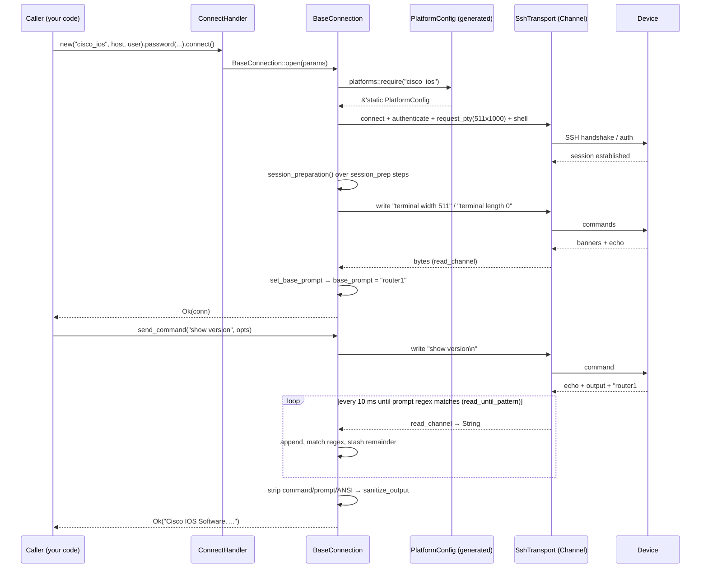

# LEARNME.md — Learn Rust by Understanding the Python Netmiko → Rust Port

Welcome. This document teaches you the Rust programming language from
"Hello, world!" and uses **this repository** — a working port of the Python
[Netmiko](https://github.com/ktbyers/netmiko) network-automation library — as
the living textbook. By the end you will be able to read, debug, extend and
contribute to this codebase, even if you have never written Rust before.

**Who this is for:** network engineers and Python developers who know
networking (SSH, Telnet, device CLIs) and Python well, but have at most
written one Hello World program in Rust.

**Ground rules used throughout:**

* Every code excerpt with a file path was copied from this repository; line
  numbers were correct when this document was written. Line numbers drift as
  code changes — always trust the *file name + function name* pair over the
  number.
* Anything that is **not** in the repository is explicitly marked
  **(illustrative)** or **(proposed)**.
* Commands that were actually executed while writing this document are listed
  in [Appendix A](#appendix-a--validation-log-commands-actually-run).
  Commands that are merely *recommended* are labelled as such.
* Implemented behaviour, partial behaviour and missing behaviour are never
  blurred. A parity matrix lives in [§27.6](#276-the-parity-matrix).

---

## Table of contents

* [How to read this document](#how-to-read-this-document)
* [Repository orientation](#repository-orientation)

**Part I — Rust from Hello World**

* [§1 The Rust development environment](#1-the-rust-development-environment)
* [§2 Variables, types and basic programming](#2-variables-types-and-basic-programming)
* [§3 Control flow, loops and iterators](#3-control-flow-loops-and-iterators)
* [§4 Functions, methods and the builder pattern](#4-functions-methods-and-the-builder-pattern)
* [§5 Ownership, borrowing and lifetimes (deep dive)](#5-ownership-borrowing-and-lifetimes-deep-dive)
* [§6 Structs, enums, traits and type design](#6-structs-enums-traits-and-type-design)

**Part II — Understanding real Rust projects**

* [§7 Modules, files and visibility](#7-modules-files-and-visibility)
* [§8 Error handling and failure recovery](#8-error-handling-and-failure-recovery)

**Part III — Networking and the Netmiko port**

* [§9 Understand Python Netmiko first](#9-understand-python-netmiko-first)
* [§10 Trace the port: public API → device response → back](#10-trace-the-port-public-api--device-response--back)
* [§11 Python-to-Rust mapping table](#11-python-to-rust-mapping-table)
* [§12 Transports, protocols and binary data](#12-transports-protocols-and-binary-data)
* [§13 Device drivers and extensibility](#13-device-drivers-and-extensibility)

**Part IV — Advanced Rust concepts actually used**

* [§14 Dependencies, generics and external APIs](#14-dependencies-generics-and-external-apis)
* [§15 Async Rust, tasks and concurrency](#15-async-rust-tasks-and-concurrency)
* [§16 Macros, attributes and conditional compilation](#16-macros-attributes-and-conditional-compilation)
* [§17 Memory, performance and resource management](#17-memory-performance-and-resource-management)

**Part V — Testing and contribution**

* [§18 Testing the Rust port](#18-testing-the-rust-port)
* [§19 Debugging, formatting and code quality](#19-debugging-formatting-and-code-quality)
* [§20 How to contribute to this repository](#20-how-to-contribute-to-this-repository)

**Part VI — The deep code walkthrough**

* [§21 Walkthrough conventions](#21-walkthrough-conventions)
* [§22 Core layer: `src/core/`](#22-core-layer-srccore)
* [§23 Connection layer: `src/connection/`](#23-connection-layer-srcconnection)
* [§24 Transports: SSH, Telnet, Serial](#24-transports-ssh-telnet-serial)
* [§25 Dispatcher, CLI, SCP, parsers, tools, tests, examples](#25-dispatcher-cli-scp-parsers-tools-tests-examples)

**Part VII — Practical learning path**

* [§26 Progressive exercises (Levels 1–5, with solutions)](#26-progressive-exercises)
* [§27 Python-to-Rust porting methodology](#27-python-to-rust-porting-methodology)

**Part VIII — Reference material**

* [§28 Essential Rust syntax reference](#28-essential-rust-syntax-reference)
* [§29 Glossary](#29-glossary)
* [§30 Learning roadmap and self-assessment](#30-learning-roadmap-and-self-assessment)

**Appendices**

* [Appendix A — Validation log (commands actually run)](#appendix-a--validation-log-commands-actually-run)
* [Appendix B — Known gaps and unverified areas](#appendix-b--known-gaps-and-unverified-areas)

---

## How to read this document

* **Linear first pass (recommended).** Parts I and II teach every Rust
  concept *before* the repository uses it. If you skip ahead to Part VI
  without Parts I–II, you will hit unfamiliar syntax constantly.
* **Reference mode.** §11 (mapping table), §28 (syntax reference) and §29
  (glossary) are look-up material.
* **Every concept follows a ten-step teaching sequence:**
  1. *What is it?* 2. *Why does it exist?* 3. *How does it work?*
  4. *What does the syntax mean (token by token where needed)?*
  5. *How does Python handle the same problem?*
  6. *How is it used in this repository?*
  7. *What happens at compile time / runtime?*
  8. *What mistakes do beginners make?*
  9. *How do you debug or test it?*
  10. *What exercise helps you learn it?* (exercises live in §26)

  Not every paragraph repeats all ten headings — for small concepts the steps
  are compressed into prose — but every major concept (ownership, traits,
  `Result`, `async`, the platform table…) covers all ten explicitly.

### Prerequisites

* Comfortable with Python (functions, classes, exceptions, `re`).
* Know what SSH, Telnet, TCP ports, prompts and device CLIs are.
* A working Rust toolchain: `rustup` + `cargo` on your `PATH`
  (`cargo --version` must work). See §1.3 if not installed.

---

## Repository orientation

The crate lives at `C:\Users\singh\netmiko-rs` (from here on: the *repo
root*). Its sibling checkout at `C:\Users\singh\netmiko` is the **upstream
Python Netmiko source** used for comparisons; the Python clone reports
`__version__ = "4.8.0"` (`netmiko/__init__.py` line 3) and is the source
that `tools/extract_platforms.py` was run against. The Rust `README.md`
describes the crate as porting "Netmiko 5.x semantics" — treat the *code*
as the truth: it was generated from the 4.8.0 source tree. See Appendix B.

### The 30-second tour

```
netmiko-rs/
├── Cargo.toml               # package manifest: deps, features, bin, examples
├── Cargo.lock               # exact resolved versions (committed)
├── README.md                # user-facing overview + runnable examples
├── LEARNME.md               # this document
├── src/
│   ├── lib.rs               # crate root: module tree + public re-exports
│   ├── main.rs              # the `netmiko` CLI binary (6 lines)
│   ├── core/                # errors, traits, params, helpers
│   │   ├── error.rs         #   NetmikoError enum + Result alias
│   │   ├── traits.rs        #   Channel + Platform traits
│   │   ├── types.rs         #   ConnectionParams, Protocol, CommandOutput…
│   │   └── util.rs          #   regex/ANSI/linefeed helpers + unit tests
│   ├── connection/
│   │   ├── base.rs          #   BaseConnection — the heart of the port (1503 lines)
│   │   └── platforms/
│   │       ├── mod.rs       #   PlatformConfig type + lookup()
│   │       └── generated.rs #   414 device platforms (GENERATED — never edit)
│   ├── dispatch.rs          #   ConnectHandler builder + telnet_fallback + redispatch
│   ├── ssh/mod.rs           #   SSH transport on russh
│   ├── telnet/mod.rs        #   Telnet transport (IAC negotiation)
│   ├── serial/mod.rs        #   serial-console transport (serialport)
│   ├── scp/mod.rs           #   SCP file transfer over an exec channel
│   ├── parsers/             #   TextFSM / CliTable / TTP structured parsing
│   └── cli/                 #   `netmiko show|cfg|grep` command line tool
├── tests/
│   ├── platforms.rs         #   414-platform table vs tools/platforms.json
│   ├── textfsm.rs           #   Rust TextFSM vs Python-generated fixtures
│   └── fixtures/*.json      #   template + input + expected Python output
├── tools/
│   ├── extract_platforms.py #   parses netmiko Python sources with `ast`
│   ├── gen_platforms_rs.py  #   emits src/connection/platforms/generated.rs
│   └── platforms.json       #   414 extracted platforms (checked in)
└── examples/
    ├── ssh_show_version.rs  #   run a show command
    ├── send_config.rs       #   push a configuration
    └── ssh_bench.rs         #   local benchmark harness
```

### What this port is, in one paragraph

Python Netmiko implements ~100 device-driver *classes* on top of paramiko
(SSH), `telnetlib` and pyserial. The Rust port keeps the **same public API
names** (`send_command`, `send_config_set`, `enable`, `config_mode`, …) but
replaces the class hierarchy with **data**: one `PlatformConfig` struct per
device type, generated directly from the Python sources by
`tools/extract_platforms.py` + `tools/gen_platforms_rs.py`. 414 device types
are supported; the connection object is async and built on `tokio` +
`russh` 0.64.

### Verified commands (executed while writing this document)

```console
$ cargo test --all-features        # 54 tests pass (44 unit + 4 doctests + 6 integration)
$ cargo clippy --all-features --all-targets   # Finished, 0 warnings
$ cargo fmt --check                # FAILS: formatting diffs in 20 files (known, see §19.3)
```

Do **not** run the examples against devices you do not own or without
understanding `send_config` — they push configuration.

---

# Part I — Rust from Hello World

### 1. The Rust development environment

**What it is.** Rust is a compiled systems language. Two tools matter at
first: `rustc` (the compiler) and `cargo` (the build system, dependency
manager and test runner rolled into one). You almost never invoke `rustc`
directly — you let `cargo` do it.

**Why it exists.** Python is interpreted and dynamically typed; you find out
about mistakes when the code runs. Rust moves that feedback to *compile
time*: memory bugs, type mismatches and misuse of `None` are reported by
`cargo build` before any byte executes. That is the single biggest cultural
difference you will feel coming from Netmiko scripts.

**How it works.** A Rust *crate* is one compilation unit (a library and/or
a binary). A *package* is a directory with a `Cargo.toml`. This repository
is a package containing **one library crate** (`src/lib.rs`), **one binary
crate** (`src/main.rs`, gated behind the `cli` feature) and **three
examples** (§25.7).

**What happens at compile time.** `cargo build` parses every module
reachable from `src/lib.rs`, type-checks and borrows-checks it, monomorphizes
generics, and links the result with all dependencies from `Cargo.lock`.
Errors you will see constantly at first:

* `E0382 borrow of moved value` — ownership violation (taught in §5).
* `E0599 no method named ...` — wrong type or missing trait import (§6).
* `E0432 unresolved import` — wrong path/module or a feature not enabled
  (§7).

#### 1.1 This repository's manifest, line by line

`Cargo.toml` is the contract between you and the build system. The package
section (lines 1–11) declares the essentials:

```toml
[package]
name = "netmiko"
version = "0.1.0"
edition = "2021"
rust-version = "1.85"
```

* **`name = "netmiko"`** — the crate is imported in Rust code as
  `use netmiko::...`, *not* `netmiko_rs`. The Git folder is `netmiko-rs`,
  the crate is `netmiko`. Confusing at first; that is normal.
* **`edition = "2021"`** — the language/stdlib version. Editions are
  backwards compatible; they exist so the language can improve without
  breaking old code. All code in §26 is written for edition 2021.
* **`rust-version = "1.85"`** — the minimum supported compiler
  (MSRV). Older compilers get a clear error instead of a syntax failure.

Dependencies live in `[dependencies]` (Cargo.toml lines 12–49) and are
analysed in depth in §14. Features are declared at lines 56–64:

```toml
[features]
default = ["ssh"]
ssh = []
telnet = []
serial = ["dep:serialport"]
scp = []
parsers = []
cli = ["dep:clap", "dep:serde_yaml", "dep:rpassword"]
all = ["ssh", "telnet", "serial", "scp", "parsers", "cli"]
```

**Features are compile-time switches.** `[]` means "this flag exists but
enables no extra dependency"; `["dep:serialport"]` means "enable the
optional `serialport` crate too". `src/lib.rs` lines 43–54 show how code is
switched off when a feature is off:

```rust
#[cfg(feature = "ssh")]
pub mod ssh;
#[cfg(feature = "telnet")]
pub mod telnet;
#[cfg(feature = "serial")]
pub mod serial;
#[cfg(feature = "scp")]
pub mod scp;
#[cfg(feature = "parsers")]
pub mod parsers;
#[cfg(feature = "cli")]
pub mod cli;
```

`#[cfg(...)]` is a *conditional compilation attribute*: if the feature is
not enabled, the module does not exist — it is not just hidden, it is
**not compiled at all** (§16). This is why `cargo test` and
`cargo test --all-features` can produce different results: the second one
turns everything on.

The manifest also wires up the binaries and examples (lines 66–81):

```toml
[[bin]]
name = "netmiko"
path = "src/main.rs"
required-features = ["cli"]

[[example]]
name = "ssh_show_version"
required-features = ["ssh"]

[[example]]
name = "send_config"
required-features = ["ssh"]

[[example]]
name = "ssh_bench"
required-features = ["ssh"]
```

`required-features` means "only build this target when the feature is on".
Because `default = ["ssh"]`, the examples build out of the box, but the
`netmiko` binary does **not** — you need `--features cli` (or `all`).

#### 1.2 Commands you will use daily

| Command | What it does | Status when this document was written |
|---|---|---|
| `cargo build` | compile (debug) | ✅ succeeds |
| `cargo build --all-features` | compile with every feature | ✅ succeeds |
| `cargo test --all-features` | run unit + integration + doc tests | ✅ **54 pass, 0 fail** |
| `cargo clippy --all-features --all-targets` | linter | ✅ **0 warnings** |
| `cargo fmt --check` | style check | ❌ **fails** — diffs in 20 files (§19.3) |
| `cargo run --example ssh_show_version -- --help` | run an example | ✅ compiles (needs a device to do more) |
| `cargo run --features all --bin netmiko -- --help` | run the CLI | ✅ compiles |
| `cargo doc --all-features --no-deps --open` | generated API docs with source links | recommended, not run while writing |

The exact outputs of the first three are reproduced in
[Appendix A](#appendix-a--validation-log-commands-actually-run).

#### 1.3 Your first program (textbook Hello World)

If you have literally never written Rust, create a scratch package
*outside* this repository — do not run `cargo new` inside the repo:

```console
$ cargo new hello_rust
$ cd hello_rust
```

`src/main.rs` contains:

```rust
fn main() {
    println!("Hello, world!");
}
```

Token by token: `fn` declares a function; `main` is the entry point every
Rust binary must have; `()` means it takes no arguments; `println!` with the
`!` is a **macro** (not a function — §16) that formats and prints; the
string literal is an `&str`; `;` ends the statement. Run it with
`cargo run`.

Every example in this document that is marked **(illustrative)** follows
this shape and compiles under edition 2021 unless stated otherwise.

#### 1.4 Python comparison

```python
# Python: you just run it
print("Hello, world!")
```

Python finds mistakes at runtime (`AttributeError`, `TypeError`, typos in
keywords). Rust finds them at compile time, which is why the first hour with
Rust feels slow (fighting the compiler) and the next hundred hours feel
fast (the compiler fights for you).

#### 1.5 Beginner mistakes specific to this repo

1. **Running `cargo build` without the right features** and then wondering
   why `netmiko::telnet` "does not exist". Use `--all-features` exactly like
   the test command does.
2. **Editing `src/connection/platforms/generated.rs` by hand.** It is
   17,736 lines of generated data (line 1: `// @generated by
   tools/gen_platforms_rs.py - do not edit by hand.`). Your edit will be
   overwritten the next time the generator runs. Change the Python sources
   or the `tools/` scripts instead (§13.5, §27).
3. **Confusing the `netmiko` crate name with the `netmiko` Python package
   or the `netmiko` binary.** Three different things, one name.
4. **Expecting `cargo run` to run the CLI** — it will fail with
   "`a bin target must be available`" or build the wrong thing; pass
   `--bin netmiko --features all`.

---

### 2. Variables, types and basic programming

#### 2.1 `let`, `mut`, and shadowing

**What it is.** Bindings are immutable by default; you opt into mutation
with `mut`.

**Syntax.**

```rust
let device_type = "cisco_ios";      // &str, immutable
let mut retries = 3;                // i32, mutable
retries = retries - 1;              // ok
// device_type = "junos";           // compile error E0386
let device_type = "juniper_junos";  // shadowing: a NEW binding
```

**Why.** Immutability-by-default makes concurrent code (§15) and reasoning
about state vastly easier. **Shadowing** lets you transform a value in place
(`let x = x.trim();`) without `mut`, and it also lets you change the *type*
of a binding.

**Runtime/compile behaviour.** `let x = 5; x = "five";` fails at compile
time — Python would silently allow it. Shadowing always creates a new
variable; the old one is dropped (§17.2) at the end of its scope.

**Where this repo uses it.** Shadowing-for-transformation is everywhere in
`src/connection/base.rs`. `send_command_timing` (base.rs line 677 onward)
does exactly the `let x = transform(x)` idiom:

```rust
let command_string = if options.normalize {
    self.normalize_cmd(command_string)
} else {
    command_string.to_string()
};
```

The parameter `command_string: &str` is shadowed by a new local
`command_string: String` — afterwards, every use of the name refers to the
trimmed/normalized owned copy. `mut` is used only where state genuinely
accumulates: buffers like `let mut output = String::new();` (base.rs line
347 in `read_until_pattern`), counters, and builders.

#### 2.2 Scalar types and `as` conversions

Rust's scalars: `i8…i128`/`u8…u128` (integers), `f32`/`f64` (floats),
`bool`, `char` (a Unicode scalar value, 4 bytes — not a byte!).

Integer literal suffixes are optional (`42` infers from context) but
`usize`/`isize` matter: `usize` is the index type and its width follows the
CPU (64-bit on your machine). Python ints have arbitrary precision; Rust
integers **overflow** in debug builds with a panic and wrap in release
builds. Never port Python arithmetic blindly.

Conversions are explicit: `let secs = duration.as_secs_f64() as usize;` —
`as` truncates floats to integers. `base.rs` line 351 shows a float
comparison against a timeout instead:

```rust
while (start.elapsed().as_secs_f64() < read_timeout) || read_timeout == 0.0 {
```

`read_timeout` is an `f64` (netmiko's seconds), and `Instant::elapsed()`
returns a `Duration` that must be converted with `as_secs_f64()`. Silent
int/float mixing does not exist.

#### 2.3 `&str` versus `String` — the most important pair

**What they are.**

* `String` — an **owned, growable** UTF-8 buffer on the heap. You can
  append, trim in place, and it is destroyed when it goes out of scope.
* `&str` — a **borrowed string slice**: a pointer + length into memory
  someone else owns (a literal, or inside a `String`). You cannot grow it.

**Why both.** Ownership (§5) requires knowing who frees what. `String`
always owns; `&str` never does. APIs take `&str` when they only need to
*read* text, so callers can pass either a literal or a `String`.

**The conversion rule (memorize it):**

| direction | code |
|---|---|
| `&str` → `String` | `s.to_string()` or `s.to_owned()` or `String::from(s)` |
| `String` → `&str` | `&s` (deref coercion) or `s.as_str()` |
| `String` → `String` | moving (no copy) |

**In this repository.** The generated platform table stores everything as
`&'static str` — string literals that live for the whole program, which is
why `PlatformConfig` (platforms/mod.rs line 122) can be a plain `static`
table with zero allocation:

```rust
device_type: "cisco_ios",        // &'static str — compiled into the binary
pri_prompt_terminator: "#",
```

(from `src/connection/platforms/generated.rs` line 4614, the `cisco_ios`
entry.) By contrast `ConnectionParams` (`src/core/types.rs` line 88) holds
**owned** `String`s — user-supplied hosts, usernames and passwords that come
from CLI arguments or YAML files:

```rust
let mut connection = ConnectionParams::new(host, username, device_type);
if let Some(password) = get_str("password") {
    connection.password = Some(password);
}
```

(from `src/cli/inventory.rs` lines 262–266; `get_str` returns
`Option<String>`.) The value returned by `.password(...)` on the builder is
an owned `String` because the connection must outlive the function that
parsed the YAML.

**Python comparison.** Python has only `str` — immutable, refcounted,
shared freely. The Rust split feels bureaucratic until you hit a language
with no GC: every byte must have exactly one owner.

**Beginner mistakes.**

```rust
let s1 = String::from("cisco");
let s2 = s1;             // MOVE: s1 is now invalid
println!("{s1}");        // error E0382: borrow of moved value: `s1`
let s3 = s1.clone();     // explicit deep copy — s1 still valid
```

* Passing `&temporary` beyond its lifetime:
  `let r = format!("{}#", host).as_str();` fails — the temporary `String`
  dies at the end of the statement.
* Calling `.to_string()` on everything "to be safe" — it allocates; prefer
  taking `&str` parameters as this codebase does
  (`pub fn escape(pattern: &str) -> String`, util.rs line 196 area).

**Debugging.** Print both forms: `println!("{s:?}")` shows quotes and
escapes (the `Debug` format), `println!("{s}")` shows the raw text (the
`Display` format). `src/core/types.rs` line 272 defines
`enum CommandOutput { Text(String), Structured(Vec<Value>) }` and implements
`Display` for it so that `println!("{output}")` works on either variant —
that is a taste of §6.5.

#### 2.4 Collections: `Vec`, `HashMap`, `VecDeque`

| Rust | Python equivalent | Grows? | Notes |
|---|---|---|---|
| `Vec<T>` | `list` | yes | contiguous, index with `v[i]`, `v.push(x)` |
| `HashMap<K, V>` | `dict` | yes | `map.get(k)` returns `Option<&V>` — no `KeyError` |
| `VecDeque<T>` | `collections.deque` | yes | efficient push/pop both ends |
| `&[T]` / `&[T]` slice | `listview` | no | borrowed view into an array/`Vec` |

Python's `try: d[k] except KeyError` becomes:

```rust
match map.get(key) {
    Some(value) => { /* use value */ }
    None => { /* handle absence */ }
}
```

**In this repository.**

* The large-output path of `send_command` uses a sliding window of past
  reads instead of growing one string without bound — base.rs lines 22–25:

```rust
/// Maximum number of characters `send_command` will buffer before switching
/// to "only look at the last N reads" mode (netmiko's `MAX_CHARS`).
const MAX_CHARS: usize = 2_000_000;
/// How many past reads are kept for the "large output" mode (netmiko's
/// `DEQUE_SIZE`).
const DEQUE_SIZE: usize = 20;
```

  Those past reads live in a `VecDeque<String>` (netmiko uses a Python
  `deque` — a direct port of the same algorithm).

* `src/connection/platforms/mod.rs` line 211 builds a
  `LazyLock<HashMap<String, &'static PlatformConfig>>` named `PLATFORM_MAP`
  as a fast lookup index over the static `PLATFORMS` slice (§2.3).

* `src/core/util.rs`'s `show_run_command` (util.rs line 31) uses
  `static MAPPER: LazyLock<HashMap<String, &str>>` — a constant map
  initialized on first use (§6.6).

**Indexing.** `v[i]` **panics** (crashes the program) when out of range;
`v.get(i)` returns `Option<&T>`. Netmiko-style code that slices prompts
should prefer `.get()` or handle the `None`, as `find_prompt` does when it
takes the last whitespace-separated token.

**Beginner mistakes.** `for x in vec` iterates by *reference* automatically
(`for line in &lines`), but `for x in vec.into_iter()` consumes the vector.
Iterating while mutating is a borrow-checker fight — see §5.7 for the
pattern this repo uses instead (collect first, then iterate).

#### 2.5 `Option<T>`: how Rust says "maybe null"

**What it is.** `Option<T>` is an enum with exactly two variants:

```rust
pub enum Option<T> { Some(T), None }
```

**Why.** Python's `None` can appear anywhere and explodes at runtime
(`AttributeError: 'NoneType' object has no attribute ...`). Rust forces you
to *prove* the value is present before using it. Null-pointer bugs become
compile errors.

**How you unwrap it** — four ways, pick by intent:

| technique | when |
|---|---|
| `if let Some(x) = opt { ... }` | you only care about the present case |
| `match opt { Some(x) => ..., None => ... }` | both cases matter |
| `opt.unwrap()` | you are *certain*; panics otherwise — avoid in library code |
| `opt.ok_or_else(|| Error::...)?` | absence is an error for your API |

**In this repository.** Nearly every optional field of
`ConnectionParams` (types.rs lines 88–169) is `Option<...>`:
`password: Option<String>`, `secret: Option<String>`,
`key_file: Option<PathBuf>`, `global_cmd_verify: Option<bool>`,
`read_timeout_override: Option<f64>`, and so on. The optional platform
fields are `Option<&'static str>`: `commit_command: None` for `cisco_ios`
(generated.rs line 4630) versus `commit_command: Some("commit")` for
`juniper_junos` (generated.rs line 12166 area) — the Juniper-specific
behaviour disappears entirely on platforms that do not commit. That is the
data-driven replacement for Python's `if self.platform == "juniper"`.

`save_config` (base.rs line 1102) shows the `ok_or`-style flow in the wild:

```rust
let command = self.platform.save_config_command.to_string();
if command.is_empty() {
    return Err(NetmikoError::NotImplemented(
        "save_config is not supported on this platform".to_string(),
    ));
}
```

Here the field is `&'static str` rather than `Option`, and absence is
encoded as the empty string — a design choice made by the generator
(`tools/gen_platforms_rs.py`) so the table stays uniform. Knowing *why*
`Option` was not used is as important as knowing `Option`: uniform data
tables are easier to generate and to test (§18.2).

**`?` and `Option`.** The `?` operator works on `Option` too: in a function
returning `Option`, `let x = maybe()?;` returns `None` early if `maybe()`
is `None`. (It works on `Result` the same way — §8.2.)

**Python comparison.**

```python
password = params.get("password")     # None if absent
if password:                          # truthiness: careful, "" is falsy too!
    ...
```

```rust
if let Some(password) = params.get("password") { /* ... */ }
```

Rust's version distinguishes "no key" from "empty string" naturally.

#### 2.6 `const`, `static` and `LazyLock`

* `const` — a value inlined at every use, no memory, must be computable at
  compile time. `MAX_CHARS` above is `const`.
* `static` — a single location with `'static` lifetime, lives for the whole
  program. Reading it requires thread-safety (§15.6).
* `LazyLock<T>` (from std, used via `std::sync::LazyLock`) — a `static`
  that is initialized on first access, like Python's module-level lazy
  import.

The repo uses `LazyLock` for exactly the things Python initializes at import
time. `src/core/util.rs` line 31:

```rust
/// The `show run` command for platforms that do not use `show running-config`.
pub fn show_run_command(device_type: &str) -> &'static str {
    static MAPPER: LazyLock<std::collections::HashMap<String, &...
```

The same trick backs the ANSI-escape regex list (util.rs line 88) and the
platform index map (platforms/mod.rs line 211). First call pays
initialization cost; every later call is a plain read.

#### 2.7 Type inference and annotation

Rust infers most types: `let mut output = String::new();` — no annotation
needed because `String::new()` determines it. You annotate when the type is
ambiguous (`let port: u16 = args.parse()?;`) or in public API signatures,
which **always** name their types (as every `pub fn` in this repo does —
look at any signature in §22–§25).

Functions return `()` implicitly when they declare no return type; to return
a value, put `-> Type` before the `{` and end with an expression, **not** a
statement:

```rust
pub fn protocol(&self) -> Protocol {
    Protocol::from_device_type(&self.device_type)
}                                  // no semicolon: this is the return value
```

(vs. Python's `return Protocol.from_device_type(self.device_type)`.)

#### 2.8 Debugging variables

`println!("{:?}", value)` uses the `Debug` trait and works on any type that
derives `Debug` — which is why the structs in this repo carry
`#[derive(Debug, Clone)]` (e.g. `ConnectHandler`, dispatch.rs line 29). For
formatted output use `println!("{name} = {value:?}")` (inline named
arguments, Rust 2021 captures identifiers from scope — Python's f-strings
are `f"{name} = {value}"`, nearly identical).

When a value is behind a reference, `{:?}` still works (the trait is
forwarded). When you see `&"cisco_ios"` with extra brackets, that is
`Option`/`&` printing itself — not a bug.

---

### 3. Control flow, loops and iterators

#### 3.1 `if` / `else if` — a real expression

`if` in Rust is an **expression** (it has a value), but only when the
branches agree on type:

```rust
let timeout = if fast { 5.0 } else { 30.0 };   // ok: f64 both arms
```

Conditions must be exactly `bool` — `if retries {}` is a compile error
(unlike Python's truthiness). This removes the classic Python bug
`if password:` silently skipping an empty-but-intentional password.

#### 3.2 `match`: pattern matching done right

**What it is.** `match` is Python's `match`/`case` (3.10+) but mandatory,
exhaustive and fall-through-free: every arm ends with `break`-like
semantics — you cannot accidentally forget one.

**In this repository — the session preparation state machine.**
`BaseConnection::session_preparation` (base.rs line 1193) walks the
platform's list of `SessionStep`s and executes each one. `SessionStep` is
defined at platforms/mod.rs line 23; each variant carries its own data:

```rust
pub enum SessionStep {
    /// Read from the channel to make sure the device is talking to us.
    TestChannelRead {
        /// Optional pattern to read until.
        pattern: Option<&'static str>,
    },
    /// Set the terminal width.
    SetTerminalWidth {
        ...
```

The `match` in `session_preparation` then has one arm per variant
(`SetTerminalWidth`, `DisablePaging`, `SetBasePrompt`, …). Add a variant to
the enum and the compiler *immediately* points at every `match` that must
learn about it — this is Rust's exhaustiveness guarantee, and it is how
Python's stringly-typed `if step == "disable_paging"` logic stays honest
across 414 platforms.

**Binding in arms.** `if let Some(x) = opt` is sugar for
`match opt { Some(x) => { ... }, _ => () }` and is used constantly for
`Option`, e.g. inventory.rs line 178:

```rust
let Some(name) = name.as_str() else {
    continue;
};
```

This is a **let-else**: "if the pattern does not match, jump to the `else`
block" — here, skip this list entry (Python: `if not isinstance(name, str):
continue`).

**Beginner mistakes.**

* Forgetting the `_ =>` catch-all on a non-exhaustive `match` — compile
  error E0004, which *tells you the missing patterns*. Read it.
* Using `match` where the arms return values of different types.
* Porting Python's `elif` chains into nested `if let` pyramids — prefer one
  `match`.

#### 3.3 Loops: `loop`, `while`, `for`

Python's `while` and `for` exist as-is, plus a labelled `loop` for
"retry forever" cases. Labels enable `break 'name` / `continue 'name` out of
nested loops — the retry loop in `find_prompt` (base.rs line 473) and the
login loops `telnet_login`/`serial_login` (base.rs lines 1312 and 1374) are
exactly the shape you would write with `while` + `else: break` in Python.

**`while` with a deadline** is the canonical netmiko pattern, ported
literally in `read_until_pattern` (base.rs line 351):

```rust
while (start.elapsed().as_secs_f64() < read_timeout) || read_timeout == 0.0 {
    output.push_str(&self.read_channel().await?);

    if regex.is_match(&output) {
        ...
```

Same algorithm as Python's `read_until_pattern`
(`netmiko/base_connection.py` line 674): accumulate reads until the regex
matches or the clock runs out. Differences: the loop body is `async` (§15),
and `output.push_str(...)` must be explicit because strings do not
auto-concatenate with `+=` on `&str`.

**`for` over ranges and iterators.**

```rust
for step in self.platform.session_prep { ... }   // over &'static [SessionStep]
for (name, config) in map.iter() { ... }         // over pairs, by reference
```

`0..n` is a range; `0..=n` is inclusive. The generator-emitted platform
list `pub static PLATFORMS: &[PlatformConfig]` (generated.rs line 10) is
iterable by reference for free — iterating a `static` slice never copies it.

#### 3.4 Iterators and closures — Python's `map`/`filter` on steroids

**What they are.** An *iterator* produces values lazily; a *closure* is an
anonymous function that can capture its environment.

```rust
let upper: Vec<String> = names.iter().map(|n| n.to_uppercase()).collect();
let ios: Vec<_> = platforms.iter().filter(|p| p.device_type.starts_with("cisco")).collect();
```

`|n| ...` is the closure syntax (the pipes hold the parameters).
`.collect()` drives the iterator and builds a collection — until you call
`collect()` (or `for`), **nothing runs**. Methods like `map`, `filter`,
`fold`, `any`, `all` mirror Python's `map`/`filter`/`any`/`all`, but each
item flows through *without* allocating an intermediate list, and the
compiler inlines the closures.

**In this repository.** `src/connection/platforms/mod.rs` line 235 exposes
the table as a Python-like helper:

```rust
pub fn supported_device_types() -> Vec<&'static str> { ... }
```

and `scp_device_types()` (line 242) builds its 16-entry allowlist the same
way. `tests/platforms.rs` line 23 collects JSON keys into a
`BTreeMap<String, JsonValue>` with `.map(...).collect()` — the exact shape
you would write as a dict comprehension in Python.

**Errors inside iterators.** `map` returning `Result` requires
`collect::<Result<Vec<_>, _>>()?` — the idiomatic way to run a fallible
step over every element. The parser glue in `src/parsers/mod.rs` uses this
family of combinators when it walks template/index lines.

**Beginner mistakes.**

* Mutating the source while iterating — Rust forbids it (§5.7). Collect
  indices/values first.
* `for x in vec.iter().map(f)` when you needed the result — iterators are
  lazy; forget `.collect()` and your loop body never executes. This
  surprises Python users because Python's `map()` *also* is lazy but is
  usually consumed by `list()`.
* Capturing a *moved* value in a closure — closures obey ownership too
  (§5.6).

#### 3.5 Python→Rust control-flow cheat sheet

| Python | Rust |
|---|---|
| `elif` | `else if` |
| `for x in range(n)` | `for x in 0..n` |
| `while True:` | `loop { ... }` |
| `try/except X` | `match result { Err(X(..)) => ..., }` or `if let Err(...)` |
| `for ... else` (loop finished) | a `let mut found = false;` flag or labelled `break` |
| `break`/`continue` inside nested loop | `break 'outer;` with `outer:` label |
| `any(...)` / `all(...)` | `iter().any(\|x\| ...)` / `.all(...)` |
| `sorted(xs)` | `xs.sort();` (in place) or `xs.iter().sorted()` (needs `itertools`) |
| `enumerate(xs)` | `xs.iter().enumerate()` |
| `zip(a, b)` | `a.iter().zip(b.iter())` |

#### 3.6 What to practise next

Exercises L1–1 in [§26](#26-progressive-exercises) covers `let`/`mut`,
`String` vs `&str` and a `match` over `Option` using real
`ConnectionParams` fields.

---

### 4. Functions, methods and the builder pattern

#### 4.1 Free functions vs. methods

**What it is.** A *free function* lives at module level
(`pub fn escape(pattern: &str) -> String` in `src/core/util.rs`). A *method*
lives in an `impl` block and receives a self-parameter:

```rust
impl BaseConnection {
    pub async fn write_channel(&mut self, data: &str) -> Result<()> { ... }
}
```

`self` (by value) takes ownership, `&self` borrows immutably, `&mut self`
borrows mutably. Because `write_channel` mutates the read buffer and the
channel, base.rs line 291 takes `&mut self` — **the signature tells you the
method mutates state**, which is invisible in Python's `def write_channel`.

**Static methods** take no self and are namespaced by type — Python's
`@classmethod`/`@staticmethod`:

```rust
impl Protocol {
    pub fn from_device_type(device_type: &str) -> Protocol { ... }
}
```

(types.rs line 22.) Called as `Protocol::from_device_type(s)`.

#### 4.2 Visibility: `pub`, and why so little of this repo is `pub`

`pub` means "exported from its module". No `pub` means private — visible
only inside the current module *and its children*. This is taught properly
in §7; for now note the discipline: `BaseConnection`'s `params`,
`platform`, `base_prompt` are `pub` (base.rs lines 153–155) because tests
and the CLI read them, but `channel`, `read_buffer`, `session_log` are
private (lines 156–160) because all access must go through the read/write
methods that implement netmiko's buffering semantics. Encapsulation here is
not decoration — bypassing `read_channel`'s logic would break prompt
detection.

#### 4.3 The builder pattern: `ConnectHandler`

**What it is.** Instead of a 20-argument constructor, each configuration
call returns `self` (moved) so calls can be chained.

**Why.** Python's `ConnectHandler(**kwargs)` accepts anything and fails at
runtime on typos. The Rust builder fails at **compile time** on unknown
methods, gives autocomplete, and keeps required arguments separate from
optional ones.

**Syntax walkthrough** — `src/dispatch.rs`, the whole pattern in 15 lines:

```rust
#[derive(Debug, Clone)]
pub struct ConnectHandler {
    params: ConnectionParams,
}

impl ConnectHandler {
    ///
    /// ```no_run
    /// # async fn run() -> netmiko::Result<()> {
    /// use netmiko::ConnectHandler;
    ///
    /// let mut conn = ConnectHandler::new("cisco_ios", "10.0.0.1", "admin")
    ///     .password("secret")
    ///     .secret("enable-secret")
    ///     .connect()
    ///     .await?;
    ///
    /// println!("{}", conn.send_command("show version", &Default::default()).await?);
    /// # Ok(())
    /// # }
    /// ```
```

(dispatch.rs lines 14–28 — note the doctest is one of the 4 doc-tests that
`cargo test` runs; `no_run` means "compile but do not execute".)

Token by token:

1. `#[derive(Debug, Clone)]` — automatically implement two traits (§6.7).
2. `pub struct ConnectHandler { params: ConnectionParams }` — one field,
   private: outside code cannot touch `params` directly.
3. `pub fn new(device_type: &str, host: &str, username: &str) -> Self`
   (dispatch.rs line 36) — `Self` inside an `impl` block is an alias for
   `ConnectHandler`. Required arguments only.
4. `.password("secret")` is a method of shape
   `pub fn password(mut self, password: &str) -> Self` — it takes `self`
   **by value** (consuming the builder) and returns it back. Each setter
   mutates the private `params` in place and returns `self`.
5. `.connect().await?` — `.connect()` (dispatch.rs line 164) is `async` and
   returns `Result<BaseConnection>`; `.await` drives the future (§15), `?`
   propagates errors (§8.2).

**Python comparison.**

```python
from netmiko import ConnectHandler
conn = ConnectHandler(device_type="cisco_ios", host="10.0.0.1",
                      username="admin", password="secret")
```

Same name, same keyword-ish order; Rust moves the keywords into method
names and the validation into the compiler.

**Why `mut conn` at the call site.** `send_command` needs `&mut self` (it
mutates buffers), so the caller's binding must be mutable — Python never
requires this because attributes are always writable.

**Beginner mistakes.**

* Writing `fn password(&self, p: &str) -> Self` — that would clone nothing
  and fail to chain usefully; the convention for consuming builders is
  `mut self`.
* Forgetting `.await` on `connect()` — the compiler emits
  "`unused implementation of `Future`" / "call is async" warnings. Every
  netmiko call in Rust that does I/O needs `.await`.
* Expecting `?` inside a non-`Result` function — see §8.3.

#### 4.4 Returning `()` vs. returning values

Python's `None`-returning methods become Rust methods with no `->` clause
(`fn main()` style). The port keeps netmiko's *return values* where they
exist: Python's `find_prompt()` returns a string, and so does Rust's
`find_prompt` (base.rs line 473) — `-> Result<String>`. Netmiko's
`enable()` returns `""` in Python; Rust returns `Result<String>` to carry
the possible error (base.rs line 830). When porting, **never drop a return
value silently**; either return it inside `Result` or document why not
(§27.4).

---

### 5. Ownership, borrowing and lifetimes (deep dive)

> This is the concept that sends every Python developer back to the
> compiler three times. Read it slowly; every other section assumes it.

#### 5.1 What is it?

Rust has no garbage collector. Instead, the compiler enforces a single rule:
**every value has exactly one owner, and when the owner goes out of scope,
the value is dropped (freed).** References (`&T`, `&mut T`) are *borrows* of
someone else's value and must obey three static rules:

1. Any number of **shared borrows** (`&T`) *or* exactly one **mutable
   borrow** (`&mut T`) — never both at once.
2. A borrow may not outlive what it points to.
3. A moved value can no longer be used by its old owner.

#### 5.2 Why does it exist?

Python's model is "everything is a heap object, refcounts and GC decide".
That is flexible and slow, and it makes data races hard to reason about.
Rust's ownership gives you C-level control with compile-time proof of
memory safety. In this port it is why a `BaseConnection` can hold an SSH
channel, a session log file and a buffer with no hidden allocations of
control structures, and why `cargo test` can run 44 unit tests in 1.65 s
(Appendix A).

#### 5.3 How it works: moves and copies

```rust
let owned = String::from("running-config");
let target = owned;             // MOVE — ownership transfers
println!("{owned}");            // ❌ E0382

let n = 42;                     // integers implement Copy
let m = n;                      // COPY — n still valid
```

`String`, `Vec`, `HashMap` **move**; integers, `bool`, `char`, `f64`
**copy**. `&T` references are cheap and copied freely.

**In this repository.** Moving is the reason builders take `mut self` (§4.3):
`.password("x")` consumes the `ConnectHandler` and hands it back — the caller
never holds two half-configured copies. It is also why `ScpClient` and
`FileTransfer` are **generic over a lifetime** (§5.5):
`pub struct FileTransfer<'a> { conn: &'a mut BaseConnection, ... }`
(scp/mod.rs line 345) — they borrow the connection rather than taking it.

To *duplicate* explicitly you call `.clone()` (requires the `Clone` trait;
§6.7). `ConnectionParams` derives `Clone` (types.rs line 87 area) and
`ConnectHandler` derives `Clone` (dispatch.rs line 29) so tests and the CLI
can fork a parameter set cheaply. Cloning a `String` copies every byte —
the compiler never inserts clones for you. That is a *feature*: an
accidental O(n) copy in Python is invisible; in Rust you write `.clone()`
and reviewers see it.

#### 5.4 Borrowing: `&T` and `&mut T`

```rust
fn count_commands(text: &str) -> usize { text.lines().count() }  // shared borrow
fn normalize(buf: &mut String) { buf.push_str("\r\n"); }         // exclusive borrow
```

A function that only reads takes `&T` and callers never have to worry;
a function that writes takes `&mut T`. This *encodes intent into
signatures*.

**The repository's central example** — the `Channel` trait methods
(`src/core/traits.rs` line 12):

```rust
#[async_trait]
pub trait Channel: Send {
    /// Write raw bytes to the device.
    async fn write(&mut self, data: &[u8]) -> Result<()>;

    /// A single, non blocking, read of whatever **bytes** are available.
    ///
    /// Returns an empty vector when no data is available.
    async fn read_buffer_bytes(&mut self) -> Result<Vec<u8>>;
```

* `&mut self` — writing to a channel mutates its internal buffers, so the
  borrow must be exclusive.
* `data: &[u8]` — a *slice* borrow: the caller keeps ownership of the bytes,
  the callee just reads them. Netmiko passes `bytes` around; Rust makes
  "I will not free or modify this" a type-level promise.

`BaseConnection::write_channel` (base.rs line 291) then narrows further:

```rust
pub async fn write_channel(&mut self, data: &str) -> Result<()> {
```

`&str` in, `&mut self` out — the method may touch its own state but not the
caller's string.

**Conflicting borrows produce precise errors.** Trying to call
`conn.send_command(...)` while holding a `&conn.platform` reference into
`PLATFORMS` is fine (both are shared borrows *of different things*), but
calling `send_command(&mut conn)` while `&conn.read_buffer` exists is E0502:

```
cannot borrow `conn` as mutable because it is also borrowed as immutable
```

The fix is always the same: *finish reading before writing*, or copy the
small value out (`let cmd = conn.base_prompt.clone();`).

#### 5.5 Lifetimes: reading `<'a>` without panic

**What it is.** A lifetime is a compiler-invented label on how long a
reference is valid: `'a` reads "some region a". You write lifetimes only
when the compiler cannot infer them.

**Where they appear in this repo.**

```rust
pub struct ScpClient<'a> {
    conn: &'a mut BaseConnection,
    ...
}
impl<'a> ScpClient<'a> {
    pub fn new(conn: &'a mut BaseConnection, timeout: Duration) -> Self {
```

(scp/mod.rs lines 128–136.) The `<'a>` means: "`ScpClient` cannot outlive
the `BaseConnection` it points at." If you tried to drop the connection
while an `ScpClient` exists, you get E0597 "`conn` does not live long
enough" — the compiler prevented a use-after-free that Python would only
manifest as a `ReferenceError` (or worse, a segfault in a C extension).

The same pattern appears on `FileTransfer<'a>` (scp/mod.rs line 345) and on
free functions like `file_transfer(conn: &mut BaseConnection, ...)`
(scp/mod.rs line 741).

**Functions rarely need explicit lifetimes** — elision rules infer them:

```rust
pub fn escape(pattern: &str) -> String          // output is owned: no lifetime worry
fn longest<'a>(a: &'a str, b: &'a str) -> &'a str { ... }   // (illustrative)
```

Rule of thumb: if a function takes several references and returns one of
them, you must say which — `<'a>` on inputs and output.

**Python comparison.** Python references are managed at runtime; "lifetime"
bugs appear as closures capturing variables that later change (late
binding) — a completely different failure mode. Rust shifts the category of
bug from *runtime surprise* to *compile error*.

#### 5.6 Ownership in closures

Closures capture by the least demanding mode they can:

| capture | syntax | when |
|---|---|---|
| by reference | `\|x\| f(x, &state)` | default, borrows `state` |
| by mutable reference | `\|x\| { state.push(x) }` | needs `mut state` |
| by value (move) | `move \|x\| f(x, state)` | must outlive/own `state` |

You will meet `move` in async tasks (§15.5) — spawned tasks cannot borrow
the spawning function's stack, so values must move in. That is why
`src/cli/mod.rs` (line 102, `ssh_conn`) builds each device's parameters
*inside* the task rather than borrowing a shared `Vec` across awaits.

#### 5.7 Iterating while mutating: the standard escape hatches

Python lets you mutate a list while iterating it (often with subtle bugs).
Rust flatly refuses: you cannot `push` into a `Vec` you are iterating.

Patterns used in this codebase:

1. **Split the borrows structurally** — touch disjoint fields:
   `self.read_buffer.push_str(...)` while `&self.channel` exists is fine,
   because they are separate fields (the compiler splits `&mut self`
   borrows per field). You see this throughout `read_until_pattern`
   (base.rs lines 341–375): it borrows `self.params`,
   `self.read_buffer` and `self.channel` at different moments.
2. **Iterate an index range** and index inside:
   `for i in 0..lines.len() { ... lines[i] ... }` (used by the template
   parsers in `src/parsers/textfsm.rs`, which walk line vectors with a
   cursor — `let lines: Vec<&str> = template.lines().collect();` at line 608
   and a `position` cursor instead of `for`).
3. **Collect then consume**: `let names = self.platform.device_type;` first,
   iterate afterwards.
4. **`retain`/`drain`** for filter-in-place (not needed much here).

#### 5.8 Compile-time vs. runtime: what actually happens

At compile time the borrow checker builds a control-flow graph of every
reference and proves rules 1–3 on *all paths*, including error paths and
loops. Nothing about lifetimes exists at runtime — lifetimes are erased
like generics (§14.2). There is no run-time check, no overhead, and no way
to "cast away" a borrow (unlike Python's `_` hacks).

#### 5.9 Beginner mistakes

1. **Returning a reference to a local**:
   `fn prompt(s: String) -> &str { &s }` — E0515. Return `String` (owned)
   or take `&str` and return `&str` from the input.
2. **Holding a borrow across an `.await`** that needs `&mut self` — often
   surfaces as "`cannot borrow `self` as mutable more than once at a time`"
   in async code. Fix: clone the small piece you need
   (`let pattern = self.platform.pri_prompt_terminator;` — a `&'static str`
   is `Copy`, so it costs nothing) before awaiting.
3. **Cloning reflexively to silence errors** — it compiles but doubles
   allocations. First try restructuring so one owner drives the value.
4. **Misreading `&mut self` as "the method is slow"** — it says nothing
   about speed, only about mutation.

#### 5.10 How to debug it

* Read the *suggestion* in the compiler output; modern rustc literally
  prints the fixed code for common move/borrow errors.
* For lifetime spaghetti, annotate types on paper: write the type of every
  binding, then mark arrows for borrows and ask "does the arrow point
  leftwards past the owner's scope end?"
* `cargo build` twice with the smallest change that reproduces; add
  `let _ = &value;` probes only as a last resort.
* Exercises L2-* in §26 target moves, borrows and a `'a` struct on real
  repo types.

---

### 6. Structs, enums, traits and type design

#### 6.1 Structs: grouping data

**What/why.** A struct is a named bundle of fields — Python's `__slots__`
class or a dataclass, but with no runtime object overhead. Three flavours:

```rust
pub struct DeviceParams(pub BTreeMap<String, Yaml>);        // tuple struct — one unnamed field
pub struct NullChannel;                                     // unit struct — no fields
pub struct TransferStatus {                                 // classic named fields
    pub direction: Direction,
    ...
}
```

(repo: `cli/inventory.rs` line 16, `connection/base.rs` line 1476 area,
`scp/mod.rs` line 63.)

Fields are private unless `pub`. Construction is positional (not keyword
like Python):

```rust
let mut connection = ConnectionParams::new(host, username, device_type);
```

(types.rs line 262) — there is a `new` constructor *because* 40 keyword
arguments would be unreadable positionally; the generator of this codebase
prefers `new` + setter methods over struct literals for big structs.

Small config structs use literals instead — the platform table is written
as `PlatformConfig { device_type: "a10", class_name: "A10SSH", ... }`
(generated.rs line 11) because every field is named and static.

**Methods on structs** live in `impl StructName { ... }` (§4.1); you may
have multiple `impl` blocks (the repo does: `BaseConnection` has one impl
block, plus separate `impl std::fmt::Debug for BaseConnection` at base.rs
line 169).

#### 6.2 `enum`: types with variants — the port's secret weapon

**What it is.** An `enum` is a closed set of variants, each able to carry
its own data. This is *sum types*, and Python has no direct equivalent
(pre-3.10 `enum.Enum` is only labels).

```rust
pub enum Protocol {
    Ssh,
    Telnet,
    Serial,
}
```

(types.rs line 8.)

```rust
pub enum Direction {
    Put,
    Get,
}
```

(scp/mod.rs line 44.)

```rust
pub enum StructuredData {
    Raw(...),
    Records(...),
}
```

(parsers/mod.rs line 45.)

**Why it matters for this port.** The Python code branches on strings:
`if device_type.endswith("_telnet")`. The Rust version makes the category
exhaustively checkable:

```rust
pub fn from_device_type(device_type: &str) -> Protocol {
    if device_type.contains("_telnet") {
        Protocol::Telnet
    } else if device_type.contains("_serial") {
        Protocol::Serial
    } else {
        Protocol::Ssh
    }
}
```

(types.rs line 22.) After that single string-based parse, everything else
in the crate deals in `Protocol::Ssh` — and a `match` on it *must* handle
`Serial` even if the caller "only ever uses SSH".

The richest enum in the repo is `SessionStep` (platforms/mod.rs line 23,
shown in §3.2) — 13-ish variants with named payloads, executed by
`session_preparation`. Also `NetmikoError` (§8.1), `CommandOutput`
(types.rs line 272), `LineOp`/`RecordOp`/`ValueOption` in the TextFSM
engine (textfsm.rs lines 45, 303, 314), and `Command` in the CLI
(args.rs line 27: `Show(ShowArgs) | Cfg(CfgArgs) | Grep(GrepArgs)` — clap
parses argv into this enum, so an unknown subcommand is impossible by
construction).

**Matching enums with payloads:**

```rust
match direction {
    Direction::Put => { /* upload */ }
    Direction::Get => { /* download */ }
}
```

Destructuring with fields: `SessionStep::DisablePaging { command, pattern, cmd_verify } => ...`.

#### 6.3 `Option` and `Result` are just enums

Now re-read §2.5 and §8 with fresh eyes: `Option<T>` and `Result<T, E>` are
ordinary enums defined in the standard library — the language just gives
them special syntax (`?`, `if let`, `let ... else`).

#### 6.4 Traits: behaviour without classes

**What it is.** A trait is a set of method signatures; a type *implements*
it via `impl Trait for Type`. There is no inheritance anywhere —
composition only.

**Why.** Python's MRO (multiple inheritance, `super()`) creates fragile
hierarchies. Traits give polymorphism ("anything that is a `Channel` can be
`write`n to") with static dispatch and zero runtime object model.

**The repo's core trait** — `Channel` (`src/core/traits.rs` line 12, full
signature shown in §5.4), which the transports implement:

```rust
impl ChannelTrait for TelnetTransport { ... }   // telnet/mod.rs line 166
impl ChannelTrait for SerialTransport { ... }   // serial/mod.rs line 91
```

And SSH has *two*: `SshTransport` implements `ChannelTrait`
(ssh/mod.rs line 202) while `ExecChannel` (ssh/mod.rs line 301) serves SCP's
second channel. `BaseConnection` stores only the trait object:

```rust
channel: Box<dyn Channel>,
```

(base.rs line 156, field `channel` of `BaseConnection`.) `Box<dyn Channel>`
= "heap-allocated, dynamic type, only the trait's methods visible" —
Python's duck typing with a receipt. The concrete type could be SSH, telnet
or serial at runtime; `session_preparation` and `send_command` never care.
This is **dynamic dispatch**: a vtable pointer per object (§17.4), the
`NullChannel` placeholder (base.rs line 1476) proves the pattern — it
implements `Channel` so the struct can exist before `connect()` succeeds,
returning `NetmikoError::NotConnected` from every method.

**Default method bodies.** Traits may ship working implementations:

```rust
async fn read_buffer(&mut self) -> Result<String> {
    let data = self.read_buffer_bytes().await?;
    Ok(String::from_utf8_lossy(&data).into_owned())
}
```

(traits.rs lines 22–25.) Every transport gets UTF-8 decoding for free by
implementing only `read_buffer_bytes`. Likewise
`Channel::open_exec` defaults to
`Err(NetmikoError::NotImplemented(...))` — an implementor *may* override it
(SSH does, for SCP), and telnet/serial need not think about it at all.
Python's equivalent is raising `NotImplementedError` in a base class, but
here the *cost of not implementing* is zero and visible in the signature.

**Trait bounds.** `fn f<T: Channel>(...)` means "T must implement Channel".
`async-trait`'s `#[async_trait]` attribute (traits.rs line 11) is required
because `async fn` in traits had no stable representation in edition 2021 —
it boxes futures so the trait object stays `dyn`-compatible. That is why
every method there is spelled `async fn ... ` under the attribute and why
implementations write `#[async_trait]` too (telnet/mod.rs line 166 area,
ssh/mod.rs line 202 area).

**Blanket impls and the supertrait** — `Channel: Send` (traits.rs line 12)
means "every Channel must also be `Send`" (safe to move between threads,
§15.6). This is how the compiler can promise that a connection can be sent
into a tokio task for the parallel CLI (§15.7) — Python's `ThreadPool`
could not make such a promise at all.

#### 6.5 `Display` and `Debug`

Two formatting traits (they are traits — same mechanism as above):

* `Debug` (`{:?}`) — developer-facing, usually `#[derive(Debug)]`.
* `Display` (`{}`) — user-facing, hand-written (derive cannot invent a
  human format).

`CommandOutput` (types.rs line 272) implements `Display` so CLI code can
`print!("{output}")` regardless of variant; `NetmikoError` gets `Display`
from `thiserror`'s `#[error("timeout: {0}")]` attributes (error.rs line 21).
A manual `impl Debug` exists for `BaseConnection` (base.rs line 169) —
because the auto-derived version would print the whole session buffer and
the log `File`, it instead prints a curated subset. That is the practical
reason to hand-write `Debug`.

#### 6.6 `derive`: traits for free

`#[derive(Debug, Clone, PartialEq, ...)]` generates the impl at compile
time. Available classics: `Debug`, `Clone`, `Copy`, `PartialEq`, `Eq`,
`Hash`, `Default`, `Serialize`/`Deserialize` (from serde, used on
`ConnectionParams`/`Protocol`, types.rs lines 3 and 7).

`Default` is the basis of `Default::default()` in the doc-test
(`&Default::default()` for `SendOptions`, dispatch.rs line 25) —
see `impl Default for SendOptions` (base.rs line 85 area) and
`impl Default for PlatformConfig` (platforms/mod.rs line 178) which gives
every generated entry uniform "unset" values.

`LazyLock` (§2.6) is not derive-based but follows the same
"infrastructure for free" spirit.

#### 6.7 When this repo chose *data* instead of a class hierarchy

Python Netmiko models each device as a class
(`CiscoIosSSH(BaseConnection)` in `ssh_dispatcher.py`-routed modules) with
overridden attributes. The Rust port deliberately flattens this into
`PlatformConfig` + `SessionStep` data (platforms/mod.rs lines 1–10):

```
Python: class hierarchy  →  attributes overridden per subclass
Rust:   static table     →  one struct per platform, generated, plus
                             optional callbacks for the few platforms
                             that need real behaviour
```

Design trade-off, spelled out:

| | Python classes | Rust data table |
|---|---|---|
| add a platform | write a class | regenerate from Python sources |
| per-platform behaviour | override methods | `SessionStep` list + a few `Option` fields |
| lookup cost | dict of classes at import | `PLATFORM_MAP` `HashMap` (platforms/mod.rs line 211) |
| typo in a pattern | silent runtime bug | caught by `tests/platforms.rs` compiling every regex |
| cross-platform consistency | must be reviewed by hand | enforced: all 414 entries share one struct |

That last row is the whole point — see §13 and the parity matrix §27.6.

#### 6.8 The ten-step recap for traits (compressed)

1. *What*: named interface of methods. 2. *Why*: polymorphism without
inheritance. 3. *How*: `trait` + `impl ... for ...`. 4. *Syntax*:
`&mut self`, default bodies, `#[async_trait]`. 5. *Python*: ABCs / duck
typing — but enforced. 6. *Here*: `Channel` (traits.rs:12), `Platform`
(traits.rs:69), `Display`/`Debug`. 7. *Compile time*: dynamic (`dyn`) uses a
vtable, static generics monomorphize (§14.2); no runtime cost beyond one
indirection. 8. *Mistakes*: forgetting the `#[async_trait]` on the impl,
missing `Send` bound, expecting inheritance (`impl Channel for X: Other`)
— not supported, use supertraits or delegation. 9. *Debug*: `cargo test`
doctests compile every signature; add a tiny `impl Channel for
MyFakeChannel { ... }` to experiment — the `NullChannel` in base.rs line
1476 is a 27-line template. 10. *Exercise*: L2-3 in §26 asks you to write a
recording `Channel` wrapper.

---

# Part II — Understanding real Rust projects

### 7. Modules, files and visibility

#### 7.1 What is a module?

**What it is.** A module is a namespace: a folder of code with a name, a
path, and its own privacy boundary. Rust maps modules onto directories *by
declaration*, not by filesystem convention alone.

**Why.** Python's packages rely on `__init__.py` and import side effects;
Rust modules are resolved statically, so the compiler always knows the full
dependency graph — and can dead-code-eliminate what nobody uses.

#### 7.2 How this repository declares its module tree

The crate root is `src/lib.rs` (lines 39–54):

```rust
pub mod core;
pub mod connection;
pub mod dispatch;

#[cfg(feature = "ssh")]
pub mod ssh;
#[cfg(feature = "telnet")]
pub mod telnet;
#[cfg(feature = "serial")]
pub mod serial;
#[cfg(feature = "scp")]
pub mod scp;
#[cfg(feature = "parsers")]
pub mod parsers;
#[cfg(feature = "cli")]
pub mod cli;
```

Token by token: `pub mod core;` declares a module named `core` whose source
lives in `src/core.rs` **or** `src/core/mod.rs` (this repo uses the
directory form, because `core` has submodules). `pub` here means *the
module itself is visible outside the crate root* — inside the module,
individual items still need their own `pub`.

Nested modules are declared the same way inside the parent `mod.rs`:
`src/connection/mod.rs` contains `pub mod base; pub mod platforms;`, so the
full path to the connection object is `netmiko::connection::base::BaseConnection`.

Python comparison:

```python
# Python equivalent of: use netmiko::connection::base::BaseConnection;
from netmiko.connection.base import BaseConnection
```

but with the crucial difference that Rust re-exports (next section) are how
a library *curates* its public API.

#### 7.3 Re-exports: `pub use` — the crate's front door

`src/lib.rs` lines 56–62 define what users actually import:

```rust
pub use core::error::{NetmikoError, Result};
pub use core::traits::Channel;
pub use core::types::{
    CommandOutput, ConnectionParams, ExtraArgs, HostKeyPolicy, Protocol, SerialSettings,
};
pub use connection::base::{BaseConnection, ConfigSetOptions, RegexFlags, SendOptions};
pub use connection::platforms::{PlatformConfig, SessionStep};
```

A *re-export* makes an item reachable under a shorter path. `pub use
core::error::Result` means every downstream crate can write
`netmiko::Result<T>` instead of `netmiko::core::error::Result<T>`. This is
deliberate API design: the internal file layout may change freely; only the
re-export list is the contract. (Python libraries do this with
`__init__.py` re-exports — same idea, but here it is checked by the
compiler and `cargo doc` renders it as "Re-exports".)

The examples use exactly this curated surface — `examples/ssh_show_version.rs`
line 15:

```rust
use netmiko::{ConnectHandler, Result, SendOptions};
```

All three names are re-exports, none of which require knowing which file
they came from.

#### 7.4 Privacy rules, precisely

| written as | visible to |
|---|---|
| `fn f()` (no `pub`) | the enclosing module **and its descendants** |
| `pub fn f()` | anyone who can name the enclosing module path |
| `pub(crate) fn f()` | the whole crate, not external users |
| `pub(super) fn f()` | the parent module only |
| `pub(in path::to::mod)` | that subtree |

Note the subtlety beginners miss: **"private" means module-private, not
type-private**. Code inside `src/connection/base.rs` can reach
`self.channel` directly (it is the same module); code in `src/cli/mod.rs`
cannot — it must call methods. This is why `BaseConnection` (base.rs
lines 151–166) mixes `pub` fields (`params`, `platform`, `base_prompt` —
read by the CLI and tests) with private ones (`channel`, `read_buffer`,
`session_log` — invariants must be preserved by the read/write methods, §4.2).

Visibility of a path item also gates visibility through re-exports: you
cannot `pub use` a private item (compile error E0365).

#### 7.5 The module map of this crate (orientation chart)

```
netmiko (src/lib.rs)
├── core                (always compiled)
│   ├── error           NetmikoError, Result            → §22.1
│   ├── traits          Channel, Platform traits        → §22.2
│   ├── types           ConnectionParams, Protocol,...   → §22.3
│   └── util            regex/ANSI/linefeed helpers     → §22.4
├── connection
│   ├── base            BaseConnection (1503 lines)     → §23
│   └── platforms
│       ├── mod         PlatformConfig, SessionStep     → §13
│       └── generated   414-platform table (generated)  → §13.4
├── dispatch            ConnectHandler builder          → §25.1
├── ssh                 SSH transport (feature: ssh)    → §24.1
├── telnet              Telnet transport (feature)      → §24.2
├── serial              Serial transport (feature)      → §24.3
├── scp                 SCP transfers (feature)         → §25.3
├── parsers             TextFSM/CliTable/TTP (feature)  → §25.4
└── cli                 `netmiko` binary logic (feature)→ §25.5
```

Anything in the tree can import `crate::core::...` — the keyword `crate`
means "the current crate root", the Rust 2018+ replacement for `::core::`
paths. Inside `src/connection/base.rs` you see
`use crate::core::error::{NetmikoError, Result};` (line 13) — always
absolute-from-crate, never fragile relative paths.

#### 7.6 Workspace vs. single crate

This repository is a **single package** with one library, one binary and
three examples — not a Cargo *workspace* of many crates. You would split
into a workspace when pieces have independent versioning or dependency
graphs; a network-automation library with one coherent API does not need
that yet. (Mentioned so you recognise `workspace = true` if you meet it in
other repos.)

#### 7.7 Beginner mistakes

1. **`use super::*;` star imports** — compiles, but makes refactoring
   impossible to reason about; this repo imports explicitly, follow that.
2. **Declaring `mod x;` twice** (once in `lib.rs`, once in a submodule) —
   E0428 duplicate definitions.
3. **Forgetting that `mod` + privacy interact**: `pub mod parsers;` exports
   the module, but `parsers::textfsm::TextFSM` still needs `pub` on the
   struct *and* on `pub mod textfsm;` inside `parsers/mod.rs` (line 31) —
   every link in the path must be public.
4. **Editing `generated.rs`** (again — it is the most dramatic module in
   the tree, and the most protected by convention, line 1:
   `// @generated by tools/gen_platforms_rs.py - do not edit by hand.`).

#### 7.8 How to explore a new codebase

Start at `lib.rs` and read *only* the `pub use` list — that is the API in
about 10 lines. Then follow one name to its definition. For this repo:
`lib.rs:56` → `core/error.rs:14` (`NetmikoError`), `lib.rs:61` →
`connection/base.rs:151` (`BaseConnection`). Tools: `cargo doc --open` (§1.2)
or your editor's "go to definition".

---

### 8. Error handling and failure recovery

> Python raises exceptions anywhere and catches them anywhere. Rust has no
> exceptions: every fallible operation returns a value you must inspect.

#### 8.1 The crate's error type

`src/core/error.rs` is the entire error story (lines 9–22):

```rust
/// Result alias used throughout the crate.
pub type Result<T> = std::result::Result<T, NetmikoError>;

/// The error type returned by all fallible netmiko operations.
#[derive(Debug, Error)]
pub enum NetmikoError {
    /// The device refused the supplied credentials.
    #[error("authentication to device failed: {0}")]
    Authentication(String),

    /// A read/write operation exceeded its deadline.
    #[error("timeout: {0}")]
    Timeout(String),

    /// The underlying transport (TCP/TLS) failed.
    #[error("connection error: {0}")]
    Connection(String),

    /// The SSH layer reported a failure.
    #[error("ssh error: {0}")]
    Ssh(String),

    /// The telnet layer reported a failure.
    #[error("telnet error: {0}")]
    Telnet(String),
```

…followed by `Serial`, `Scp`, `Regex(#[from])`, `Io(#[from])`,
`UnsupportedDeviceType`, `ConfigInvalid`, `InvalidParameter`,
`NotConnected`, `Read`, `Parsing`, `NotImplemented` and `Generic`, plus
helper predicates `generic()`, `is_timeout()`, `is_auth()` and a
`From<russh::Error>` conversion (error.rs lines 84–105).

**Token by token.**

* `pub type Result<T> = std::result::Result<T, NetmikoError>;` — a *type
  alias*, so every function signature reads `Result<String>` instead of
  `std::result::Result<String, NetmikoError>`. Python's equivalent doesn't
  exist: annotations say `-> str` and exceptions hide the failure mode.
* `#[derive(Debug, Error)]` — `Error` comes from `thiserror` (a proc
  macro, §16.4) and generates the `std::error::Error` implementation,
  `Display`, and `From` conversions for you.
* `#[error("timeout: {0}")]` — the `Display` format string; `{0}` is the
  payload. This is why users see `timeout: pattern=router1# ...` text.
* Variants carry `String` payloads — the human-readable detail, the same
  information netmiko puts in exception messages.

**Why one enum for everything.** Python's netmiko raises dozens of classes
from `netmiko/exceptions.py` (`NetmikoTimeoutException`,
`NetmikoAuthenticationException`, `ConfigInvalidException`, …) and callers
write `except (A, B)` lists. Rust's single-enum discipline means a `match`
on `NetmikoError` is exhaustive — you cannot forget a case (§3.2). Helper
predicates `is_timeout()`/`is_auth()` (error.rs line 84 onward) provide the
"catch one category" ergonomics:

```rust
if err.is_auth() { /* retry with new credentials */ }
```

**The Python hierarchy ↔ Rust variants mapping** (grounded in
`netmiko/exceptions.py`):

| Python exception | Rust variant |
|---|---|
| `NetmikoAuthenticationException` | `NetmikoError::Authentication` |
| `NetmikoTimeoutException` | `NetmikoError::Timeout` |
| `ConnectionException` | `NetmikoError::Connection` |
| `ConfigInvalidException` | `NetmikoError::ConfigInvalid` |
| `ReadTimeout` | `NetmikoError::Timeout` |
| `WriteException` | `NetmikoError::Connection` (message says "connection error") |
| `CliError` / parser `ValueError` | `NetmikoError::Parsing` |
| `CommandParsingResponse` | `NetmikoError::ConfigInvalid` |
| `SCPError` | `NetmikoError::Scp` |
| `NetmikoBaseException` (generic) | `NetmikoError::Generic` |

(The Python side of this table is elaborated in §11; unknown-to-variant
mapping rows are labelled in Appendix B where not exhaustively verified.)

#### 8.2 `Result`, `?`, and early return

**The `?` operator** — the workhorse:

```rust
pub async fn connect(&mut self) -> Result<()> {
    ...
}
```

(base.rs line 223.) Inside such a function, `something()?` means:

> If it is `Ok(v)`, continue with `v`. If it is `Err(e)`, **return `Err(e)`
> from this function right now**, converting the error type via `From` if
> needed.

Python's `try/except` with `raise` is the nearest analogue, but `?` is not
a catch — it is a *propagate*. You cannot accidentally swallow an error by
forgetting to re-raise; there is no re-raise.

**Error conversion via `From`.** `#[derive(Error)]` plus
`#[from]`-annotated variants (e.g. `Regex(#[from])`, `Io(#[from])` in
error.rs) and the hand-written `impl From<russh::Error> for NetmikoError`
(error.rs line 101) let `?` "unwrap" foreign errors into the crate's type
automatically:

```rust
let re = Regex::new(pattern)?;                     // regex::Error → NetmikoError::Regex
let file = File::create(&path)?;                   // io::Error → NetmikoError::Io
```

This is the Rust replacement for Python's exception-chaining — except it
happens at compile time and can never leak a foreign type into your API.

**Explicit early return** appears where an error must be *constructed*:

```rust
return Err(NetmikoError::Read(format!(
    "Unable to successfully split output based on pattern: pattern={pattern}"
)));
```

(base.rs lines 358–361, inside `read_until_pattern`.) Note the inline
format capture: `pattern={pattern}` reads the local variable of the same
name — edition 2021 shorthand, no `%` or `.format()` call.

**Success with no value:** `Result<()>` is the "nothing or an error" type —
Python's `-> None` plus exception. Every mutating operation
(`write_channel`, `session_preparation`, `disconnect`) returns
`Result<()>`.

#### 8.3 Where `?` is legal — and the two traps

1. **The enclosing function must return `Result` (or `Option`).** Inside
   `fn main()` you cannot use `?` unless you change the signature to
   `fn main() -> Result<(), Box<dyn std::error::Error>>`. That is why
   `src/main.rs` (6 lines) simply calls `netmiko::cli::run();` and why
   `cli::run()` (cli/mod.rs line 221) handles errors itself — `eprintln!`
   + `std::process::exit(2)` — instead of propagating to `main`.
2. **`?` inside closures/async blocks needs the right return type.** In the
   examples, `main` is `async fn main() -> ExitCode` and errors are matched
   by hand (`examples/ssh_show_version.rs` lines 100–106):

   ```rust
   let args = match parse_args() {
       Ok(args) => args,
       Err(err) => {
           eprintln!("error: {err}\n\n{USAGE}");
           return ExitCode::from(2);
       }
   };
   ```

   (This is also the pattern for *expected* failures: a user typo should
   print usage text, not panic.)

3. **Don't `?` away errors you must translate.** `enable()` (base.rs line
   830) deliberately *discards* the intermediate error and returns its own
   single user-facing message ("Failed to enter enable mode") rather than
   leaking a nested SSH error — porting judgement worth studying (§27.4).

#### 8.4 Panics: `unwrap`, `expect`, and `panic!`

**What they are.** `panic!` aborts the current thread with a message.
`x.unwrap()` panics on `None`/`Err`. `x.expect("message")` panics with your
message attached.

**The rules this codebase follows** (and you should too):

* **Never panic on user/device input.** Device output, YAML inventories and
  regex compilation from platform data must all produce `NetmikoError`.
* **`expect` is acceptable for invariants** — bugs, not runtime
  conditions. `src/cli/output.rs` line 90:

  ```rust
  let re = Regex::new(r"\x1b\[[0-9;]*m").expect("v...
  ```

  A literal pattern that cannot fail to compile — if it does, the code is
  wrong and a loud crash beats silent misbehaviour.
* **Tests may `unwrap` freely** (`tests/platforms.rs` line 20–22 does, and
  uses `unwrap_or_else(|error| panic!("cannot read {}: {error}",
  path.display()))` for a readable test failure).

A panic unwinds the stack (or aborts, depending on profile), and **drops
are still run** — RAII (§17.2) means a panic mid-transfer closes the
channel, unlike a Python exception mid-`finally` subtlety.

#### 8.5 Python→Rust error mapping cheat sheet

| Python | Rust |
|---|---|
| `raise X("msg")` | `return Err(NetmikoError::X("msg".to_string()))` |
| `try: f() except X as e: handle` | `match f() { Err(NetmikoError::X(msg)) => handle(msg), other => other? }` |
| `except:` (catch all) | `match result { Err(e) => ..., }` — must be exhaustive, no silent swallow |
| `raise ... from e` | automatic: `?` keeps the source error type via `From`; wrap manually with `format!("...: {e}")` when you need a chain |
| `assert` | `assert!(cond, "message")` (still a panic — for invariants) |
| `sys.exit(1)` | `std::process::exit(1)` |
| custom exception classes | new variants on `NetmikoError` (one enum to rule them all, §20.3) |

#### 8.6 How errors flow through this port — a concrete trace

1. Device never sends the prompt: `read_until_pattern` (base.rs line 335)
   exhausts its deadline → `Err(NetmikoError::Timeout(...))`.
2. `send_command` (base.rs line 577) uses `?` → the same `Err` leaves it.
3. The CLI's `ssh_conn` (cli/mod.rs line 102) catches it, substitutes the
   `%%%failed%%%` marker (cli/mod.rs line 24) and records the device in the
   failure list, so one dead device never aborts the fan-out — the same
   design as the Python `cli_tools` (§25.5).
4. `output_failed_devices` (cli/output.rs line 227) prints the summary with
   the original error text preserved.

That chain — construct once, propagate cheaply, translate only at a UX
boundary — is the error-handling philosophy to copy.

#### 8.7 Debugging errors

* Print with `{:?}`: `println!("{err:?}")` shows the variant structure;
  `{err}` (Display) shows the user message. In the CLI they differ by
  design.
* `RUST_LOG=debug` / `RUST_LOG=netmiko=trace` — the crate uses `tracing`
  (`debug!`, `trace!`, `warn!` calls throughout base.rs, e.g. line 366);
  `tracing-subscriber` with `env-filter` is wired in the examples and the
  CLI (§16.6, §19.2).
* Unit-test error *kinds*, not messages: `assert!(matches!(err,
  NetmikoError::Timeout(_)))` — messages are UX, variants are API. (§18.4
  shows how the existing tests do this.)

#### 8.8 Exercises

L1-2 and L3-1 in [§26](#26-progressive-exercises) practise building errors,
`?` propagation and `From` conversions against the real `NetmikoError`.

---

# Part III — Networking and the Netmiko port

### 9. Understand Python Netmiko first

You cannot evaluate a port without knowing what it ported. Everything in
this section was read from the upstream Python checkout at
`C:\Users\singh\netmiko` (`__version__ = "4.8.0"`, `netmiko/__init__.py`
line 3).

#### 9.1 What Netmiko is for

Netmiko solves the "network devices are weird CLIs" problem:

* Login (SSH / telnet / serial), including enable-mode and config-mode.
* Disable paging so a 50,000-line `show run` arrives in one piece.
* Send a command and **wait for the right thing** — the next prompt, or a
  pattern — with timeouts and retries.
* Optionally parse the output into structured records (via TextFSM/TTP/Genie).
* Do it for ~414 `device_type` strings, each with its own prompts and
  quirks.

Everything else Netmiko does is bookkeeping around those five jobs.

#### 9.2 The Python architecture you are porting

| Python piece | file (verified) | job |
|---|---|---|
| `BaseConnection` class | `netmiko/base_connection.py:145` (2141 lines) | all transport-independent behaviour |
| `read_until_pattern` | `base_connection.py:674` | the core "read until regex" loop |
| `session_preparation` | `base_connection.py:1011` | disable paging, set width, set base prompt |
| `set_base_prompt` | `base_connection.py:1376` | learn `router1` from `router1#` |
| `find_prompt` | `base_connection.py:1427` | what prompt is the device showing right now? |
| `send_command` | `base_connection.py:1671` | prompt-based command execution |
| `send_config_set` | `base_connection.py:2213` | config-mode command push with error scanning |
| `enable` / `config_mode` / `exit_config_mode` | `base_connection.py:2040 / 2144 / 2170` | mode transitions |
| `save_config` | `base_connection.py:2549` | platform-specific save |
| `ConnectHandler` | `netmiko/ssh_dispatcher.py:504` | factory: device_type string → class |
| exceptions | `netmiko/exceptions.py` | error taxonomy (§8.1) |
| SCP handlers | `netmiko/scp_handler.py`, `scp_functions.py` | file transfer |
| parsing glue | `netmiko/utilities.py` | TextFSM/TTP/Genie dispatch |
| CLI tools | `netmiko/cli_tools/` | show/cfg/grep over an inventory |

Two ideas dominate:

**Prompt-driven I/O.** Devices echo commands, insert banners, wrap lines.
Netmiko does not count bytes; it *waits until a regex matches* and treats
everything before it as output. `send_command` defaults to waiting for the
current prompt, `read_until_pattern` is the primitive underneath.

**Class-per-vendor.** `ConnectHandler(device_type=...)` looks up a Python
class; subclasses override attributes like `prompt_name`,
`disable_paging`, `config_mode_command`, and occasionally methods
(Juniper's context stripping in `session_preparation`).

#### 9.3 The Python data a Rust port must reproduce

From `cisco_ios` (class `CiscoIosSSH`, via `CiscoIosBaseConnection`):

* `prompt_name_pattern = r"^([Rr]outer|[Ss]witch|...)"`
* `pri_prompt_terminator = "#"`, `alt_prompt_terminator = ">"`
* `disable_paging = "terminal length 0"`
* `config_mode_command = "configure terminal"`, check string `")#"`
* `exit_config_mode_command = "end"`
* `session_preparation`: test channel read → set terminal width
  (`terminal width 511`) → disable paging → `set_base_prompt()`
* base prompt truncated at **16 characters** (the classic netmiko Cisco
  quirk — `base_prompt_max_len`).

From `juniper_junos`:

* config mode = `configure`, enter pattern requires
  `Entering configuration mode...`
* `commit` + marker `commit complete`
* three session-preparation commands (`set cli complete-on-space off`,
  `set cli screen-length 0`, `set cli screen-width 511`) with their own
  expected reply patterns, and no enable mode.

Every one of these facts appears in the Rust generated table
(`src/connection/platforms/generated.rs`: `cisco_ios` at line 4614,
`juniper_junos` at line 12151) — the port's core thesis is that
*class-per-vendor* can be replaced by *row-per-vendor data* (§6.7, §13).

#### 9.4 What the Rust port deliberately does differently

| dimension | Python | Rust |
|---|---|---|
| concurrency model | threads (`ThreadPool` in cli_tools) | tokio async tasks (§15) |
| SSH library | paramiko (C extension) | russh 0.64 (pure Rust, `Cargo.lock`: 0.64.1) |
| channel reads | paramiko non-blocking `recv` | short-timeout polls emulating non-blocking (§12.2) |
| drivers | Python classes | generated `PlatformConfig` table |
| parsing | shells out to `textfsm`/`ttp` packages | TextFSM engine ported in-tree (`src/parsers/textfsm.rs`); TTP partially; Genie not ported (§25.4) |
| SCP | opens a **second SSH connection** | reuses the session with a second **channel** (`scp -t`/`scp -f`, scp/mod.rs lines 1–7) |
| errors | exception classes | one `NetmikoError` enum (§8) |

The SCP difference is the most interesting engineering decision in the
crate: one TCP connection + one extra channel instead of paramiko's
connect-twice, with the trade-off that the same device-side `scp` binary
must be available.

---

### 10. Trace the port: public API → device response → back

This section first maps where control enters and leaves the crate
(§10.1), then follows one call end-to-end through the Rust code (§10.2
onward). Read it with `src/connection/base.rs` open.

#### 10.1 Entry points and exit points

Before tracing one call end to end, map where control **enters** the crate
and where it **leaves** it. Here "entry point" means the public surface a
caller touches first; "exit point" means what comes back to that caller —
a value, an error, or a process exit code. Every line number below was
read from the source while writing this section.

**Entry points**

1. **The builder — the front door, and it does no I/O.**
   `ConnectHandler::new(device_type, host, username)` (dispatch.rs line 36)
   only fills a `ConnectionParams`: no sockets, no `.await`, no failure
   path — it returns `Self`, not `Result`. Variants on the same door:
   `ConnectHandler::from_params(params)` (dispatch.rs line 47) and the
   mutable `params_mut()` (dispatch.rs line 57) for callers assembling
   parameters programmatically.
   This is a deliberate split from Python: netmiko's `ConnectHandler` is a
   *factory function* (ssh_dispatcher.py line 504) that validates the
   platform — an unsupported `device_type` **raises** `ValueError`
   (lines 507–514) — and then calls `ConnectionClass(*args, **kwargs)`
   (line 516). The connection itself happens **inside that constructor**:
   `BaseConnection.__init__` calls `self._open()` when `auto_connect` is
   set (base_connection.py lines 489–491), and `_open()` =
   `_modify_connection_params()` + `establish_connection()` +
   `_try_session_preparation()` (lines 506–510). So in Python one
   statement does construction, I/O and session setup, and any failure is
   raised. In Rust the cheap half (`ConnectHandler::new`) is separate,
   infallible, and the I/O half is `.connect().await`.
2. **`.connect().await` — the first I/O, and the first gate.**
   dispatch.rs line 164: `platforms::require(&params.device_type)?` runs
   *before* any socket is opened (an unknown platform fails with
   `UnsupportedDeviceType` and lists the supported types), then
   `BaseConnection::open` (base.rs line 270) = `BaseConnection::new()`
   (base.rs line 181) + `connect().await`. Callers who already hold a
   `ConnectionParams` use the free function `netmiko::connect()`
   (dispatch.rs line 175) — the same path — or `telnet_fallback()`
   (dispatch.rs line 183), which wraps it with netmiko's SSH→telnet retry.
3. **The transport fork.** `BaseConnection::connect()` (base.rs line 223)
   matches on `params.protocol()`: `Protocol::Ssh` (base.rs line 225) →
   `SshTransport::connect` (ssh/mod.rs line 115), telnet (base.rs line
   236), serial (base.rs line 248). A serial attempt without the cargo
   feature returns `NetmikoError::NotImplemented` instead of connecting
   (base.rs line 256) — the feature flag is part of the entry contract.
4. **Session preparation — the last gate before work.**
   `session_preparation()` (base.rs line 1193) replays the platform's
   `SessionStep` list: `TestChannelRead`, `SetTerminalWidth`,
   `DisablePaging`, `SetBasePrompt`, `Enable`, `ConfigMode`, `FindPrompt`,
   `SendCommandTiming`, … (§13). If any step fails, the session is closed
   *before* the error propagates (base.rs lines 262–265) — a failed login
   never leaves a half-open session behind.
5. **Program entry points.** The `netmiko` binary: `src/main.rs` →
   `netmiko::cli::run()` (cli/mod.rs line 221), gated by
   `required-features = ["cli"]` (Cargo.toml lines 67–69). For library
   consumers the entry is their own `#[tokio::main] async fn main`, in
   either accepted shape the examples demonstrate:
   `-> ExitCode` (examples/ssh_show_version.rs line 99) or
   `-> netmiko::Result<()>` (examples/ssh_bench.rs line 84).

**Exit points**

1. **Success shapes.** Every public operation hands back `netmiko::Result<T>`:

   | You called | Returns | where |
   |---|---|---|
   | `ConnectHandler::connect()` / `connect()` | `Result<BaseConnection>` — a live session | dispatch.rs 164 / 175 |
   | `send_command` | `Result<String>` (echo and prompt already stripped) | base.rs 577 |
   | `send_config_set` | `Result<String>` | base.rs 1006 |
   | `enable` / `save_config` | `Result<String>` | base.rs 830 / 1102 |
   | `write_channel` | `Result<()>` | base.rs 291 |
   | `open_exec` | `Result<Box<dyn Channel>>` — the channel seam SCP uses | base.rs 1430 |
   | `disconnect` | `Result<()>` — closes the channel **and flushes the session log** | base.rs 1418 |
   | `get_structured_data_textfsm` | `Result<StructuredData>`: `Records(Vec<serde_json::Value>)`, or netmiko's soft-fail `Raw(String)` | parsers/mod.rs 176, 45 |

2. **The error exit — one type, no exceptions.** Everything fallible
   returns `netmiko::Result<T>` = `std::result::Result<T, NetmikoError>`
   (error.rs line 10). `NetmikoError` (error.rs line 14) is a 17-variant
   `thiserror` enum — `Authentication`, `Timeout`, `Connection`, `Ssh`,
   `Telnet`, `Serial`, `Scp`, `Regex`, `Io`, `UnsupportedDeviceType`,
   `ConfigInvalid`, `InvalidParameter`, `NotConnected`, `Read`, `Parsing`,
   `NotImplemented`, `Generic` — with `From` conversions for
   `regex::Error`, `std::io::Error` (via `#[from]`, error.rs lines 45 and
   49) and `russh::Error` (error.rs line 101), so `?` crosses dependency
   boundaries. Branch on `is_timeout()` / `is_auth()` (error.rs lines 91,
   96), never on message text. The contrast with Python: netmiko's
   failures are typed *exceptions* — `NetmikoTimeoutException`,
   `NetmikoAuthenticationException` — raised from the connection layer
   (base_connection.py lines 543, 977, 1264, …) and propagating straight
   through the `ConnectHandler` factory; only the `ConnUnify` helper
   re-wraps them in `ConnectionException` (ssh_dispatcher.py lines
   604–612). Rust has no exception channel — an error travels only as the
   `Err` half of a `Result`.
3. **Process exit codes — the binary's exit.** `cli::run()` ends in
   `std::process::exit(code)` (cli/mod.rs line 256) with:
   `2` for argument-validation failures (cli/mod.rs line 226), `1` when
   the inventory fails to load (cli/mod.rs line 205) or a device/group
   cannot be resolved (`return 1` at cli/mod.rs lines 304, 360, 372,
   404), otherwise `0`. **Caveat:** per-device failures are printed
   (`output_failed_devices`, cli/mod.rs line 330) but do *not* change
   `show`'s exit code (cli/mod.rs line 332) — a run where every device
   failed can still exit `0`. The examples are stricter:
   `ExitCode::SUCCESS` / `ExitCode::FAILURE` for outcomes and `2` for
   usage errors (ssh_show_version.rs lines 145, 149, 104).
4. **State exits.** Output leaves as `String` or `StructuredData`; the
   session log leaves via the flush inside `disconnect()` (base.rs lines
   1420–1422); CLI results leave as `Results = BTreeMap<String, String>`
   (output.rs line 42) before `output_dispatcher` prints them (cli/mod.rs
   line 319).

```text
entry                                                     exit
─────                                                     ────
ConnectHandler::new          (free, infallible)
   │  from_params / params_mut  (mutate before use)
   ▼
.connect().await ──► platforms::require ──► BaseConnection::open
                        │ gate                 │ BaseConnection::new  (base.rs:181)
                        │ fails first          │ connect()            (base.rs:223)
                        │                      │  ├─ Ssh / Telnet / Serial transport
                        │                      │  └─ session_preparation (SessionStep loop)
                        ▼                      ▼
              Err(UnsupportedDeviceType)   BaseConnection ──► Result<BaseConnection>
                                                   │
              ┌────────────────┬───────────────────┤
              ▼                ▼                   ▼
        send_command     send_config_set      disconnect()
        Result<String>   Result<String>       Result<()>  (+ log flush)
              │                │                   │
              └────────────────┴─────────┬─────────┘
                                         ▼
                    Ok(T)  ── or ──  Err(NetmikoError)     ← the library's only error exit

binary path:  src/main.rs → cli::run() → process::exit(0 | 1 | 2)
```

With that map in hand, §10.2 follows one concrete call through it.

#### 10.2 The call

```rust
let mut conn = ConnectHandler::new("cisco_ios", "10.0.0.1", "admin")
    .password("secret")
    .connect()
    .await?;
let out = conn.send_command("show version", &Default::default()).await?;
```

#### 10.3 Phase 1 — build and connect

1. **`ConnectHandler::new("cisco_ios", ...)`** (dispatch.rs line 36) fills a
   `ConnectionParams` (types.rs line 88) — 40-ish `Option`-heavy fields
   mirroring netmiko's kwargs.
2. **`.password("secret")`** — consuming builder method (§4.3).
3. **`.connect().await?`** (dispatch.rs line 164) → `BaseConnection::open`
   (base.rs line 270) = `new(params)?` + `connect().await`:
   * `BaseConnection::new` (base.rs line 181) calls
     `platforms::require(&params.device_type)?` — a miss raises
     `NetmikoError::UnsupportedDeviceType` and *lists* supported types
     (platforms/mod.rs line 225).
   * It picks the line-ending mode: `Protocol::Telnet` →
     `return_str = "\r\n"`, otherwise `"\n"` (base.rs line 194 area) — a
     telnet RFC detail Python's `telnetlib` hides.
   * It opens the optional session log file and installs a
     `NullChannel` placeholder so the struct is valid before any transport
     exists (base.rs lines 1476–1503).
4. **`BaseConnection::connect()`** (base.rs line 223) matches on
   `params.protocol()` (types.rs line 265):

   * SSH: `SshTransport::connect(&params).await?` (ssh/mod.rs line 115) —
     TCP connect with timeout, russh handshake with
     `client_id "SSH-2.0-netmiko_rust"`, host-key policy check, then
     authentication in netmiko's order: **public key → password →
     keyboard-interactive** (ssh/mod.rs line 386 area). Finally
     `channel_open_session`, `request_pty` (vt100, **511×1000** — the same
     values netmiko requests through paramiko) and `request_shell`.
   * Telnet: `TelnetTransport::connect` (telnet/mod.rs line 58) — raw TCP +
     IAC negotiation refusing every server option (§12.3).
   * Serial: `SerialTransport::connect` (serial/mod.rs line 60) with the
     `SerialSettings` fields (types.rs line 44).

5. **`session_preparation()`** (base.rs line 1193) executes the platform's
   `session_prep` list. For `cisco_ios` (generated.rs lines 4650–4653):

   ```
   SetTerminalWidth { command: "terminal width 511", pattern: Some("terminal width 511"), cmd_verify: false }
   DisablePaging    { command: "", pattern: None, cmd_verify: true }   // → "terminal length 0"
   SetBasePrompt    { pri: None, alt: None, delay_factor: None }
   ```

   * `TestChannelRead` first (on platforms that have it) proves the device
     is talking: `test_channel_read` (base.rs line 1276) reads with a
     banner/pattern tolerance.
   * `DisablePaging` with an empty command falls back to
     `platform.disable_paging_command` = `"terminal length 0"`
     (base.rs line 1146).
   * `SetBasePrompt` → `set_base_prompt` (base.rs line 516) → `find_prompt`
     (base.rs line 473): clear buffer, send newline, read the line ending
     in `#` or `>`, strip the terminator, truncate to
     `base_prompt_max_len = 16`. Result: `base_prompt = "router1"`.
   * If preparation fails, `connect()` **disconnects before returning the
     error** (base.rs line 252 area) — no half-open sockets; Python's
     `auto_connect` does not guarantee this cleanup ordering.

From here on, `conn` is a live session whose prompt knowledge is cached.

#### 10.4 Phase 2 — `send_command("show version")`

`send_command` (base.rs line 577) with default `SendOptions` (read_timeout
10 s, last_read 2 s, cmd_verify true, strip both prompt and command,
normalize — base.rs line 85 area):

1. **Normalize** the command (`normalize_cmd`, base.rs line 809): ensure a
   trailing line-ending so devices that need `\n` get it.
2. **Resolve the search pattern**: `prompt_handler` (base.rs line 745) —
   `auto_find_prompt` is on, so `find_prompt()` refreshes
   `base_prompt`, and the pattern becomes the regex-escaped prompt
   (`escape()`, util.rs line ~196 — `regex::escape`, so `router1#` matches
   literally, not as a regex).
3. **Write** the command: `write_channel` (base.rs line 291) —
   `trace!`-log it, append it to the session log if recording, then
   `Channel::write(data.as_bytes())` → russh `Channel::data`.
4. **Command echo verification** (cmd_verify true and global override not
   off): `command_echo_read` (base.rs line 704) waits for the device to
   echo the exact command, and strips the echoed prompt prefix. Platforms
   that cannot echo reliably pass `cmd_verify: false` in their table rows —
   the mechanism Python implements with `global_cmd_verify`.
5. **Read until prompt**: `read_until_prompt` →
   `read_until_pattern(escaped_prompt, ...)` (base.rs line 335):

   ```rust
   while (start.elapsed().as_secs_f64() < read_timeout) || read_timeout == 0.0 {
       output.push_str(&self.read_channel().await?);
       if regex.is_match(&output) { ... }
   ```

   * `read_channel` (base.rs line 300) drains the transport and performs
     netmiko's LF-normalization (a `\r\n` split across two reads must not
     become `\r\r\n`), and prepends any stashed remainder (§10.6).
   * On match, `util::split_on_regex` (base.rs line 355) splits output at
     the **first** match; the matched prompt is dropped, and any text
     *after* it is pushed into `self.read_buffer` for the next call.
   * On deadline: `Err(NetmikoError::Timeout(...))` with the pattern and
     the accumulated output in the message.
6. **First-line cleanup**: `first_line_handler` (base.rs line 724) removes
   the repainted prompt + backspaces devices emit when you type into an
   interactive shell (`\u{8}` handling) — a real-world artifact Python
   netmiko handles in `read_until_pattern`.
7. **Large-output mode**: if the buffer exceeds `MAX_CHARS = 2_000_000`
   (base.rs line 22), the code switches to keeping only the last
   `DEQUE_SIZE = 20` reads, exactly like netmiko's deque strategy, so a
   pathological `show` cannot exhaust memory.
8. **Sanitize** (`sanitize_output`, base.rs line 758):
   `normalize_linefeeds` → `strip_command` (drop the echoed command line)
   → `strip_prompt` (drop trailing prompt remnants) →
   `strip_ansi_escape_codes` (util.rs line ~156, the `LazyLock` regex list).
9. **Return** `Result<String>`; the caller's `?` either unwraps it or
   forwards a `Timeout` upward (§8.6).

#### 10.5 The same trace as a diagram



Every arrow in this diagram exists as a named function in the codebase; the
diagram is a map, the line numbers are the ground truth.

#### 10.6 The read buffer: state that survives between calls

`BaseConnection.read_buffer` (base.rs line 157 area) is the port's memory of
"the tail of the last read that arrived after the prompt". When the next
`read_channel` runs, that stash is prepended before fresh transport reads —
without it, fast devices would lose bytes between logical commands.
Python's equivalent is implicit in paramiko's channel buffer; here it is
explicit state you can print in tests.

#### 10.7 `send_config_set`: the other half of netmiko

`send_config_set` (base.rs line 1006) takes `&[String]` commands plus
`ConfigSetOptions` (base.rs line 110 area: exit_config_mode, read_timeout,
strip_prompt/strip_command, config_mode_command, cmd_verify,
enter_config_mode, error_pattern, terminator, bypass_commands):

1. Enter config mode via `config_mode` (base.rs line 930), which writes
   `configure terminal`, waits for the enter pattern, and
   `check_config_mode` (base.rs line 911) *verifies* — netmiko's
   double-check, ported.
2. `bypass_commands` (default regex `^banner .*$`) disables echo-verify
   for banner-style commands that break line-based matching — the same
   netmiko quirk.
3. With `cmd_verify`: for each command, write → read echo → read until
   `(?:prompt.*$|terminator.*$)` in `RegexFlags::MULTILINE`. Without:
   write → fixed delay `0.05 × global_delay_factor` — Python's timing mode.
4. After each command: `check_error_pattern` (base.rs line 1090) scans for
   `% Invalid input detected`-style markers and returns
   `NetmikoError::ConfigInvalid` naming the offending command.
5. Exit config mode (unless configured not to) and sanitize.

This is a faithful port of `base_connection.py:2213`; the parity is what
§27.6's matrix asserts.

---

### 11. Python-to-Rust mapping table

| Concern | Python (file:line) | Rust (file:line) |
|---|---|---|
| entry point / factory | `ConnectHandler` `ssh_dispatcher.py:504` | `ConnectHandler::new(...).connect()` `dispatch.rs:36,164` |
| connection object | `BaseConnection` `base_connection.py:145` | `BaseConnection` `connection/base.rs:151` |
| params bag | `**kwargs` on `__init__` | `ConnectionParams` `core/types.rs:88` |
| transport pick | class hierarchy | `Protocol::from_device_type` `core/types.rs:22` + `match` in `connect()` `base.rs:223` |
| SSH transport | paramiko | russh, `ssh/mod.rs:93` (`SshTransport`) |
| telnet transport | `telnetlib` | `telnet/mod.rs:37` (`TelnetTransport`) |
| serial transport | pyserial | `serial/mod.rs:15` (`SerialTransport`) |
| channel abstraction | `netmiko/channel.py` | `Channel` trait `core/traits.rs:12` |
| read-until-regex | `read_until_pattern` `base_connection.py:674` | `read_until_pattern` `base.rs:335` |
| read-until-prompt | `read_until_prompt` | `read_until_prompt` `base.rs:378` |
| timing read | `read_channel_timing` | `read_channel_timing` `base.rs:412` |
| find prompt | `find_prompt` `base_connection.py:1427` | `find_prompt` `base.rs:473` |
| set base prompt | `set_base_prompt` `base_connection.py:1376` | `set_base_prompt` `base.rs:516` |
| session prep | `session_preparation` `base_connection.py:1011` | `session_preparation` `base.rs:1193` over `SessionStep`s `platforms/mod.rs:23` |
| disable paging | `disable_paging` `base_connection.py:1308` | `disable_paging` `base.rs:1146` |
| send command | `send_command` `base_connection.py:1671` | `send_command` `base.rs:577` |
| send command (timing) | `send_command_timing` | `send_command_timing` `base.rs:672` |
| enable mode | `enable` `base_connection.py:2040` | `enable` `base.rs:830` |
| config mode | `config_mode` `base_connection.py:2144` | `config_mode` `base.rs:930` |
| exit config mode | `exit_config_mode` `base_connection.py:2170` | `exit_config_mode` `base.rs:973` |
| check config mode | `check_config_mode` `base_connection.py:2117` | `check_config_mode` `base.rs:911` |
| config push | `send_config_set` `base_connection.py:2213` | `send_config_set` `base.rs:1006` |
| save config | `save_config` `base_connection.py:2549` | `save_config` `base.rs:1102` |
| commit (Juniper) | `BaseConnection.commit` / `commit_check` | `commit` `base.rs:1119` |
| normalize cmds | `normalize_cmd` | `normalize_cmd` `base.rs:809` |
| strip prompt/cmd | `strip_prompt`/`strip_command` | `strip_prompt` `base.rs:793`, `strip_command` `base.rs:778` |
| ANSI stripping | `strip_ansi_escape_codes` `utilities.py` | `strip_ansi_escape_codes` `core/util.rs:156 area` |
| device drivers | classes in `cisco_base_connection.py` et al. | `PlatformConfig` rows `platforms/generated.rs` |
| driver lookup | dict in dispatcher | `PLATFORM_MAP` `platforms/mod.rs:211` |
| exceptions | `exceptions.py` classes | `NetmikoError` `core/error.rs:14` |
| SCP | `scp_handler.py` (2nd SSH conn) | `scp/mod.rs:128` (2nd channel) |
| TextFSM glue | `utilities.py:get_structured_data_textfsm` | `parsers/mod.rs:176` |
| TTP glue | `utilities.py:get_structured_data_ttp` | `parsers/mod.rs:248` |
| Genie glue | `utilities.py:get_structured_data_genie` | `parsers/mod.rs:279` (**not ported** — returns the Python-style "not installed" error) |
| CLI tools | `netmiko/cli_tools/` | `cli/` module + `netmiko` bin `cli/mod.rs:221` |
| inventory file | `.netmiko.yml` | `cli/inventory.rs:33` (`find_cfg_file`) |
| session log | `session_log` | `session_log` field + `log_session` `base.rs:1463` |
| telnet fallback | `telnet_proxy.py`-adjacent helpers | `telnet_fallback`/`telnet_variant`/`redispatch` `dispatch.rs:183,209,227` |

Line numbers were verified against both checkouts while this document was
written; they drift — trust file + symbol over number.

---

### 12. Transports, protocols and binary data

#### 12.1 The `Channel` trait: one abstraction, three wires

The whole port talks to devices through four primitives
(`core/traits.rs` line 12, shown in §5.4): `write`, `read_buffer_bytes`,
`is_alive`, `close`, plus defaulted `read_buffer` (lossy UTF-8),
`read_channel` (drain-all) and `open_exec` (NotImplemented unless SCP).
Python's `netmiko/channel.py` has the same shape, but here the *trait*
is the contract and the compiler enforces it on all three transports.

"Bytes in, bytes out" is deliberate: device output is **not** guaranteed
UTF-8 (mangled banners, latin-1 hostnames, binary `show crypto` dumps).
`String::from_utf8_lossy` (traits.rs line 24) replaces invalid sequences
with `U+FFFD` instead of panicking — the same forgiveness as Python 3's
`errors="replace"` in spirit.

#### 12.2 SSH: `src/ssh/mod.rs` on russh 0.64

Key pieces:

* `POLL_TIMEOUT = Duration::from_millis(25)` (ssh/mod.rs line 27). Paramiko
  reads are non-blocking; russh reads are async. To keep netmiko's
  "poll, sleep 10 ms, poll again" algorithm intact, each poll waits at
  most 25 ms for a message before reporting "no data". This preserves
  timing semantics (`last_read`, `read_timeout`) at the cost of one timer.
* `SshTransport` (line 93) holds the russh `Handle`, the `Channel`, a
  `pending` byte buffer, and `eof`/`closed` flags. Every read goes
  `fill_pending` → slice → stash.
* `ClientHandler::check_server_key` (line 34 area) implements host-key
  policy: `HostKeyPolicy::AutoAdd` (accept and remember, like paramiko's
  `AutoAddPolicy`) vs `Reject`, plus optional known-hosts paths.
* `authenticate` (line 386): tries **public key** (with RSA SHA-512 hash
  algorithm selection), then **password**, then **keyboard-interactive**
  answering each prompt with the password — mirroring netmiko's auth
  preference order.
* PTY: `request_pty` with `vt100`, width **511**, height **1000** — the
  same values netmiko hard-codes, which is why `terminal width 511` in the
  platform table is coherent with the PTY.
* `ExecChannel` (line 301) implements `Channel::open_exec` — SCP's second
  channel runs `scp -t`/`scp -f` on the device (§25.3).
* `with_timeout` (line 458) wraps any russh future with a deadline,
  converting to `NetmikoError::Timeout`.

#### 12.3 Telnet: `src/telnet/mod.rs` — RFC 854 in 210 lines

Python's `telnetlib` is deprecated (removed in 3.13); the port implements
the subset devices actually use (telnet/mod.rs lines 1–5):

* **IAC constants** (lines 17–31): `IAC=255`, `DO=253`, `DONT=254`,
  `WILL=251`, `WONT=252`, `SB=250`, `SE=240`.
* **`cook()`** (line 90): a state machine that strips negotiation bytes
  from the byte stream and keeps *partial* escape sequences in an
  `escape` buffer across reads (a telnet IAC may straddle two TCP
  segments — the classic bug the buffer exists to prevent).
* **`negotiate()`** (line 135): refuse everything — answer `DO x` with
  `WONT x` and `WILL x` with `DONT x`. Device CLIs need no telnet options;
  refusing is the safest interop posture.
* `TelnetTransport::connect` (line 58) sets `nodelay` and honors the
  connect timeout; `POLL_TIMEOUT` again emulates non-blocking semantics
  (line 34).
* The `Channel` impl (line 166) also flushes a `pending_reply` on the next
  write — negotiation answers are queued rather than interleaved into the
  middle of a command.

#### 12.4 Serial: `src/serial/mod.rs`

`SerialTransport` (line 15) wraps `Box<dyn SerialPort + Send>` from the
`serialport` crate (feature `serial`). `data_bits`/`parity`/`stop_bits`
converters (lines 30–56) map `ConnectionParams`/`SerialSettings` values;
parity `M`/`S` deliberately map to `None` with a documented limitation.
Reads poll `bytes_to_read()` instead of a timeout-based read, so the same
non-blocking contract holds on a COM port.

#### 12.5 Binary data, encodings and line endings

Three separate concerns, all handled:

1. **Bytes vs text at the wire**: transports are byte-oriented; only
   `Channel::read_buffer` decodes (lossily). SCP reads/writes bytes only.
2. **Line endings**: `return_str` is `"\r\n"` for telnet, `"\n"`
   otherwise (base.rs line 194 area); `normalize_linefeeds`
   (core/util.rs, LazyLock regex) collapses `\r\n` and stray `\r` into
   `\n` in received text — paramiko-era netmiko relies on the same cleanup.
3. **ANSI escapes**: devices emit cursor-control sequences; the
   `ANSI_CODES` regex list (util.rs line 88 area) strips them before
   prompt matching — regex-escape handling identical in spirit to
   netmiko's `utilities.py`.

#### 12.6 Timeouts, the three clocks

| knob | where | meaning |
|---|---|---|
| `conn_timeout` | `ConnectionParams` (types.rs) | TCP/handshake deadline |
| `session_timeout` | `ConnectionParams` | session-preparation deadline |
| `read_timeout` (per call) | `SendOptions::read_timeout` (default **10.0 s**) | read-until-pattern budget |
| `last_read` | `SendOptions::last_read` (default **2.0 s**) | timing mode: silence that means "done" |
| `POLL_TIMEOUT` | ssh/mod.rs:27, telnet/mod.rs:34 | 25 ms single-read grace |

`read_timeout_override` on `ConnectionParams` overrides the per-call
default globally (base.rs line 341 area) — the equivalent of netmiko's
connection-level `timeout` parameter. Understanding these five clocks
separately is the difference between "my script hangs" and "my script
times out with a useful error".

---

### 13. Device drivers and extensibility

#### 13.1 The `PlatformConfig` schema

One struct per device type (`platforms/mod.rs` line 122). Its fields are
the *effective behaviour* extracted from the Python class hierarchy:

| field group | fields (names as in code) | Python origin |
|---|---|---|
| identity | `device_type`, `class_name` | class name, e.g. `"CiscoIosSSH"` |
| prompts | `pri_prompt_terminator`, `alt_prompt_terminator` | class attrs |
| config mode | `config_mode_command`, `config_mode_check_string`, `config_mode_pattern`, `config_mode_force_regex`, `config_mode_enter_pattern`, `exit_config_mode_command`, `exit_config_mode_pattern` | `config_mode_command`, `check_config_mode()` overrides |
| enable | `enable_command`, `enable_pattern`, `enable_check_string`, `exit_enable_mode_command`, `has_enable` | `session_preparation`/`enable()` overrides |
| session prep | `disable_paging_command`, `terminal_width_command`, `session_prep: &'static [SessionStep]` | `session_preparation()` body |
| misc | `save_config_command`, `commit_command`, `commit_marker`, `base_prompt_max_len` | `save_config`, `commit`, prompt truncation |
| login | `telnet_login: LoginConfig`, `serial_login: LoginConfig` | `telnet_login`/`serial_login` overrides (username/password prompt patterns) |

`LoginConfig` (platforms/mod.rs line 98) holds `username_prompt`,
`password_prompt`, `retry_pattern` — the login dances Juniper and others
need on telnet/serial.

#### 13.2 `SessionStep`: ported control flow as data

`SessionStep` (platforms/mod.rs line 23) is how per-platform
`session_preparation()` bodies became table rows: `TestChannelRead`,
`SetTerminalWidth`, `DisablePaging`, `SetBasePrompt`, and their siblings —
each variant carrying `&'static str` payloads. `session_preparation`
(base.rs line 1193) is then one `match` implementing the interpreter.
Python's version is 60 lines of if/elif per class; Rust's is one function
plus 414 rows of data, and adding a platform cannot forget a step — the
compiler demands the new row enumerate its whole list.

#### 13.3 The two-platform worked comparison

`cisco_ios` (generated.rs line 4614): terminators `#`/`>`,
`enable` supported (`has_enable: true`), paging `terminal length 0`, width
`terminal width 511`, prompt truncated to 16 chars, `save_config_command`
`"write mem"`, `commit_command: None`.

`juniper_junos` (generated.rs line 12151): config enter requires the
`Entering configuration mode` banner pattern, `has_enable: false`,
`commit_command: Some("commit")` with `commit_marker: Some("commit
complete")`, three `DisablePaging`/`SetTerminalWidth` steps with their own
expected-reply patterns, no prompt truncation.

The `commit` implementation (base.rs line 1119) reads
`platform.commit_command` as `Option<&'static str>` and raises
`NotImplemented` when `None` — this is `Option` (§2.5) doing the job of
Python's `hasattr` checks.

#### 13.4 `generated.rs`: what it is and how to read it

17,736 lines, generated by `tools/gen_platforms_rs.py` from
`tools/platforms.json` (414 entries — asserted by `tests/platforms.rs`).
Structure:

```rust
// @generated by tools/gen_platforms_rs.py - do not edit by hand.
use super::{LoginConfig, PlatformConfig, SessionStep};

/// Every device type understood by netmiko (SSH, telnet and serial variants).
pub static PLATFORMS: &[PlatformConfig] = &[
    PlatformConfig {
        device_type: "a10",
        class_name: "A10SSH",
        ...
```

(lines 1–13.) A `static` slice of `&'static PlatformConfig` — zero runtime
construction; lookups go through `PLATFORM_MAP` (platforms/mod.rs line 211,
`LazyLock<HashMap>`) with `lookup()`/`require()` (lines 220, 225).

#### 13.5 The `tools/` pipeline (how 414 rows stay honest)

```
netmiko Python sources (C:\Users\singh\netmiko)
        │  tools/extract_platforms.py   — parses with Python's `ast`,
        │                                  resolves class attribute
        │                                  inheritance, emits JSON
        ▼
tools/platforms.json  (414 platform records, checked in)
        │  tools/gen_platforms_rs.py    — type-checked emission of Rust
        ▼
src/connection/platforms/generated.rs   (17,736 lines, checked in)
```

Why JSON is checked in: the Rust test suite validates the generated table
**against the JSON** (`tests/platforms.rs` line 16) without needing the
Python tree at test time — a deliberate reproducibility choice. The
`ast`-based extraction is the porting methodology's centerpiece: instead of
hand-transcribing 414 × ~20 attributes (an error farm), behaviour is
*mechanically lifted* from the authoritative source (§27.2).

#### 13.6 How to add or fix a platform (contribution recipe)

1. **Never edit `generated.rs`.** (Line 1 says so; §20.1 makes it a PR rule.)
2. Fix the *Python* behaviour understanding first: find the class in
   `C:\Users\singh\netmiko\netmiko\...`, read its attribute overrides.
3. If `extract_platforms.py` mis-extracts: fix the script, re-run
   `python tools/extract_platforms.py <netmiko_src> tools/platforms.json`,
   inspect the diff.
4. Re-generate: `python tools/gen_platforms_rs.py` (writes `generated.rs`).
5. `cargo test --all-features` — `tests/platforms.rs` will compile every
   prompt regex in the table (the test asserts **> 500** patterns) and
   cross-check all 414 rows against the JSON.
6. For genuinely behavioural platforms (custom session prep, custom login),
   the extension points are `SessionStep` variants and `LoginConfig` — both
   defined in `platforms/mod.rs`, both interpretable by existing code.

#### 13.7 Extending beyond devices: the `Platform` trait

`core/traits.rs` line 69 defines a small `Platform` trait (`config()` +
default `cleanup()`) for the connection object to talk to its platform
data — the seam where hand-written behaviour (Juniper context stripping,
the cisco prompt truncation) can plug in without touching the generated
table. The module doc (platforms/mod.rs lines 8–10) is explicit that
"a handful of platforms still need real behaviour" and that those live in
optional callbacks on `PlatformConfig`.

#### 13.8 Design consequences worth stating

* **414 platforms cost one code path.** A bug fixed in `session_preparation`
  is fixed for every device simultaneously.
* **Behaviour diffs are data diffs.** A PR that changes a Juniper pattern
  shows up as a one-line JSON/`generated.rs` change, reviewable by a
  network engineer who does not read Rust.
* **The cost**: per-platform *logic* (not data) must be pre-anticipated as
  `SessionStep`/callback shapes. When a future platform needs a step nobody
  imagined, you extend the enum — and the compiler walks you to every
  interpreter that must learn it (§3.2 exhaustiveness).

---

# Part IV — Advanced Rust concepts actually used

### 14. Dependencies, generics and external APIs

#### 14.1 The dependency table, one row at a time

Every line of `[dependencies]` (Cargo.toml lines 12–49) with its actual
job in this crate (verified by reading the sources):

| crate | version (lock) | used by | job |
|---|---|---|---|
| `tokio` | 1.54.0 | ssh, telnet, cli, everywhere async | the async runtime: TCP, timers, tasks (§15) |
| `russh` | 0.64.1 | `src/ssh/mod.rs` | pure-Rust SSH client (`ring`/`flate2`/`rsa` features; default features off) |
| `async-trait` | — | traits.rs, all transports | `async fn` in traits via boxed futures (§6.4) |
| `regex` | 1.13.1 | base.rs, util.rs, output.rs | fast non-backtracking regex for prompt matching |
| `fancy-regex` | 0.19.2 | parsers/{textfsm,clitable,ttp}.rs | Python-`re`-compatible regex (lookaround, backrefs) for template engines |
| `thiserror` | 2.0.21 | core/error.rs | `#[derive(Error)]` + `#[error(...)]` Display + `#[from]` conversions |
| `tracing` | — | base.rs, ssh, cli | structured logging macros (`debug!`, `trace!`, `warn!`) |
| `tracing-subscriber` | 0.3 (env-filter) | cli, examples | runtime log configuration via `RUST_LOG` |
| `serde` (derive) | — | types.rs, platforms, parsers | (de)serialization traits |
| `serde_json` | — | tests, parsers, examples | JSON for `platforms.json` fixtures and `CommandOutput::Structured` values (`serde_json::Value`) |
| `bytes` | — | ssh/mod.rs | cheap byte buffers (`Bytes` in russh messages) |
| `futures` | — | cli/mod.rs, ssh_bench.rs | `StreamExt::buffer_unordered` fan-out (§15.7) |
| `md-5` | — | scp/mod.rs:36 (`md5::{Digest, Md5}`) | MD5 for SCP file verification |
| `hex` | — | scp/mod.rs:585 | hex-encode digests |
| `clap` (opt, feature `cli`) | 4.5 | cli/args.rs | derive-based argument parsing |
| `serialport` (opt, feature `serial`) | 4.5 | serial/mod.rs | serial-port access |
| `serde_yaml` (opt, feature `cli`) | 0.9 | cli/inventory.rs | `.netmiko.yml` parsing |
| `rpassword` (opt, feature `cli`) | 7.3 | cli/args.rs | hidden password prompts |
| `tempfile` (dev) | 3.12 | tests | temporary files |
| `pretty_assertions` (dev) | 1.4 | tests | readable assertion diffs |
| `tokio` full (dev) | 1.54.0 | tests/examples | `#[tokio::test]` runtime |

Honest note for contributors: `sha2`, `base64`, `indexmap`, `walkdir` and
`toml` are declared in Cargo.toml but **no source file references them**
(verified by searching `src/`, `tests/`, `examples/`). They are
harmless build-time baggage and obvious first-PR cleanup candidates
(§20.3).

#### 14.2 Generics and monomorphization

**What it is.** `fn f<T>(x: T)` compiles to *one copy per concrete T* —
no runtime cost, no vtable. Traits bound the possibilities:
`<T: Channel>`.

**Where this repo uses it.**

* `with_timeout` in `src/ssh/mod.rs` line 458 — a generic wrapper turning
  any russh future into a `NetmikoError::Timeout`-returning future:
  one function reused for connect, channel open and pty request, each
  instantiating with a different future type.
* `CommandOutput`/`Value` plumbing in parsers is generic over serde's
  `Value`, not over user types — the crate's generics are deliberately
  shallow. That is a design signal: this codebase prefers *data-driven
  dispatch* (platform table, `SessionStep`) over type-level cleverness.
  When you port, resist the urge to model vendors as type parameters;
  netmiko's runtime data model maps to tables, not generics.

**Dynamic vs static dispatch, revisited concretely.**

```rust
channel: Box<dyn Channel>,              // base.rs:156 — ONE type, vtable per call
fn escape(pattern: &str) -> String      // fully static, inlined
```

`Box<dyn Channel>` costs one heap allocation and one indirect call per
I/O; it buys the ability to swap SSH/telnet/serial at runtime after a
single string parse (§13.1). The alternative — `BaseConnection<C: Channel>`
— would make `BaseConnection` itself generic, infecting every function
signature and the CLI's heterogeneous device list. The port chose runtime
swapping everywhere; that is also why `NullChannel` (base.rs:1476) can
exist as a placeholder.

#### 14.3 Consuming external APIs: russh as a case study

`src/ssh/mod.rs` lines 11–18 show the import surface:

```rust
use russh::client::{self, Config, Handle, Handler, KeyboardInteractiveAuthResponse};
use russh::keys::{
    known_hosts, load_secret_key, HashAlg, PrivateKey, PrivateKeyWithHashAlg,
    PublicKeyOrCertificate,
};
use russh::{Channel, ChannelMsg, Preferred};
```

Three habits worth copying:

1. **Alias foreign traits to avoid collisions** — line 21:
   `use crate::core::traits::Channel as ChannelTrait;` while the russh
   `Channel` keeps its name. One glance tells you which `Channel` an impl
   targets.
2. **Wrap, don't leak.** No `russh` type appears in the crate's public API;
   everything is converted into `NetmikoError` at the boundary
   (`impl From<russh::Error>` in error.rs line 101, `with_timeout`). Users
   can swap SSH libraries without breaking downstream code — exactly what
   paramiko-in-Python could never offer.
3. **Pin majors in Cargo.toml, exact versions in `Cargo.lock`.** The lock
   file is committed (you can see `russh 0.64.1`), so every contributor
   builds byte-identical dependencies. Library users resolve their own
   lock files; `rust-version = "1.85"` protects the lower bound.

#### 14.4 `Cargo.toml` conventions seen here

* Optional deps + features that enable them (`serial = ["dep:serialport"]`)
  keep default builds lean: `cargo add netmiko` pulls SSH only.
* `default-features = false` on russh with an explicit feature list
  (`ring`, `flate2`, `rsa`) — cryptographic backends chosen, not inherited.
* `required-features` on `[[bin]]`/`[[example]]` targets (Cargo.toml lines
  66–81) — documentation and build wiring in one place.
* `[dev-dependencies]` never leak into users' builds.

---

### 15. Async Rust, tasks and concurrency

> Python Netmiko is synchronous and thread-hungry. This port is `async` on
> tokio. This section teaches async from zero using the port's real code.

#### 15.1 What is it, in one page

**What.** An `async fn` does not run when called — it returns a `Future`,
a description of work that *can* progress. `.await` hands control to the
runtime until that step finishes. The runtime (tokio) multiplexes many
futures onto a few OS threads.

**Why.** A network automation tool spends 99% of its life waiting on a
device. Python buys parallelism with threads (the CLI tools use a thread
pool) — thousands of threads for thousands of devices is wasteful. Async
gives the same concurrency with ordinary memory per connection.

**The shape.**

```rust
#[tokio::main]                       // build a runtime, run the async main
async fn main() -> ExitCode {
    let mut conn = ConnectHandler::new(...).connect().await?;   // may take seconds
    let out = conn.send_command("show version", &Default::default()).await?;
    ...
}
```

(examples/ssh_show_version.rs lines 98–126 style.) Token by token:
`async fn` returns an opaque `Future<Output = T>`; `.await` *drives* one
future to completion; `?` works inside async fns exactly as in sync fns
(§8.2) because the return type is still `Result`.

Three rules:

1. **`.await` only inside `async` contexts** (async fn, `async` block).
2. **Every `.await` is a potential interleaving point.** Another task may
   run between your `write` and your `read`.
3. **Holding a borrow across `.await` ties the borrow's life to the
   await** — the #1 async compile error (§15.8).

#### 15.2 How the port structures async

* The **library** is async end-to-end: `BaseConnection::connect`
  (base.rs:223), `send_command` (base.rs:577), `send_command_set`
  (base.rs:1006), every transport method.
* The **binary** owns the runtime: `cli::run()` (cli/mod.rs:221) builds it
  explicitly via `#[tokio::main]`-equivalent wiring in `main.rs`
  (`fn main() { netmiko::cli::run(); }`, 6 lines).
* **Tests** that need async use `#[tokio::test]` (dev-dependency tokio with
  `full` features); the 44 unit tests are mostly pure sync helpers, which
  is why they finish in ~1.65 s (Appendix A).
* Examples carry `#[tokio::main]` themselves.

A consequence for Python readers: there is no `await conn.send_command`
"keyword-level" difference — the *entire stack* is async, because a
half-sync/half-async library (like much of Python's ecosystem) forces
blocking-in-async or thread-offloading hacks.

#### 15.3 Polling with timeouts: async that mimics sync netmiko

The most instructive function in the crate is `wait_for_data`
(ssh/mod.rs line 167 area): it selects on russh `ChannelMsg` variants
(`Data`, `ExtendedData`, `Eof`, `Close`) with a deadline, returning
`Ok(vec![])` for "nothing yet" — reproducing paramiko's non-blocking read
contract on top of an async channel, so the netmiko algorithm
(read → sleep 10 ms → re-read, base.rs:351–352) survives intact. The
`POLL_TIMEOUT` 25 ms (§12.2) is the pressure valve that stops a poll from
blocking forever.

#### 15.4 Async traits and why `#[async_trait]` exists

`core/traits.rs` line 11: `#[async_trait]` above `pub trait Channel: Send`.
In edition 2021, `async fn` in traits desugars to a boxed future per call
so the trait stays object-safe (`dyn Channel` must work). Practical rules:

* Put `#[async_trait]` on the trait **and every impl**.
* Each call allocates one boxed future — negligible for I/O, never use it
  in a hot loop.
* Bounds move: `&mut self` still required for `write`/`read_buffer_bytes`.

#### 15.5 Tasks, `spawn`, and ownership across await points

`tokio::spawn` runs a future concurrently on the runtime; the spawned
future must be `'static` + `Send` — no borrowed stack data. Hence the CLI
*copies* each device's parameters into its own task closure rather than
sharing a slice across awaits (§5.6, `cli/mod.rs` line 102 area). Python's
thread-pool code can casually share a dict; Rust makes the data flow
explicit, which removes a whole class of race bugs from the parallel
fan-out.

#### 15.6 `Send`, `Sync`, and why `Channel: Send` matters

`Send` = "safe to move this value to another thread". `Sync` = "safe to
share `&T` between threads". The `Channel: Send` supertrait
(traits.rs:12) is the compile-time promise behind the CLI's parallelism:
a `BaseConnection` can be handed to another task and nothing tears. Python
has no equivalent guarantee — its equivalent, the GIL, protects interpreters,
not data structures.

#### 15.7 Bounded concurrency: `buffer_unordered`

The CLI fan-out (cli/mod.rs line 136 area) uses
`futures::stream::StreamExt::buffer_unordered(max_workers)`:

```rust
let max = max_workers();   // NETMIKO_MAX_THREADS env, default 10 (cli/mod.rs:30)
```

A `Stream` of per-device futures, pipelined `max` at a time — the async
heir to netmiko's `ThreadPool` (`max_workers` in Python's cli_tools reads
the same `NETMIKO_MAX_THREADS` variable, a deliberate compatibility
choice). Bounded is the operative word: unbounded `spawn` on 10,000
devices would open 10,000 SSH connections at once.

`examples/ssh_bench.rs` line 23 uses the same combinator for its parallel
phase (`futures::stream::{self, StreamExt}`) — the benchmark harness
doubles as the most compact async example in the repo.

#### 15.8 Beginner mistakes (async edition)

1. **Blocking in async**: calling `std::thread::sleep` or synchronous file
   I/O inside an async fn stalls the whole worker thread. Use
   `tokio::time::sleep` (the read loop's 10 ms delay at base.rs:348 uses
   tokio's timer via the async-aware loop).
2. **Missing `.await`** — the compiler warns (`unused implementation of
   `Future``); treat the warning as an error in review.
3. **Borrow across await** — "future is not `Send`" / "borrowed value does
   live long enough" pointing at an await. Fix: clone the small thing
   before `.await` (the platform `&'static str` fields are `Copy` — free).
4. **Unbounded fan-out** — always `buffer_unordered(n)` or a semaphore.
5. **`select!` dropping futures** — cancellation safety; the port uses
   plain deadline arithmetic (`Instant::now()` + elapsed checks, base.rs:349–351)
   instead of `select!` in the hot loops, which keeps state consistent.

#### 15.9 Debugging async

* `RUST_LOG=netmiko=trace` — the read/write paths log at `trace!`
  (base.rs lines 292, 352–366) and that is usually enough to see the
  read-until-regex rhythm.
* Timeouts with diagnostics: every `NetmikoError::Timeout` message carries
  the pattern *and* the collected output, so a hang diagnosis needs no
  debugger.
* For structure, `tokio-console` or `tracing` spans are the ecosystem
  tools — not wired into this repo (listed as future work, §30).

---

### 16. Macros, attributes and conditional compilation

#### 16.1 Two worlds: declarative macros vs. attributes

**`macro_rules!`** — pattern-based compile-time rewriting: `println!`,
`format!`, `vec!`. You mostly *consume* them; writing one is rare (this
repo writes none — proc-macro-free, which keeps builds fast).

**Attributes** — `#[...]` modifiers checked by the compiler or expanded by
proc-macro crates. The repo's inventory:

#### 16.2 Derive attributes (§6.6 recap)

`#[derive(Debug, Clone, ...)]` on structs/enums generates trait impls. The
`Serialize, Deserialize` pair on `Protocol` and `ConnectionParams`
(types.rs lines 3, 87) is what lets serde round-trip connection data.

#### 16.3 Conditional compilation: `#[cfg]`

```rust
#[cfg(feature = "ssh")]
pub mod ssh;
```

(lib.rs:43.) Also seen as `#[cfg(feature = "ssh")]` on entire test files —
`tests/platforms.rs` line 7: `#![cfg(feature = "ssh")]` (inner attribute —
applies to the whole file). `tests/textfsm.rs` line 12 gates on `parsers`.
Consequences you must internalize:

* `cargo test` (default features) **skips** telnet/serial/scp/cli code
  entirely; only `--all-features` exercises everything. This is why every
  validation command in this document uses `--all-features`.
* Dead-code lints respect `#[cfg]`; `#[allow(dead_code)]` marks
  transport methods that exist for API symmetry but are unused on some
  feature combinations (e.g. `telnet_login` at base.rs:1312 when only SSH
  is compiled).

#### 16.4 Derive-macro packages doing heavy lifting

* **`thiserror`** (error.rs): `#[derive(Error)]` + `#[error("timeout: {0}")]`
  writes `Display` + `std::error::Error`; `#[from]` writes the `From`
  conversions that make `?` convert foreign errors (§8.2).
* **`clap` derive** (cli/args.rs): `#[derive(Parser)]` on `Cli`,
  `#[derive(Subcommand)]` on `Command` (args.rs:27) turn struct definitions
  into an argv parser with `--help` generated from doc comments — each
  `/// Execute show command using Netmiko (defaults to 'show run').`
  (args.rs:28) becomes CLI help text. Compare Python: ~200 lines of
  argparse wiring.
* **`serde` derive** — `#[serde(...)]` attributes shape YAML/JSON field
  names; `cli/inventory.rs` tolerates unknown keys (inventory.rs line 240
  area) rather than erroring, mirroring netmiko's forgiving inventory.

#### 16.5 The `tracing` attribute-style macros

`debug!`, `trace!`, `warn!` look like function calls and behave like
`log`-style macros: messages are structured (`trace!("read_channel data={:?}", ...)`
in base.rs), and when no subscriber is configured they cost essentially
nothing. In examples and the CLI, `tracing_subscriber` with `env-filter`
activates them from the `RUST_LOG` environment variable — the port's
equivalent of netmiko's `session_log` debug output, but structured.

#### 16.6 Tool attributes you will meet

* `#[allow(dead_code)]`, `#[allow(unused_variables)]` — scoped lint
  suppression; the repo uses them narrowly (e.g. serial SE constant,
  telnet/mod.rs line 30: `#[allow(dead_code)] const SE: u8 = 240;`).
* `#[tokio::main]` / `#[tokio::test]` — proc macros that rewrite a function
  into a runtime entry point (§15.2).
* `#[async_trait]` — §15.4.
* `#[no_run]`, `ignore` on doctests (dispatch.rs:15, scp/mod.rs:10) —
  compile-but-don't-execute, essential when examples need real devices.

#### 16.7 Python comparison

Python "macros" are decorators and `__init_subclass__` — runtime,
per-call-site, invisible to tooling. Rust attributes are compile-time and
usually free. The practical habit: when you see `#[...]`, ask "does this
change *code generation* (derive/proc macro) or *inclusion* (`cfg`)?"

---

### 17. Memory, performance and resource management

#### 17.1 RAII: values own resources

**What:** a value's `Drop` runs when it goes out of scope — no `finally`,
no context-manager `__enter__`, no GC pause.

**In this repo:**

* `session_log: Option<File>` (base.rs field list, ~line 159) — the file
  handle closes on drop; `disconnect()` (base.rs:1418) additionally flushes
  explicitly, because *flush* semantics matter more than *close* here.
* `SshTransport`'s `close()` (traits.rs contract) and the russh `Handle`
  inside — dropping tears down the SSH session deterministically.
* A panic mid-command still closes sockets and files — try/finally
  equivalence, guaranteed on all paths including unwinding panics.

#### 17.2 Allocation discipline (why this is fast)

Python's `send_command` allocates str objects per read, decodes, strips,
re-allocates. The Rust path:

* `read_channel` (base.rs:300) allocates one `String` per drain; the
  append-into-`output` loop reuses capacity (`push_str` grows geometrically).
* Prompt patterns are compiled **once per call** (§23's `read_until_pattern`
  calls `compile_pattern`, util.rs) from `&'static str` platform data —
  no Python `re` cache juggling, no interpretation.
* `MAX_CHARS`/`DEQUE_SIZE` (§2.4) bound memory for pathological outputs —
  a *ported algorithm*, not an accident.
* `&'static str` everywhere in the platform table means the 414 drivers
  cost table bytes only; zero heap, zero init (§2.6).

#### 17.3 Cloning: where it is, and isn't

Rule of thumb in this codebase: `clone()` on the *control plane* (params,
patterns, error messages — tiny, cold), never on the *data plane* (command
output — can be megabytes). Watch for it in review: an `output.clone()` in
`send_command` would be a red flag; `params.clone()` in the CLI's task
fan-out is correct and necessary (§15.5).

#### 17.4 Dispatch costs, honestly

* `Box<dyn Channel>`: one vtable indirection per read/write + one
  allocation per connection. Irrelevant next to network latency
  (milliseconds), which is precisely the trade the port made.
* Generics (`with_timeout`, parsers): monomorphized, zero-cost.
* Regex: `regex` crate is linear-time (no catastrophic backtracking —
  valuable when patterns come from a 414-row table); `fancy-regex` in
  parsers supports backrefs/lookaround at the price of possible
  backtracking — acceptable because templates are curated files, and the
  choice is documented in textfsm.rs lines 12–14.

#### 17.5 Concurrency performance shape

Async + bounded `buffer_unordered` (§15.7) means the CLI's throughput
scales with device latency, not thread count. `examples/ssh_bench.rs`
exists to *measure* this against a loopback server (`--connects`,
`--commands`, `--parallel` flags; release profile mandatory). It has now
been run end-to-end against a fixed server companion: the numbers, the
method and their caveats are in §17.7. They are not flattering to the
port in its default configuration.

#### 17.6 Compile-time performance

* Incremental compilation (default) makes edit-build cycles on `base.rs`
  tolerable; touching `generated.rs` (17k lines, one giant literal) costs
  a re-typecheck of that file only.
* `cargo clippy --all-features --all-targets` in 3.66 s on this machine
  (Appendix A) — the feature matrix multiplies work; keep `--all-features`
  for validation, plain builds for iteration.

#### 17.7 Measuring

No `#[bench]`/criterion suite exists in the repo (Appendix B records this).
The performance-relevant constants you *can* reason about statically:
`POLL_TIMEOUT` 25 ms (per-poll grace), the 10 ms loop delay
(base.rs:348), `last_read` 2 s settle (timing mode) — all chosen for
semantic fidelity to netmiko, not raw speed.

**Measured results (loopback, release mode).** The harness was run
against `bench_server.py`, an `asyncssh` 2.24.1 device emulator on
`127.0.0.1:2222` that echoes commands, answers `show` commands with a
~100 KB blob and prompts `router1#`. Both sides use `device_type`/
`cisco_ios`, credentials `admin`/`secret`, identical phase sizes
(10 connects / 50 sequential `show run` / 40 parallel sessions).
Two runs each, numbers are per-run:

| side | connect avg ms | per-command ms | parallel wall s |
|---|---|---|---|
| Python netmiko 4.8.0, library defaults | 176.2 / 195.1 | 79.6 / 82.8 | 0.999 / 0.983 |
| Rust netmiko-rs, library defaults | 617.0 / 595.2 | 634.4 / 630.1 | 1.903 / 1.870 |
| Rust, `--delay-factor 0.1` | 250.4 / 238.4 | 217.9 / 220.7 | 1.095 / 1.109 |

Sequential-phase throughput: Python 1.3 / 1.2 MB/s, Rust defaults
0.2 MB/s, Rust with `--delay-factor 0.1` 0.5 MB/s. All three parallel
runs moved exactly 4,098,160 bytes — the work is identical, only the
timing differs.

**Why the default is 3–8× slower.** Python netmiko defaults to
`fast_cli=True`, which sets `global_delay_factor = 0.1`
(`base_connection.py:381–382`), shrinking every `find_prompt()`/
`clear_buffer()` sleep by 10×. netmiko-rs *stores* the same flag
(`core/types.rs:108`, default `true` at `:183`) but **never reads it
back** — no code converts it into a delay factor, so every sleep runs at
full size (`base.rs:447`, `base.rs:474`). The `--delay-factor 0.1` row
above applies Python's effective delays manually and closes most of the
gap (per-command 634 ms → 220 ms).

**What remains (≈220 ms vs ≈84 ms) was not isolated to a single cause**,
and this document does not pretend otherwise: both implementations sleep
25 ms per `send_command` read-loop iteration (`base_connection.py:1733`,
`base.rs:582`), so the difference must come from how many iterations each
side needs to observe the same bytes. Candidate causes, named but *not
measured*: the port's 25 ms first-read grace (`POLL_TIMEOUT`,
`ssh/mod.rs:27`) and `wait_for_data` returning an empty read on
non-data channel messages (`ssh/mod.rs:183`), which can end a read pass
early and cost another loop iteration. Splitting the remainder is left
as follow-up work (§20.3). Once delays are matched, parallel throughput
lands within ~13% of Python.

**Caveats, in full.** Single machine, Windows, loopback only; one
single-threaded `asyncssh` server shared by both clients (a common
bottleneck that compresses differences at high concurrency); no real
network, no real device (Appendix B item 2); harness not wired into CI
(Appendix B item 9). Run-to-run variance was ≤5%. Reproduce with:

```text
python bench_server.py 2222 100
python bench_python.py --port 2222 --connects 10 --commands 50 --parallel 40
cargo run --release --example ssh_bench -- --host 127.0.0.1 --port 2222 \
    --connects 10 --commands 50 --parallel 40 [--delay-factor 0.1]
```

The server companion required three fixes to work at all (invalid
`session_factory` kwarg; str-vs-bytes writes; `exit()` inside the exec
handler suppressing `CHANNEL_SUCCESS`). It lives outside the repo, so
it is harness, not product, and the numbers above are only meaningful
with the configuration recorded here.

---

# Part V — Testing and contribution

### 18. Testing the Rust port

#### 18.1 The test inventory (as actually run)

`cargo test --all-features` (Appendix A):

| suite | file(s) | tests | what it proves |
|---|---|---|---|
| unit | `src/core/util.rs` (inline `#[cfg(test)]`) + others | 44 | regex/ANSI/linefeed helpers against values produced by the Python reference |
| integration: platforms | `tests/platforms.rs` | 4 | all 414 rows exist, no gaps vs `tools/platforms.json`, every prompt regex compiles, unknown device types rejected |
| integration: TextFSM | `tests/textfsm.rs` | 2 | Rust engine reproduces **Python** `textfsm` output byte-for-byte on real ntc-templates fixtures |
| doc-tests | lib.rs:11, dispatch.rs:15, parsers/mod.rs:16, scp/mod.rs:9 | 4 | every documented example compiles against the real API |
| **total** | | **54 pass, 0 fail** | |

Run them the way CI would (there is no CI yet — §20.3):
`cargo test --all-features`. Run one test: `cargo test --all-features every_platform -- --nocapture`.

#### 18.2 The platform table test — data-driven validation

`tests/platforms.rs` is the port's most important safety net. Structure:

1. `platforms_json()` (line 16) loads `tools/platforms.json` via
   `serde_json` into a `BTreeMap` (sorted — deterministic failures).
2. `every_..._has_a_config` (line 31 area): asserts the Rust `PLATFORMS`
   table covers every JSON entry — **count ≥ 400 asserted**, so a
   generator regression that silently halves the table fails the build.
3. A second test asserts the converse direction (no Rust entry missing
   from JSON) — the two together pin bijection.
4. `all_prompt_patterns_compile` (line 108 area): every
   `pri/alt_prompt_terminator`, config-mode and enable pattern across
   **> 500 compiled patterns** is pushed through `regex::compile` —
   catching malformed escapes *before* any device sees them. Note the
   subtlety: terminators like `#` are compiled after
   `escape()`-style treatment (platforms/mod.rs `prefix()` helpers), which
   the test mirrors.
5. `unknown_device_type_is_rejected` (line 145) proves `require()` errors
   instead of defaulting — the anti-foot-gun for typo'd `device_type`
   strings.

The lesson for your own work: when behaviour is data, the test must bind
*the data file* to *the compiled artefact*, not sample three rows.

#### 18.3 The TextFSM parity tests — golden files from Python

`tests/textfsm.rs` replays fixtures produced by the *Python*
implementation:

```json
// tests/fixtures/cisco_ios_show_version.json (shape)
{ "template": "...", "template_text": "...", "input": "...",
  "header": [...], "rows": [[...]] }
```

The Rust engine (`TextFSM::try_from_str` + `parse_text_to_dicts`,
textfsm.rs lines 599, 679) must produce identical header + rows; cells may
be strings or lists (`Multiple` values — the `Fixture` struct's doc
comment at tests/textfsm.rs lines 21–29 describes the shape; note that the
module doc at lines 9–10 refers to a `tests/fixtures/README.md` which is
**not present** in the repository — a small doc gap worth a first PR).
Gated by `#![cfg(feature = "parsers")]` (line 12). This is the
port's strongest possible claim: **behavioural equivalence with the
upstream Python engine**, encoded as fixtures anyone can regenerate from
the Python `textfsm` package.

Golden-file testing is the pattern to copy whenever porting: generate
expected output *with the original implementation*, check it in, compare.

#### 18.4 Unit tests inside the source

`src/core/util.rs` lines 204–320 hold ~9 `#[cfg(test)] mod tests` —
inline tests colocated with the code (Rust convention, unlike Python's
separate `tests/` mirroring). They cover `normalize_linefeeds`,
`strip_ansi_escape_codes`, `split_on_pattern`, `escape`, `strip_backspaces`
against values documented as Python-generated — the same golden-data
discipline at function scale. Assertions use `pretty_assertions` (dev-dep)
so failures show diffs.

#### 18.5 Doc-tests: examples that cannot rot

Every ` ```rust ` block in doc comments compiles as a test;
`no_run` (dispatch.rs:15, scp/mod.rs:10) means compile-only — mandatory
here since real examples need devices. The 4 doctests in the suite are the
public API's contract tests: `ConnectHandler` chaining (dispatch.rs:15–28),
`get_structured_data` (parsers/mod.rs:16–28), the crate overview
(lib.rs:11), `file_transfer` (scp/mod.rs:9–31). If you change a signature,
doctests fail — documentation enforced by the compiler.

#### 18.6 What is NOT tested (be honest with yourself)

| gap | status |
|---|---|
| live-device integration tests | **none in repo** — no lab, no mock SSH server suite; transport code is exercised only by compilation + unit tests of pure parts |
| telnet/serial transports | no runtime tests at all (telnet `cook()` state machine is the highest-risk untested code) |
| SCP transfers | compile-checked via doctest; no protocol-level test |
| TTP engine (`parsers/ttp.rs`) | no fixture suite comparable to TextFSM's |
| Genie | intentionally unimplemented — `get_structured_data_genie` (parsers/mod.rs:279) returns the Python-style "Genie and PyATS are not installed" error for cisco/linux platforms and raw output otherwise, mirroring Python's behaviour when Genie is absent |
| benchmarks | loopback harness exists **and has been run** — results and their caveats in §17.7; the headline finding is a parity gap (`fast_cli` stored but never applied), not a criterion suite |
| CI | no `.github/` workflows in this repo (verified) |

A port's credibility comes from naming these gaps, not hiding them.
Fixture-driven transport tests (a scripted fake device over a local TCP
listener) are the single highest-value missing suite — see §26 L5-1.

#### 18.7 How to write a test in this repo

```rust
#[cfg(test)]
mod tests {
    use super::*;

    #[test]
    fn escape_treats_hash_as_literal() {
        assert_eq!(escape("router1#"), "router1\\#");
    }
}
```

Conventions observed: tests live next to code (`mod tests` at file end) for
units, in `tests/` for cross-crate integration; feature-gate whole files
with `#![cfg(feature = "...")]`; assert *variants* not message strings
(`matches!(err, NetmikoError::Timeout(_))`), since messages are UX;
`unwrap` freely in tests, never in `src/`.

---

### 19. Debugging, formatting and code quality

#### 19.1 The compile–test–lint loop

```console
$ cargo build --all-features            # type & borrow errors live here
$ cargo test  --all-features            # behavioural errors live here
$ cargo clippy --all-features --all-targets   # style & suspicious code
$ cargo fmt --check                     # formatting
```

Observed state: build ✅, tests ✅ (54), clippy ✅ (0 warnings), **fmt ❌**
(next section). Treat clippy warnings as errors in your PRs
(`cargo clippy -- -D warnings` is a reasonable local alias); the repo's
clean 0-warning state (Appendix A) makes any new warning obviously yours.

#### 19.2 Runtime debugging: `tracing` + `RUST_LOG`

The crate logs through `tracing` macros; the CLI and examples initialize a
subscriber with `env-filter`. Practical recipes:

```console
$ RUST_LOG=netmiko=debug   cargo run --example ssh_show_version -- ...
$ RUST_LOG=netmiko=trace   ...    # includes read/write payloads (base.rs trace!)
```

`write_channel` traces every outbound command (base.rs:292); the
read-until-pattern loop traces reads and match decisions (base.rs:352–366).
For prompt-matching mysteries, this beats a debugger. Session logs
(`session_log` param) record the raw conversation — the Python netmiko
feature, ported (base.rs `log_session`:1463).

A debugger (`lldb`/`gdb`/`rust-gdb`, or your IDE) works normally on this
code; async stacks are the one wart — instrument instead of stepping.

#### 19.3 The `cargo fmt --check` situation (documented, not hidden)

**Fact:** `cargo fmt --check` currently reports diffs in 20 files
(examples/ssh_show_version.rs, send_config.rs, ssh_bench.rs, src/cli/*,
src/connection/base.rs, generated.rs, platforms/mod.rs, core/util.rs,
lib.rs, src/parsers/*, scp/mod.rs, ssh/mod.rs, tests/*). This document
deliberately does **not** run `cargo fmt` — reformatting 17,736 generated
lines plus ~20 hand-written files is a policy decision for the maintainer
(and `generated.rs` should instead get a `#[rustfmt::skip]`-style
treatment or formatter exclusion in `gen_platforms_rs.py`), not a
side-effect of writing documentation. The excerpts in this book show the
file as it is today.

Contributor guidance: **match the local style of the file you touch**;
do not bundle a mass reformat with a behaviour change.

#### 19.4 Reading a panic

Panics print a message + backtrace; in tests they fail the test with the
`expect` message attached (that is why inventory loading uses
`unwrap_or_else(|error| panic!("cannot read {}: {error}", path.display()))`
— tests/platforms.rs:20–21). `RUST_BACKTRACE=1` enables the trace. Library
code in this repo should be panic-free on all device/user input paths
(§8.4) — if you find one, that is a bug worth a PR.

#### 19.5 Common failure signatures in this codebase

| symptom | likely cause | where to look |
|---|---|---|
| `UnsupportedDeviceType` | typo'd `device_type`, or built without features | `platforms::require` platforms/mod.rs:225 |
| timeout with huge pattern dump | prompt terminator wrong for this platform's mode (e.g. still in config mode) | table row in generated.rs; `check_config_mode` base.rs:911 |
| garbled prompts in output | ANSI/backspace artifacts | `strip_ansi_escape_codes` util.rs, `first_line_handler` base.rs:724 |
| `ConfigInvalid` naming a command | device rejected a config line — intended behaviour | `check_error_pattern` base.rs:1090 |
| `NotConnected` from `NullChannel` | method called before `connect()` succeeded | base.rs:1476; `connect()` order base.rs:223 |
| `NotImplemented` on `save_config`/`commit` | platform row has empty/`None` command | base.rs:1102, 1119; table row |

---

### 20. How to contribute to this repository

#### 20.1 Hard rules

1. **`src/connection/platforms/generated.rs` is read-only** (line 1). Fix
   `tools/extract_platforms.py`, `tools/gen_platforms_rs.py`, or the
   upstream Python sources' *understanding* — then regenerate (§13.6).
2. **Never weaken a test to make it pass.** The parity tests (§18.2–18.3)
   are the port's integrity; if they fail, either the extraction or the
   interpreter has a bug.
3. **No invented results.** Benchmark numbers, device compatibility claims
   and test outcomes must be reproducible from the repo.
4. **Python reference is 4.8.0** at `C:\Users\singh\netmiko`; record the
   source version whenever you change extraction behaviour (README's
   "5.x semantics" phrasing vs the 4.8.0 tree is a known ambiguity —
   Appendix B).

#### 20.2 A worked contribution: adding a `SendOptions` field

Sketch of the shape every option follows (this is a **proposal-grade
walkthrough**; the field described does not exist yet — use it as a
template for real options like `read_timeout`):

1. **Field** on `SendOptions` (base.rs ~line 65) with a doc comment and a
   value in `impl Default` (base.rs ~line 85) — defaults are part of the
   netmiko contract, never "just 0".
2. **Thread it** through `send_command`/`send_command_timing`.
3. **Test** both paths in a unit test; if it changes output, extend a
   fixture.
4. **Docs**: update `README.md` example tables if user-facing.
5. **Validate**: `cargo test --all-features`, `cargo clippy --all-features
   --all-targets`.
6. PR description states the Python equivalent (or explicitly "no Python
   counterpart — Rust addition") and the default-value rationale.

#### 20.3 Good first issues (verified current state)

* **Dependency hygiene**: remove unused `sha2`, `base64`, `indexmap`,
  `walkdir`, `toml` declarations (§14.1) — verify with a full-features
  build afterwards.
* **`cargo fmt` policy**: add `#[rustfmt::skip]`/formatter config for
  `generated.rs`, then decide the repo-wide format baseline (§19.3).
* **CI**: there is no `.github/` in this repo — a first workflow running
  the four commands in §19.1 would institutionalize the green state.
* **TTP fixtures**: mirror the TextFSM golden-file suite for
  `parsers/ttp.rs`.
* **Missing fixtures README**: `tests/textfsm.rs`'s module doc points at
  `tests/fixtures/README.md` for fixture regeneration, but that file does
  not exist in the repo — write it (§18.3).
* **Transport tests**: a scripted fake device (local TCP listener speaking
  a canned prompt dance) for SSH/telnet read-loop coverage (§18.6).
* **Benchmarks**: wire the now-working loopback harness (§17.7) into a
  repeatable script, fix the `fast_cli` parity gap it exposed, and
  re-measure — the current default-configuration numbers are honest but
  unflattering.

#### 20.4 Reviewing a port change: checklist

- [ ] Python behaviour identified (file:line in the 4.8.0 tree).
- [ ] Rust change lands in the right layer (data → table; logic → base.rs
      or interpreter; transport → `Channel` impl).
- [ ] No generated-file edits; regeneration diff is minimal and explained.
- [ ] New variants/options have `Default`s matching netmiko semantics.
- [ ] Errors are `NetmikoError` variants, not panics.
- [ ] Tests updated; `--all-features` suite green; clippy silent.
- [ ] Doc comments updated; doctests still compile.

#### 20.5 How the port itself is maintained (meta)

The methodology is in §27; the short version: *behaviour is lifted
mechanically where possible (ast extraction → JSON → generated Rust), and
hand-ported only where devices genuinely need logic*. Contributions that
increase the mechanical share are worth more than contributions that add
clever code.

---

# Part VI — The deep code walkthrough

### 21. Walkthrough conventions

Ground rules for this part:

* Every excerpt was copied from the file at the revision described in
  Appendix A; every line number was verified then. Files change — if a
  number is off by a few lines, search the symbol name.
* Order follows **execution flow**, not alphabet: core types → the
  connection object → transports → everything on top.
* Depth budget: `base.rs` gets a function-by-function tour (it is the
  port's heart); long files like `parsers/textfsm.rs` (1028 lines) and
  `scp/mod.rs` (793 lines) get architectural tours with the key functions
  named; `generated.rs` gets structure, never enumeration.
* Claims about Python equivalence cite both sides.

---

### 22. Core layer: `src/core/`

Four files, always compiled (no feature gates), depended on by everything.

#### 22.1 `src/core/error.rs` (105 lines) — the type every function returns

Full anatomy in §8.1. Additional details for readers going deeper:

* The `Result<T>` alias (line 10) is crate-wide; external users get it
  re-exported as `netmiko::Result` (lib.rs:56).
* Helper predicates at lines 84–99 (`generic()`, `is_timeout()`,
  `is_auth()`) — the "catch this category" API that replaces Python's
  `except NetmikoTimeoutException` lists.
* `impl From<russh::Error>` (line ~101) — the only foreign-error bridge;
  it classifies auth failures into `Authentication` and the rest into
  `Ssh`, which is what keeps `enable()`'s authentication flow honest
  (§23.8).
* Design note: every variant carries a `String` message rather than
  structured data. That is a deliberate netmiko-style trade (exception
  messages are the Python contract) at the cost of programmatic access to
  details — a possible future improvement recorded in §30.

#### 22.2 `src/core/traits.rs` (77 lines) — two traits, the whole abstraction

`Channel` (line 12) and `Platform` (line 69). `Channel`'s required methods
are only `write`, `read_buffer_bytes`, `is_alive`, `close`,
`transport_name`; everything else (`read_buffer` lossy-UTF-8 decode at
lines 22–25, `read_channel` drain loop at line 28, `open_exec` →
`NotImplemented`) has default bodies — the "provide free behaviour on top
of one primitive" pattern Python achieves with base classes, minus the
hierarchy. The `: Send` supertrait (line 12) is the async-concurrency
promise (§15.6). `open_exec`'s default-NotImplemented-override-for-SSH
design is what keeps SCP an optional feature *inside* the SSH transport
(§25.3).

#### 22.3 `src/core/types.rs` (307 lines) — the parameter vocabulary

* `Protocol` (lines 8–40): three-variant enum, the string-parse at
  `from_device_type` (line 22, quoted in §3.2), `as_str` for logs.
* `SerialSettings` (lines 44–73): port/baud/data/parity/stop/flow —
  consumed only by the `serial` feature.
* `HostKeyPolicy` (lines 77–82): `AutoAdd` vs `Reject` — paramiko's
  `MissingHostKeyPolicy` analogue.
* `ConnectionParams` (lines 88–169): the ~40-field options bag mirroring
  netmiko `ConnectHandler` kwargs — `device_type`, `host`, `port`,
  `username`, `password`, `secret`, `key_file`, `passphrase`,
  `timeout`/`conn_timeout`, `session_timeout`, `read_timeout_override`,
  `global_delay_factor`, `global_cmd_verify`, `fast_cli`, `conn_timeout`,
  `session_log` + record-write flags, telnet/serial knobs, host-key
  options, `terminal_width`/`terminal_height` (defaults 511×1000,
  matching the PTY request in §12.2), `Protocol` via
  `from_device_type`.
* `impl Default for ConnectionParams` (lines 171–216) encodes netmiko's
  defaults — including `auto_connect`-style behaviour; `new()` (line 220)
  derives the port from the protocol (22 for telnet, else 22/23 by
  protocol), and builder-style `with_password`/`with_secret`/`with_port`/
  `with_key_file` (lines 224–237) serve the CLI's inventory mapping.
* `CommandOutput` (lines 272–304): `Text(String) | Structured(Vec<Value>)`
  with a hand-written `Display` — netmiko's `Union[str, List]` return
  type made total; `ExtraArgs` (line 307) is
  `HashMap<String, serde_json::Value>` for forward-compatible kwargs.

#### 22.4 `src/core/util.rs` (320 lines) — pure functions + their Python twins

The module doc (lines 1–2) states the provenance: ported from
`netmiko/utilities.py` and parts of `base_connection.py`.

* `write_bytes` (line 9) — the one-liner that marks the bytes/text
  boundary.
* `calc_old_timeout` (line 16) — a verbatim port of netmiko's
  3.x-era `max_loops * loop_delay * delay_factor` formula, kept for
  parameter compatibility. Porting lesson: sometimes faithful means
  porting *obsolete arithmetic* because user configs depend on it.
* `show_run_command` (line 31) — `LazyLock` map of per-platform
  `show run` equivalents (Juniper et al.), Python's module-level dict.
* `normalize_linefeeds` (line 76 area) and the `ANSI_CODES` regex list
  (line 88 area): `LazyLock<Regex>` infrastructure — compiled once per
  process, unlike Python's `re` cache which recompiles by pattern.
* `strip_ansi_escape_codes` (~line 156), `split_on_pattern`,
  `split_on_regex` (~lines 160–184), `compile_pattern` (~line 186 —
  prepends flag prefixes like `(?i)` from `RegexFlags`, base.rs:346),
  `escape` (~line 196 — `regex::escape`, so platform terminators such as
  `#` and `)` match literally), `strip_backspaces`.
* **Inline tests** (lines 204–320, ~9 tests) assert these against values
  documented as Python-generated (§18.4). This file is the best
  "read one file, understand the porting style" artifact in the repo.

---

### 23. Connection layer: `src/connection/`

#### 23.1 `src/connection/mod.rs` (3 lines)

Just `pub mod base; pub mod platforms;` plus re-exports — the thinnest
possible module (shown for completeness; do not skip it when navigating).

#### 23.2 `base.rs` at a glance (1503 lines)

Structural map (line numbers verified):

| lines | contents |
|---|---|
| 1–6 | module doc: "direct port of netmiko/base_connection.py", the API list |
| 20–25 | `MAX_CHARS` / `DEQUE_SIZE` constants (quoted in §2.4) |
| 27–60 | `RegexFlags` — Python `re` flags as a newtype (`NONE`, `IGNORECASE`=2, `MULTILINE`=8, `DOTALL`=16 — the actual Python bit values), `union`, and `prefix()` producing `(?i)`/`(?m)`/`(?s)` for `compile_pattern` |
| 64–107 | `SendOptions` — `expect_string`, `read_timeout` (default 10.0), `last_read` (2.0), `strip_prompt`, `strip_command`, `normalize`, `cmd_verify`, `auto_find_prompt`; `Default` (line 85) = netmiko's defaults; `timing()` (line 101) = the `send_command_timing` preset (cmd_verify off) |
| 110–149 | `ConfigSetOptions` — exit_config_mode, read_timeout, strip_*, config_mode_command, cmd_verify, enter_config_mode, error_pattern, terminator `"#"`, `bypass_commands` (default regex `^banner .*$`) |
| 151–166 | `BaseConnection` struct: `pub params`, `pub platform: &'static PlatformConfig`, `pub base_prompt: String`, private `channel: Box<dyn Channel>`, `read_buffer: String`, `return_str`, `response_return`, `telnet_return`, `session_log: Option<File>` |
| 168–177 | hand-written `Debug` (§6.5) |
| 181–220 | `new(params)` — platform lookup, line-ending selection, log open, `NullChannel` placeholder |
| 223–267 | `connect()` — protocol `match`, per-feature transport construction, session prep, cleanup-on-failure |
| 270–274 | `open(params)` = `new` + `connect` |
| 291–329 | `write_channel`, `read_channel` (LF normalization + stash prepend) |
| 335–409 | `read_until_pattern`, `read_until_prompt`, `read_until_prompt_or_pattern` |
| 412–466 | `read_channel_timing`, `clear_buffer` |
| 473–570 | `find_prompt`, `set_base_prompt` |
| 577–701 | `send_command`, `send_command_timing` |
| 704–816 | echo/first-line/prompt handlers + sanitize/strip/normalize helpers |
| 823–1003 | enable & config mode family |
| 1006–1099 | `send_config_set`, `check_error_pattern` |
| 1102–1186 | `save_config`, `commit`, `disable_paging`, `set_terminal_width` |
| 1193–1273 | `session_preparation` — the `SessionStep` interpreter |
| 1276–1410 | `test_channel_read`, `telnet_login`, `serial_login` |
| 1413–1424 | `is_alive`, `disconnect` |
| 1430–1469 | `open_exec`, `send_command_str`, `send_command_in_shell`, `log_session` |
| 1476–1503 | `NullChannel` |

#### 23.3 `new` and `connect` — construction with invariants (lines 181–267)

`new` fails fast: `platforms::require(&params.device_type)?` (unknown
device → `UnsupportedDeviceType` listing what *is* supported), then picks
`return_str` — `"\r\n"` for telnet, `"\n"` otherwise — the RFC-level
detail Python's telnetlib hides inside the object. `session_log` is opened
here (with the record-writes flag controlling later writes, base.rs:291).
Finally a `NullChannel` is installed so `&mut self` methods are callable
pre-connection and get clean `NotConnected` errors instead of `unwrap`
panics — the placeholder pattern §6.4 promised.

`connect()` (line 223) is the feature-gated heart:

```rust
pub async fn connect(&mut self) -> Result<()> {
```

with `#[cfg(feature = "...")]` arms for SSH/telnet/serial selecting the
transport by `self.params.protocol()` (types.rs:265), then — critically —
running `session_preparation().await` and, **on preparation failure,
disconnecting before propagating the error**. That ordering guarantee
(no half-open session leaks) is one of the places the Rust port is stricter
than Python's `auto_connect` flow.

#### 23.4 `read_channel` and `read_until_pattern` — the engine (lines 300–375)

`read_channel` (line 300) drains the transport (`Channel::read_channel`,
which itself loops `read_buffer_bytes`), then normalizes line endings: a
`\r\n` split across two reads must not accumulate as `\r\r\n` — a
deadline-bounded cleanup loop (up to ~1 s, 10 ms sleeps) that Python gets
for free from paramiko's reassembly, made explicit here. It also prepends
`read_buffer` — the stash of bytes that arrived *after* the previous
prompt match (§10.6).

`read_until_pattern` (line 335) is the direct port of
`base_connection.py:674`, verbatim in structure:

```rust
let read_timeout = self
    .params
    .read_timeout_override
    .unwrap_or(read_timeout);

let regex = compile_pattern(pattern, &re_flags.prefix())?;
let mut output = String::new();
let loop_delay = Duration::from_millis(10);
let start = Instant::now();

while (start.elapsed().as_secs_f64() < read_timeout) || read_timeout == 0.0 {
    output.push_str(&self.read_channel().await?);

    if regex.is_match(&output) {
        let (matched, remainder) = match util::split_on_regex(&regex, &output) {
            Some(parts) => parts,
            None => {
                return Err(NetmikoError::Read(format!(
                    "Unable to successfully split output based on pattern: pattern={pattern}"
                )))
            }
        };
        if !remainder.is_empty() {
            self.read_buffer.push_str(&remainder);
        }
        debug!(...
```

(lines 341–366, ending at the `debug!` log.) Read it as five lessons:

1. **Parameter override semantics**: `read_timeout_override` on the
   connection wins per-call — netmiko's connection-level timeout knob.
2. **Flag plumbing**: `re_flags.prefix()` turns Python-int flags into an
   inline regex prefix — the `RegexFlags` newtype's reason for existing.
3. **The loop contract**: 10 ms poll delay, `read_timeout == 0.0` means
   wait forever (netmiko compatibility — a foot-gun, faithfully ported).
4. **Split on first match, stash the tail** — the statefulness that makes
   back-to-back `send_command` calls lossless (§10.6).
5. **Errors carry the pattern** — the failure message is a debugging
   instrument, not a label.

`read_until_prompt` (line 378) = `read_until_pattern(escape(base_prompt))`;
`read_until_prompt_or_pattern` (line 392) combines prompt and an explicit
expect with `(?:a|b)` alternation — the `expect_string` feature of Python's
`send_command`.

#### 23.5 `find_prompt` and `set_base_prompt` (lines 473–570)

`find_prompt` clears the buffer, writes a bare newline, reads the device's
response (optionally refreshing via `pattern`, sleeping per
`delay_factor`), and takes the **last** whitespace-separated token of the
last line — with bounded retries and doubling sleeps (up to ~12 attempts),
and a `find prompt: unable to find prompt` error carrying the received
output. Python's `find_prompt` (base_connection.py:1427) is the same
algorithm with `delay_factor` sleeps; the Rust port converts the sleep
budget into a deadline loop.

`set_base_prompt` (line 516) builds the terminator regex from
`pri_prompt_terminator`/`alt_prompt_terminator`, calls `find_prompt`,
validates the last character, strips the terminator, applies the platform's
`base_prompt_max_len` truncation (16 for cisco_ios — the netmiko quirk
from §9.3), and stores `base_prompt`. Every later `read_until_prompt`
depends on this single learned string — which is why session prep always
ends with it in the platform table (`SessionStep::SetBasePrompt` last in
both cisco_ios and juniper_junos rows).

#### 23.6 `send_command` (lines 577–669) — algorithm ported, not reimagined

Nine phases (the code follows; this summary is the map):

1. Normalize (`normalize_cmd`, line 809).
2. Resolve search pattern: `prompt_handler` (line 745) —
   `auto_find_prompt` → `find_prompt()` → escaped base prompt; or an
   explicit `expect_string` from `SendOptions`.
3. `write_channel` (line 291).
4. Echo verification via `command_echo_read` (line 704) when `cmd_verify`
   and `global_cmd_verify != Some(false)` — Python's cmd_verify tri-state,
   ported exactly (platforms that misbehave set `cmd_verify: false` in
   their table row).
5. Accumulate via `read_until_prompt`/`read_until_pattern` with
   `read_timeout`/`last_read`.
6. Large-output switch: past `MAX_CHARS` bytes, only the last
   `DEQUE_SIZE` reads are kept (netmiko's deque strategy, base.rs:22–25).
7. `first_line_handler` (line 724) — strips the repaint artifact
   (prompt + `\u{8}` backspaces) devices emit on interactive shells.
8. Sanitize (line 758): normalize linefeeds → `strip_command` (line 778) →
   `strip_prompt` (line 793) → ANSI strip.
9. Return `Result<String>`; timeout → `NetmikoError::Timeout` carrying the
   pattern and output.

`send_command_timing` (lines 672–700) — the timing-based sibling — is
quoted in full in §2.1/§3; its distinguishing marks: `cmd_verify` off by
default (`SendOptions::timing()`), settle detection via
`read_channel_timing(last_read, read_timeout)` (line 412): read until
`last_read` seconds of silence, the port of netmiko's
`read_channel_timing`.

#### 23.7 Mode management (lines 823–1003)

* `check_enable_mode` (823) / `enable` (830) / `exit_enable_mode` (885):
  `enable` short-circuits when already privileged (`check_string` from
  `platform.enable_check_string`), writes `enable_command`, reads the echo,
  matches `enable_pattern` case-insensitively (`RegexFlags::IGNORECASE` —
  netmiko's "ssword" trick), supplies `secret` if prompted, and
  re-verifies. All failure paths collapse to one deliberate
  user-facing error (§8.3, point 3).
* `check_config_mode` (911): platform `config_mode_pattern` or a timing
  read, `config_mode_force_regex` forcing regex semantics — the port of
  netmiko's per-class `check_config_mode` overrides.
* `config_mode` (930) / `exit_config_mode` (973): enter, echo-verify,
  read until enter-pattern or prompt, re-verify — with the
  `config_mode_enter_pattern` (Juniper's banner dance, generated.rs:12159)
  honored when present.
* `save_config` (1102, quoted §2.5) and `commit` (1119): empty/`None`
  platform commands → `NotImplemented`; `commit` additionally implements
  Juniper's `commit check`/`commit confirmed` variants and marker
  verification (`commit_marker` "commit complete", generated.rs) →
  `ConfigInvalid` when the marker is absent. `Option<&'static str>` doing
  the work of Python's class attributes (§2.5, §13.3).

#### 23.8 `send_config_set` (lines 1006–1088)

The config-push algorithm (details in §10.7) with two port-specific
touches worth re-emphasizing:

* `bypass_commands` (default `^banner .*$`) disables echo-verify per
  command — a netmiko 4.x feature carried over as a regex on the command
  text.
* The multi-line terminator regex `(?:prompt.*$|terminator.*$)` in
  `MULTILINE` mode is built from `ConfigSetOptions.terminator` (`"#"`), so
  devices whose config prompt differs from the exec prompt can be told.

`check_error_pattern` (lines 1090–1099, verbatim):

```rust
let regex = compile_pattern(error_pattern, "(?m)")?;
if let Some(found) = regex.find(output) {
    return Err(NetmikoError::ConfigInvalid(format!(
        "Invalid input detected at command: {cmd}, matched error: {cmd}", ...
```

— actually: `"... matched error: {}", found.as_str()` (lines 1093–1096):
the error names both the offending command and the matched device error
text. Netmiko's `% Invalid input detected` scanning, made structured.

#### 23.9 `session_preparation` — the `SessionStep` interpreter (lines 1193–1273)

One `match` over `SessionStep` variants (§3.2), dispatching to
`test_channel_read` (1276), `set_terminal_width` (1166), `disable_paging`
(1146), `set_base_prompt` (516) and the rest. Adding a variant to
`SessionStep` produces compiler errors at exactly this match — the
extensibility mechanism of §13.6. `telnet_login` (1312) and `serial_login`
(1374) implement the `LoginConfig`-driven username/password dances
(20-attempt loops with pattern matching) — the Python `telnet_login`
overrides turned into data + one interpreter.

#### 23.10 Housekeeping (lines 1413–1503)

`is_alive` (1413) delegates to `Channel::is_alive`; `disconnect` (1418)
closes the channel and flushes the session log; `open_exec` (1430) exposes
`Channel::open_exec` for SCP; `send_command_str` (1435) is the
`&str`-returning convenience wrapper; `send_command_in_shell` (1443) wraps
commands in a shell construct for devices needing it; `log_session`
(1463) writes the session log; `NullChannel` (1476–1503) implements every
`Channel` method as `Err(NotConnected)`/`Ok(false)` — the 27-line
template for writing your own `Channel` (exercise L2-3).

---

### 24. Transports: SSH, Telnet, Serial

#### 24.1 `src/ssh/mod.rs` (468 lines) — russh, wrapped

Anatomy (verified lines):

| lines | contents |
|---|---|
| 24–27 | `POLL_TIMEOUT = 25 ms` + the why-comment ("paramiko's channel is non blocking; we approximate that with a short timeout") |
| 34–90 | `ClientHandler` — russh `Handler` impl: `check_server_key` with `HostKeyPolicy` + optional known-hosts paths (`$HOME`/`$USERPROFILE` based) |
| 93–102 | `SshTransport { handle, channel, pending, eof, closed }` |
| 115–159 | `connect` — `build_config`, timeout-wrapped `client::connect`, `authenticate`, `channel_open_session`, `request_pty` (vt100, 511×1000), `request_shell` |
| 167–199 | `wait_for_data` — `ChannelMsg` match (`Data`, `ExtendedData`, `Eof`, `Close`) with deadline; `fill_pending` |
| 202–279 | `Channel` trait impl: `write` (`Bytes::copy_from_slice`), `read_buffer_bytes` (25 ms first poll, then 1 ms drains), `read_channel`, `is_alive`, `close`, `transport_name = "ssh"`, `open_exec → ExecChannel` |
| 283–294 | `disconnect` |
| 301–356 | `ExecChannel` — the exec-channel `Channel` used by SCP |
| 358–382 | `build_config` — `client_id "SSH-2.0-netmiko_rust"`, 2 MB window, 32 KB packet, keepalive from params |
| 386–454 | `authenticate` — key (RSA SHA-512 hash alg) → password → keyboard-interactive (prompts answered with the password); failures → `NetmikoError::Authentication` |
| 458–468 | `with_timeout` — generic deadline wrapper |

The import-aliasing habit (line 21:
`use crate::core::traits::Channel as ChannelTrait;`) and the "no russh
types in the public API" boundary (§14.3) are the two review-worthy
patterns.

#### 24.2 `src/telnet/mod.rs` (231 lines) — RFC 854 subset

Full anatomy in §12.3. Extra details: the `escape` partial-sequence buffer
and `pending_reply` queue are the two pieces of state that make
`TelnetTransport` more than a `TcpStream` — cross-read IAC straddling and
negotiation-reply deferral respectively. `cook()` (line 90) is the state
machine; `negotiate()` (line 135) refuses all options
(`DO→WONT`, `WILL→DONT`). **Untested at runtime** (§18.6) — read this file
with the most suspicion in the repo.

#### 24.3 `src/serial/mod.rs` (150 lines) — pyserial equivalent

`SerialTransport` wraps `Box<dyn SerialPort + Send>`; converter functions
`data_bits`/`parity`/`stop_bits` (lines 30–56) map settings with a
documented M/S-parity limitation; `connect` (line 60) builds the port via
the `serialport` crate's builder (baud, timeout, data bits, parity, stop
bits, flow control) from `ConnectionParams.serial_settings`; the `Channel`
impl (line 91) polls `bytes_to_read()` per read — same non-blocking
contract, so all of base.rs works unmodified on a COM port.

---

### 25. Dispatcher, CLI, SCP, parsers, tools, tests, examples

#### 25.1 `src/dispatch.rs` (252 lines) — the `ConnectHandler` facade

Builder + doc-test quoted in §4.3. Beyond it:

* `connect(params: ConnectionParams)` free function (line 175) — the
  non-builder entry.
* `telnet_fallback(params)` (line 183): retry over telnet after an SSH
  failure — the netmiko "telnet fallback" workflow, with
  `telnet_variant(device_type)` (line 209) rewriting
  `cisco_ios → cisco_ios_telnet` via the same
  `Protocol::from_device_type` convention (§12.1 of types.rs).
* `redispatch(conn, device_type, session_prep)` (line 227): re-run session
  preparation against a different platform on a live connection — the
  "device lied about its type" recovery path.
* `platforms()` / `unsupported()` (lines 242–252) — discovery helpers for
  tooling.

#### 25.2 `src/connection/platforms/` — covered in §13

(mod.rs semantics, generated.rs structure, the tools pipeline, the
contribution recipe.) One navigation tip: `mod.rs`'s `Default` impl for
`PlatformConfig` (line 178) is what makes "unset" fields uniform — if you
ever debug a weird empty-pattern behaviour, check whether the generator
emitted `""` or relied on `Default`.

#### 25.3 `src/scp/mod.rs` (793 lines) — SCP over a second channel

* Protocol note (lines 1–7): unlike Python's second-connection approach,
  the port runs `scp -t` (sink) / `scp -f` (source) on an **exec channel**
  of the existing session and speaks SCP framing over it.
* Doctest + `file_transfer` usage quoted in §14/§18.5.
* `Direction` (44), `TransferStatus` (63) — progress/verification record,
  `TransferOptions` (100).
* `ScpClient<'a>` (128) — the `'a`-borrowed connection (§5.5);
  `get_file` (140), `put_file` (185) implement SCP `C`/`D`/`E` framing +
  NUL-ack reads.
* `FileTransfer<'a>` (345) — port of netmiko's `BaseFileTransfer`:
  `check_file_exists` (422, `dir` + regex), `verify_space_available`
  (445), `transfer_file` (459), `compare_md5` (497) / `remote_md5` (511)
  / `verify_file` (527), `enable_scp`/`disable_scp` (532/539 — Cisco's
  `file transfer ...` style toggles), MD5 via the `md-5` crate hex-encoded
  (`file_md5` ~570, `hex::encode` at 585).
* `remote_space_available` (602) / `local_space_available` (627) —
  device-output parsing vs `std::fs` metadata.
* `file_transfer(...)` (741) — the one-call API mirroring Python's
  `file_transfer()` utility; `progress_bar` (813) for terminal feedback.
* No runtime test suite (§18.6); the doctest is the compile contract.

#### 25.4 `src/parsers/` — TextFSM in-tree, TTP partial, Genie absent

* `mod.rs` (427 lines): the glue layer ported from `netmiko/utilities.py`.
  `StructuredData` (45) = `Raw | Records` with `is_structured`/`records`/
  `into_value`; `get_template_dir` (99) honours `NET_TEXTFSM` then the
  python site-packages heuristic then `~/ntc-templates`; `expanduser`
  (158); `get_structured_data_textfsm` (176, re-exported as
  `get_structured_data` at line 238); `get_structured_data_ttp` (248);
  `get_structured_data_genie` (279, quoted §18.6 — intentional
  non-port mirroring Python's missing-Genie error);
  `ConverterOptions` builder (296) and `structured_data_converter` (339) —
  the "try TextFSM, then TTP, then Genie" dispatcher with
  `raise_parsing_error` semantics from Python.
* `textfsm.rs` (1028 lines): a faithful engine port (module doc lines 1–16:
  template language, state-machine semantics and error messages preserved
  so unmodified `ntc-templates` work; `fancy-regex` because some templates
  use lookaround/backrefs; every rule wrapped in `^(?:...)` because
  Python's `re.match` anchors at line start). Core types: `ValueOption`
  (45: Required/Fillup/Filldown/Key/List), `TextFSMValue` (88), `LineOp`
  (303), `RecordOp` (314), `TextFSMRule` (327), and the machine itself
  `TextFSM` (588) with `try_from_str` (599), `parse_text` (651),
  `parse_chunk` (660), `finish` (671), `parse_text_to_dicts` (679),
  `row_to_object` (996). Byte-identical-to-Python results are enforced by
  the fixture suite (§18.3).
* `clitable.rs` (495 lines): netmiko's CLI-table index resolution —
  `IndexTable` (29, parses the `index` file; `row_match` 129,
  `template_of` 147), `ParsedTable` (186), `CliTable` (223: `open` 234,
  `new` 247, `parse_cmd` 261, `parse_cmd_dicts` 316, `attributes` 406,
  `find_template` 411, `index_path` 418).
* `ttp.rs` (458 lines): `TtpVar` (37), `TtpTemplate` (65) with `parse` (76)
  and `parse_text` (116) — a subset of the Python TTP engine, **without**
  a golden-file suite (§18.6).

#### 25.5 `src/cli/` + `src/main.rs` — the `netmiko` binary

* `main.rs` (6 lines): `fn main() { netmiko::cli::run(); }` — the runtime
  lives inside `run()`.
* `args.rs` (150 lines): clap derive — `Cli` (21), `Command` enum
  `Show/Cfg/Grep` (27), `CommonArgs` (38), `ShowArgs` (81), `CfgArgs` (90),
  `GrepArgs` (103), `validate` (118), `CliCredentials` (170) with hidden
  `prompt_hidden` password input via `rpassword` (177). Doc comments are
  help text (§16.4).
* `inventory.rs` (326 lines): `.netmiko.yml` handling — `find_cfg_file`
  (33: CWD then home), `load_netmiko_yml` (80), `display_inventory` (123),
  `obtain_devices` (163, group expansion — quoted §6.1/§3.2), incl.
  `obtain_all_devices` (197), `update_device_params` (220),
  `to_connection_params` (242, quoted §2.3 — YAML → `ConnectionParams`,
  tolerating extra bookkeeping keys), plus inline unit tests with a
  `SAMPLE` YAML (line 292 onward).
* `output.rs` (280 lines): `Results` (42), raw/text/JSON renderers
  (`output_raw` 95, `output_text` 111, `output_json` 187), the unicode
  `panel` box builder (lines 60–86, quoted §— note the ANSI-aware width
  math at line 76 using its own `strip_ansi` at 89), highlighted output
  (124), `output_failed_devices` (227), and the `output_dispatcher` (245)
  selected by output-format flags.
* `mod.rs` (393 lines): the runtime — `ERROR_PATTERN = "%%%failed%%%"`
  (24), `max_workers()` (30, `NETMIKO_MAX_THREADS`, default 10 — Python
  parity), `show_run_mapper`/`show_run_command` (42/82), `DeviceTask` (91),
  `ssh_conn` (102: per-device connect/send returning the marker on error),
  `run_tasks` (136: `buffer_unordered` fan-out, §15.7), `run()` (221,
  quoted — CLI entry: parse, validate, dispatch to `run_show`/`run_cfg`/
  `run_grep`, exit codes), `version` (436).

#### 25.6 `tools/` — the extraction pipeline

`extract_platforms.py` (ast-based; module doc quoted in §13.5),
`gen_platforms_rs.py` (emitter), `platforms.json` (414 records, checked
in). Workflow and contribution rules: §13.5–13.6. One extra observation:
the JSON is the *reviewable* intermediate — a behaviour change should be
discussable as a JSON diff even though `generated.rs` is what compiles.

#### 25.7 `tests/` and `examples/`

Both fully covered in §18.2–18.3 (tests) and §1.1/§15 (examples). For
orientation: `examples/ssh_show_version.rs` (154 lines) is the smallest
complete program — env-var + flag parsing (lines 95–126 quoted) and
`ExitCode`-based error UX; `examples/send_config.rs` (164 lines) adds
multi-command input (`NETMIKO_CONFIG` env, stdin) — **it mutates device
configuration**, so treat it accordingly; `examples/ssh_bench.rs` (140
lines) is the benchmark harness (§17.7, Appendix B).

---

# Part VII — Practical learning path

### 26. Progressive exercises

Five levels, each tied to concepts from the sections named in brackets.
Solutions are sketch-grade: they show the shape, not byte-exact code —
yours may differ and still be right. All snippets target edition 2021.
**Sandbox rule:** do exercises in a scratch crate (`cargo new exNN`) unless
they explicitly say "in this repo"; never commit exercise code to the
crate itself.

#### Level 1 — Language basics (§2, §3, §4)

**L1-1. Strings and shadowing.** Write `fn device_summary(device_type: &str, host: &str) -> String`
that returns `"cisco_ios@10.0.0.1"`. Then change it to shadow
`device_type` into an upper-cased owned `String` first. *Concepts*:
`&str` parameters, `format!`, shadowing.
*Solution shape:*

```rust
fn device_summary(device_type: &str, host: &str) -> String {
    format!("{device_type}@{host}")
}
```

**L1-2. `Option` + `match`.** Given `let password: Option<String> =
None;`, write a `match` that prints `"using key file"` for `None` and
`"using password"` for `Some`. Then write the one-line `if let` version.
*Concepts*: §2.5, §3.2.

**L1-3. Iterators.** Given a `Vec<String>` of device types, produce (a) a
count of entries starting with `"cisco"`, (b) a sorted `Vec` of the
unique entries. No loops — `.iter().filter()/.count()`, `.collect()` +
`sort` + `dedup`. *Concepts*: §3.4.

**L1-4. A tiny builder.** Model `ConnectBuilder { host: String, port: u16 }`
with `new(host)`, `.port(u16)`, and a `.build() -> (String, u16)`. Chain
three calls. *Concepts*: §4.3.

#### Level 2 — Ownership, traits, errors (§5, §6, §8)

**L2-1. Move vs. copy.** Predict, then verify with `cargo build`: what
fails, and why, in:

```rust
let names = vec!["a".to_string(), "b".to_string()];
let first = names[0];          // ?
println!("{names:?}");
```

*Concepts*: indexing borrows, `String` is not `Copy`. Fix it two ways
(`names[0].clone()`, or iterate by reference).

**L2-2. Lifetime struct.** Write `struct Session<'a> { conn: &'a str }`
with a `fn prompt(&self) -> String` appending `"#"`. Then try to return
`&'a str` from a `String` local and read the E0515 error. *Concepts*: §5.5.

**L2-3. A recording `Channel`.** In the repo's style, implement
`core::traits::Channel` for a `RecordingChannel { written: Vec<u8>,
canned: VecDeque<u8> }` that serves canned bytes from `read_buffer_bytes`
and collects writes. Use `NullChannel` (base.rs:1476) as the template.
Compile with `cargo build --all-features` — this is the best single
exercise for internalizing the transport abstraction. *Concepts*: §6.4,
§22.2.

**L2-4. Error round-trip.** Make your function return
`netmiko::Result<()>`, call `std::fs::read_to_string("nope")?` inside it,
and observe that the `?` compiles thanks to `From<io::Error>`. Print the
error with `{:?}` and `{}` and compare. *Concepts*: §8.2, §8.7.

#### Level 3 — Reading real code (§9–§13, §22–§25)

*All answers exist in the repo — the exercise is locating and explaining.*

**L3-1.** Why does `enable()` return one generic error message instead of
propagating the inner SSH error? Find the code (base.rs:830 area) and the
design argument (§8.3).

**L3-2.** For `juniper_junos` (generated.rs:12151): list every session-prep
step in order, with the command each sends, and where each step's handler
lives in base.rs.

**L3-3.** Trace one `NetmikoError::Timeout` from construction
(read_until_pattern) to terminal display in the CLI (output.rs). Name each
function it passes through.

**L3-4.** `RegexFlags` uses Python's exact bit values (2/8/16). Find where
each flag is used in base.rs and name the Python call it corresponds to.

**L3-5.** Why can `tests/textfsm.rs` assert *byte-identical* output?
Describe the fixture generation pipeline in three sentences. (Bonus
finding: the pipeline's regeneration script is referenced in the test's
module doc but the referenced `tests/fixtures/README.md` is missing —
confirm this yourself with a directory listing.)

#### Level 4 — Modifying the crate (§18–§20, §27)

Follow §20.2's shape; run `cargo test --all-features` and
`cargo clippy --all-features --all-targets` after each.

**L4-1.** Add a `verbose: bool` field to `SendOptions` (default `false`)
that `debug!`-logs the resolved search pattern in `send_command`. Add one
unit test for the default.

**L4-2.** Extend `tools/platforms.json` *by script*: write a throwaway
Python one-liner script (in a temp dir) that asserts all 414 rows have
non-empty `pri_prompt_terminator`, and report any that don't. (Do **not**
hand-edit `generated.rs`.)

**L4-3.** Write a golden-file test for `core::util::strip_backspaces`:
first produce expected values with the Python original
(`netmiko/utilities.py`-derived behaviour), then assert them in Rust,
mirroring util.rs's inline test style (§18.4).

**L4-4.** Implement `Channel` for a `TcpStream`-backed toy transport in a
test module and run `read_until_pattern` against a local listener — your
first transport-level test (fills the §18.6 gap).

#### Level 5 — Porting work (§13, §27)

**L5-1. (repo-scale)** Design — as a written RFC, not code — a scripted
fake-device test suite: a tokio TCP listener that speaks a canned
`cisco_ios` login/paging/prompt dance, and the fixture format for
asserting `send_command` output. Map each assertion to the netmiko
behaviour it locks in. (This is the repo's top missing suite; §18.6.)

**L5-2.** Pick a Python netmiko behaviour *not* yet in the parity matrix
(§27.6), e.g. `send_command_w_enter` or `disconnect()` semantics on half-
open channels: find the Python source line, write the Rust-equivalent
spec, classify it (mechanical / needs-interpreter / deferred) per §27.3.

**L5-3.** Port a small pure function end-to-end: `netmiko/utilities.py`'s
` get_structured_data` fallback chain for unknown template dirs — identify
each branch and its Rust counterpart, then reconcile with
`parsers/mod.rs:99` (`get_template_dir`).

#### 26.x Answer index

Full sketches are deliberately not duplicated here; each solution's shape
was given inline above (the repo itself is the reference implementation
for L3/L4/L5). If your L2-3 `RecordingChannel` compiles under
`--all-features` with no clippy warnings, you have understood the crate's
central abstraction.

---

### 27. Python-to-Rust porting methodology

This section is the *method* the port used — reusable for any library
port, illustrated with this repo's real artifacts.

#### 27.1 The five-phase method

```
1. Anchor       pin the Python source version; record it (here: 4.8.0,
                netmiko/__init__.py:3)
2. Classify     inventory every public behaviour; label each:
                MECHANICAL (data/regex/command), INTERPRETED (control
                flow that needs a Rust function), EXTERNAL (depends on
                unported libs), DEFERRED (out of scope)
3. Extract     for MECHANICAL behaviour, build tooling to lift it from
                the authoritative source (ast parsing → JSON) instead of
                transcribing by hand
4. Interpret   hand-port INTERPRETED behaviour 1:1 first, optimize never;
                keep Python's algorithm shape so reviews can diff intent
5. Lock        golden-file / parity tests generated FROM the Python
                implementation, so equivalence is machine-checked
```

The port's concrete instantiations: phase 1 → the version pin and the
README caveat (Appendix B); phase 2 → the classification visible in
`tools/platforms.json` vs `base.rs`; phase 3 → `extract_platforms.py`
(ast over the Python tree, §13.5); phase 4 → base.rs's function-per-function
port (the §23 map is literally the phase-4 worklist); phase 5 →
`tests/platforms.rs` (data bijection) and `tests/textfsm.rs` (golden files
from Python's `textfsm`).

#### 27.2 Extraction over transcription

The single most important decision (§13.5): 414 platforms × ~20 attributes
≈ 8,000 facts. Hand-transcription would produce hundreds of silent errors;
`extract_platforms.py` resolves class-attribute inheritance with Python's
`ast` module *in the Python world where it is unambiguous* and emits
`platforms.json`. Consequences:

* The Rust table cannot drift from upstream on regeneration.
* Reviews discuss JSON diffs (readable by anyone) not 17k-line Rust diffs.
* The generator is the spec: if `gen_platforms_rs.py` mis-emits,
  `tests/platforms.rs` catches it via the JSON↔Rust bijection check.

Rule of thumb adopted here: **anything expressible as data must be
generated; only irreducible logic is hand-written.**

#### 27.3 The classification ledger (how decisions were labeled)

| behaviour | class | outcome |
|---|---|---|
| prompts, patterns, commands per platform | MECHANICAL | generated table (414 rows) |
| telnet/serial login dances | MECHANICAL (pattern data) | `LoginConfig` + one interpreter |
| session preparation | MECHANICAL (step lists) | `SessionStep` + `session_preparation` interpreter |
| read-until-regex, send_command phases | INTERPRETED | faithful port, base.rs §23.4–23.6 |
| enable/config mode flows | INTERPRETED | faithful port §23.7 |
| TextFSM engine | INTERPRETED (large) | full in-tree port + golden tests |
| TTP engine | INTERPRETED (large) | partial port, no golden suite yet (gap) |
| Genie | EXTERNAL (closed Python pkg) | intentionally unported; Python-mirroring error (parsers/mod.rs:279) |
| SCP | INTERPRETED | ported with a deliberate design change (second channel, §9.4) |
| snmp_autodetect / ssh_autodetect / encryption helpers | DEFERRED | absent from the Rust API surface (Appendix B) |
| CLI tools | INTERPRETED | ported to clap + tokio fan-out (§25.5) |

#### 27.4 Semantic fidelity decisions (where judgement was applied)

* **Keep the quirks.** `calc_old_timeout` (util.rs:16) ports obsolete
  arithmetic; `base_prompt_max_len = 16` ports a Cisco prompt quirk;
  `read_timeout == 0.0` means infinite (a foot-gun) — all kept, because
  "faithful" beats "clean" in a port. Quirks that are *Python artifacts*
  (paramiko's non-blocking reads) are emulated via `POLL_TIMEOUT`, not
  exposed.
* **Collapse exception classes → one enum.** 16-ish Python classes become
  `NetmikoError` variants with the taxonomy preserved (§8.1 mapping).
  Where Python raised a *message-only* condition, Rust adds structured
  variants (`UnsupportedDeviceType` lists valid types — strictly more
  useful, same trigger).
* **Deliberate deviations, declared.** SCP-over-second-channel (§9.4);
  async instead of threads (§15); in-tree TextFSM instead of depending on
  the Python-installed package. Each deviation is a documented API-visible
  choice, not a silent one.
* **Return types are contracts.** Python `-> ""` returns became
  `Result<String>` where an error channel existed; nothing returned
  "sentinel strings" that Python used for flow control (§4.4).
* **Never fake parity.** Unported surfaces (Genie, autodetect, SNMP) are
  absent or error-faithful, never silently-OK (Appendix B lists them).

#### 27.5 Porting workflow that produced green tests

1. Skeleton: `core/` types + errors first (they define the vocabulary).
2. Transports behind the `Channel` trait (SSH first — it unlocks
   everything).
3. `BaseConnection` top-to-bottom in Python's file order, so each Rust
   function has its Python twin directly above in the diff-history.
4. Table generation pipeline in parallel (`tools/`), wired to
   `tests/platforms.rs` early — the bijection test prevents
   "regenerated and lost 30 platforms" class of accidents.
5. Parsers last (largest pure-logic port), gated behind the `parsers`
   feature with golden fixtures.
6. Constant validation loop: `cargo test --all-features` + clippy after
   every slice.

#### 27.6 The parity matrix

Legend: ✅ implemented and covered by the green suite (54 tests, Appendix
A); ⚠️ implemented but without runtime/fixture coverage; ❌ not ported;
📌 pinned to Python 4.8.0 behaviour.

| # | Python surface (file:line) | Rust surface (file:line) | status |
|---|---|---|---|
| 1 | `ConnectHandler` `ssh_dispatcher.py:504` | `ConnectHandler` `dispatch.rs:36,164` | ✅ |
| 2 | `BaseConnection.__init__` params `base_connection.py:145` | `ConnectionParams` `core/types.rs:88` | ✅ |
| 3 | `session_preparation` `:1011` | `session_preparation` `base.rs:1193` + `SessionStep` `platforms/mod.rs:23` | ✅ |
| 4 | `read_until_pattern` `:674` | `read_until_pattern` `base.rs:335` | ✅ |
| 5 | `read_until_prompt` | `read_until_prompt` `base.rs:378` | ✅ |
| 6 | `read_channel_timing` | `read_channel_timing` `base.rs:412` | ✅ |
| 7 | `find_prompt` `:1427` | `find_prompt` `base.rs:473` | ✅ |
| 8 | `set_base_prompt` `:1376` | `set_base_prompt` `base.rs:516` | ✅ (incl. 16-char truncation) |
| 9 | `send_command` `:1671` | `send_command` `base.rs:577` | ✅ (incl. MAX_CHARS/DEQUE path) |
| 10 | `send_command_timing` | `send_command_timing` `base.rs:672` | ✅ |
| 11 | `disable_paging` `:1308` | `disable_paging` `base.rs:1146` | ✅ |
| 12 | `set_terminal_width` | `set_terminal_width` `base.rs:1166` | ✅ |
| 13 | `enable` `:2040` / `check_enable_mode` `:2005` | `enable` `base.rs:830` / `check_enable_mode` `base.rs:823` | ⚠️ (no device test) |
| 14 | `config_mode` `:2144` / `check_config_mode` `:2117` | `base.rs:930` / `base.rs:911` | ⚠️ |
| 15 | `exit_config_mode` `:2170` | `base.rs:973` | ⚠️ |
| 16 | `send_config_set` `:2213` (incl. banner bypass, error scan) | `base.rs:1006` + `check_error_pattern` `base.rs:1090` | ⚠️ |
| 17 | `save_config` `:2549` | `base.rs:1102` | ⚠️ |
| 18 | Juniper `commit` / `commit_check` | `commit` `base.rs:1119` + `commit_command`/`commit_marker` fields | ⚠️ |
| 19 | telnet fallback workflow | `telnet_fallback`/`telnet_variant`/`redispatch` `dispatch.rs:183,209,227` | ⚠️ |
| 20 | `telnet_login`/`serial_login` overrides | `LoginConfig` `platforms/mod.rs:98` + interpreters `base.rs:1312,1374` | ⚠️ |
| 21 | session log | `session_log` field + `log_session` `base.rs:1463` | ⚠️ |
| 22 | telnetlib transport | `TelnetTransport` `telnet/mod.rs:37` (IAC subset) | ⚠️ (no runtime tests) |
| 23 | pyserial transport | `SerialTransport` `serial/mod.rs:15` | ⚠️ (M/S parity → None, documented) |
| 24 | paramiko SSH transport | `SshTransport` `ssh/mod.rs:93` (russh 0.64; auth order preserved) | ⚠️ (no scripted-server tests) |
| 25 | 414 device drivers (classes) | `PLATFORMS` table `generated.rs` (414 rows, bijection-tested) | ✅ 📌 |
| 26 | `utilities.py` ANSI/linefeed/split helpers | `core/util.rs` (inline Python-derived tests) | ✅ |
| 27 | TextFSM glue `utilities.py` | `parsers/mod.rs:176` | ✅ |
| 28 | TextFSM engine (`textfsm` pkg) | `parsers/textfsm.rs` (full port) | ✅ (golden fixtures) |
| 29 | CLI-table index (`clitable` pkg) | `parsers/clitable.rs` (port) | ⚠️ (no fixture suite) |
| 30 | TTP glue `utilities.py` | `parsers/mod.rs:248` | ✅ |
| 31 | TTP engine (`ttp` pkg) | `parsers/ttp.rs` (subset) | ⚠️ (no fixture suite) |
| 32 | Genie glue `utilities.py` | `parsers/mod.rs:279` | ❌ faithful error (missing-genie message) |
| 33 | SCP (`scp_handler.py`, 2nd conn) | `scp/mod.rs` (2nd channel; `FileTransfer` parity) | ⚠️ |
| 34 | CLI tools (`cli_tools/`) | `cli/` + bin `netmiko` `cli/mod.rs:221` | ⚠️ (compiles; no CLI e2e test) |
| 35 | `.netmiko.yml` inventory | `cli/inventory.rs` (unit-tested) | ✅ |
| 36 | exceptions hierarchy `exceptions.py` | `NetmikoError` `core/error.rs:14` | ✅ |
| 37 | `snmp_autodetect.py` | — | ❌ deferred |
| 38 | `ssh_autodetect.py` | — | ❌ deferred |
| 39 | `encryption_handling.py` | — | ❌ deferred |
| 40 | `telnet_proxy.py` | — | ❌ deferred |
| 41 | `send_command_w_enter` / `send_command_w_globals` | — | ❌ deferred |

⚠️ = code exists and compiles, but no automated test exercises it against
a device or scripted server — the honest boundary of the current suite
(§18.6). Rows 37–41 are API surfaces absent from the Rust crate; they are
listed so the matrix cannot be misread as "complete".

#### 27.7 How to extend the matrix yourself

For each new contribution: add/modify a row with *both* file:lines, run
the suite, and downgrade ⚠️→✅ only when a test that would fail if the
behaviour broke actually exists. The matrix's value is that it tracks
**evidence**, not intent.

---

# Part VIII — Reference material

### 28. Essential Rust syntax reference

Quick-look card; every row was exercised somewhere above.

**Basics**

| construct | syntax | example from this repo |
|---|---|---|
| binding | `let x = ...;` / `let mut x = ...;` | `let mut output = String::new();` base.rs:347 |
| shadowing | `let x = transform(x);` | `send_command_timing` base.rs:678 |
| constant | `const N: usize = 2_000_000;` | `MAX_CHARS` base.rs:22 |
| static (lazy) | `static M: LazyLock<T> = LazyLock::new(...);` | `PLATFORM_MAP` platforms/mod.rs:211 |
| function | `fn f(a: &str) -> String { ... }` | `escape` util.rs |
| method | `impl X { fn m(&mut self) {} }` | `write_channel` base.rs:291 |
| format | `format!("{a} {b:?}")`, `println!("{v:?}")` | inline capture `pattern={pattern}` base.rs:359 |

**Types**

| construct | syntax | repo example |
|---|---|---|
| struct | `struct S { f: T }` / tuple / unit | `BaseConnection` base.rs:151; `DeviceParams` inventory.rs:16; `NullChannel` base.rs:1476 |
| enum | `enum E { A(T), B }` | `Protocol` types.rs:8; `SessionStep` platforms/mod.rs:23 |
| option | `Option<T> = Some(T) \| None` | `commit_command: Option<&'static str>` |
| result | `Result<T, E>`; crate alias `Result<T>` | error.rs:10 |
| trait | `trait Tr { fn m(&self); }` + `impl Tr for S` | `Channel` traits.rs:12 |
| generics | `fn f<T: Tr>(x: T)` | `with_timeout` ssh/mod.rs:458 |
| dyn dispatch | `Box<dyn Tr>` | `channel: Box<dyn Channel>` base.rs:156 |
| lifetime | `struct S<'a> { r: &'a T }` | `FileTransfer<'a>` scp/mod.rs:345 |
| type alias | `type R<T> = ...;` | `Result` error.rs:10; `DeviceParams` inventory.rs:16 |

**Control & error flow**

| construct | syntax | repo example |
|---|---|---|
| match | `match v { Pat(x) => .., _ => .. }` | `session_preparation` base.rs:1193 |
| if-let | `if let Some(x) = o { }` | `connect` dispatch.rs |
| let-else | `let Some(x) = o else { continue; };` | inventory.rs:178 |
| propagate | `f()?` | everywhere in base.rs |
| early error | `return Err(NetmikoError::X(msg));` | base.rs:358 |
| loop/label | `loop { ... break 'outer; }` | retry loops base.rs:473 |
| iterators | `.iter().map(..).filter(..).collect()` | platforms/mod.rs:235 |

**Concurrency**

| construct | syntax | repo example |
|---|---|---|
| async fn | `async fn f(&mut self) -> Result<()>` | all of base.rs |
| await | `f().await?` | every call site |
| runtime | `#[tokio::main]` / `#[tokio::test]` | examples, tests |
| spawn/bounded | `stream.buffer_unordered(n)` | cli/mod.rs:136; ssh_bench.rs:23 |
| async trait | `#[async_trait] trait T` | traits.rs:11 |

**Meta**

| construct | syntax | repo example |
|---|---|---|
| derive | `#[derive(Debug, Clone)]` | ConnectHandler dispatch.rs:29 |
| cfg | `#[cfg(feature = "ssh")]` / `#![cfg(...)]` | lib.rs:43; tests/textfsm.rs:12 |
| visibility | `pub`, `pub(crate)`, private-default | lib.rs:56 re-exports |
| error derive | `#[derive(Error)] #[error("...")] #[from]` | error.rs:13–22 |
| lint control | `#[allow(dead_code)]` | telnet/mod.rs:30 |

**CLI of record** (§1.2): `cargo build|test|clippy|fmt|doc`, always with
`--all-features` for validation of this repo.

---

### 29. Glossary

**async/await** — cooperative concurrency: `async fn` returns a `Future`;
`.await` drives one to completion under a runtime (tokio). §15.

**borrow (`&T` / `&mut T`)** — a reference to someone else's value;
shared borrows may coexist, a mutable borrow may not. §5.4.

**borrow checker** — the compile-time analysis enforcing ownership and
borrow rules. §5.1.

**`Box<dyn Channel>`** — heap-allocated trait object; runtime polymorphism
with one vtable indirection. §6.4, §14.2.

**`&str` vs `String`** — borrowed string slice vs owned growable string.
§2.3.

**crate / package** — compilation unit / directory with `Cargo.toml`.
§7.6.

**`cargo`, `rustc`, `rustup`** — build tool, compiler, toolchain manager.
§1.

**`const` / `static` / `LazyLock`** — compile-time value / fixed-address
global / lazily initialized global. §2.6.

**derive** — `#[derive(Trait)]` generating trait impls at compile time.
§6.6, §16.2.

**`dyn Trait`** — dynamic dispatch type; method calls go through a vtable.
§6.4.

**edition** — language version (this crate: 2021). §1.1.

**`enum` / sum type** — closed set of variants, possibly with payloads.
§6.2.

**exhaustiveness** — compiler guarantee that a `match` handles every
variant. §3.2.

**feature (cargo)** — compile-time capability switch in `Cargo.toml`.
§1.1, §16.3.

**golden file / fixture** — expected output generated by the reference
implementation and checked in. §18.3.

**`impl Trait for Type`** — implementing behaviour for a type. §6.4.

**iterator / closure** — lazy value sequences / anonymous capturing
functions. §3.4.

**lifetime (`'a`)** — compile-time label for how long a reference is
valid. §5.5.

**`match`** — exhaustive pattern switch. §3.2.

**monomorphization** — compiling one copy of generic code per concrete
type. §14.2.

**move semantics** — transferring ownership; no implicit copies of heap
types. §5.3.

**`Option<T>`** — total "maybe" type; replaces null. §2.5.

**ownership** — exactly one owner per value; drop on scope exit. §5.1.

**proc macro** — compile-time function producing code (`thiserror`,
`clap::Parser`, serde derives). §16.4.

**`pub use` (re-export)** — publishing an item at a shorter path. §7.3.

**RAII** — resource acquisition is initialization; `Drop` frees. §17.1.

**`Result<T, E>` / `?`** — total "success or error" type / propagation
operator. §8.2.

**`Send` / `Sync`** — auto-traits proving thread-movability / thread-
sharing safety. §15.6.

**serde** — serialization framework (`Serialize`/`Deserialize`). §14.1.

**trait / supertrait / default method** — behaviour interface / trait
requirement chain / provided implementation. §6.4.

**`tracing`** — structured logging macros + subscribers. §16.5, §19.2.

**type alias** — `type Name = ...;`. §8.2.

**`unwrap`/`expect`** — panic on `None`/`Err`; invariants only in `src/`.
§8.4.

**vtable** — hidden per-type method table behind `dyn Trait`. §14.4.

**generated platform table** — `generated.rs`: 414 `PlatformConfig` rows
produced by `tools/`; never hand-edited. §13.4.

**IAC** — telnet "Interpret As Command" negotiation byte (255). §12.3.

**prompt terminator / base prompt** — netmiko's markers (`#`, `>`) and the
learned prompt stem (`router1`) driving read-until-prompt. §23.5.

**cmd_verify** — netmiko's "wait for command echo" behaviour, per-call and
per-platform. §23.6.

**MAX_CHARS / DEQUE_SIZE** — netmiko large-output strategy, ported:
2,000,000 chars then keep last 20 reads. §2.4.

**POLL_TIMEOUT** — 25 ms poll grace emulating non-blocking reads on top of
async transports. §12.2.

**`SessionStep`** — data enum of session-preparation actions interpreted
by `session_preparation`. §13.2.

**`PlatformConfig`** — the per-device-type data row replacing Python
driver classes. §13.1.

**golden parity test** — Rust output asserted byte-identical to Python's.
§18.3.

---

### 30. Learning roadmap and self-assessment

#### 30.1 A four-week path through this document + repo

| week | read | do |
|---|---|---|
| 1 | §1–§4, Appendix A | hello crate; L1-*; run `cargo test --all-features` and read the 4 doctests |
| 2 | §5–§8 | L2-*; read `core/error.rs` and `core/util.rs` fully incl. tests |
| 3 | §9–§13 | L3-*; walk `session_preparation` with generated.rs open |
| 4 | §14–§20, §23–§25 | L4-*; pick one ⚠️ matrix row and write the missing test sketch (L5-1) |

#### 30.2 Self-assessment checklist

- [ ] I can explain why `connect()` takes `&mut self` and `.await`.
- [ ] I can point to where a `device_type` string becomes a
      `&'static PlatformConfig`, and why it is generated, not handwritten.
- [ ] I can trace `send_command`'s nine phases and name the base.rs
      function for each.
- [ ] I can predict what `NetmikoError` variant a given failure produces.
- [ ] I know why the crate uses `fancy-regex` in parsers and `regex` in
      base.rs.
- [ ] I can name every ⚠️ and ❌ row of the parity matrix and say what
      evidence would upgrade it.
- [ ] I can add a `SendOptions` field end-to-end without breaking
      netmiko's defaults.
- [ ] I know not to edit `generated.rs`, and where the real levers are
      (`tools/`).

#### 30.3 Where the project goes next (proposed, not promised)

Ordered by the evidence in this document: scripted fake-device test suite
(closes §18.6's biggest hole) → CI workflow institutionalizing the four
green commands → `cargo fmt` policy incl. a generated-file exemption →
TTP golden fixtures → acting on §17.7's benchmark finding (apply the
`fast_cli` semantics Python applies, then re-measure: defaults are
currently 3–8× slower than Python's) →
decision on deferred surfaces (rows 37–41 of §27.6: snmp/ssh autodetect,
encryption handling, telnet proxy, `send_command_w_enter`) → dependency
hygiene (§14.1's unused five) → reconsider README's "5.x semantics"
wording against the pinned 4.8.0 sources (Appendix B).

---

## Appendix A — Validation log (commands actually run)

All commands executed from `C:\Users\singh\netmiko-rs` on the machine where
this document was written (Windows, PowerShell).

**1. `cargo test --all-features`** — summary lines as printed:

```
running 44 tests
test result: ok. 44 passed; 0 failed; 0 ignored; 0 measured; 0 filtered out; finished in 1.65s
running 0 tests
test result: ok. 0 passed; 0 failed; ...            (bin target, no tests)
running 4 tests
test result: ok. 4 passed; 0 failed; ...            (tests/platforms.rs)
running 2 tests
test result: ok. 2 passed; 0 failed; ...            (tests/textfsm.rs)
running 4 tests
test result: ok. 4 passed; 0 failed; ...            (Doc-tests)
```

Total: **54 passed, 0 failed.** (PowerShell may report a non-zero process
exit code artifact around cargo's stderr output; the printed results are
the authority.)

**2. `cargo clippy --all-features --all-targets`**

```
    Checking netmiko v0.1.0 (C:\Users\singh\netmiko-rs)
    Finished `dev` profile [unoptimized + debuginfo] target(s) in 3.66s
```

**0 warnings.**

**3. `cargo fmt --check`** — **fails**; diff hunks in 20 files:
examples/{send_config,ssh_bench,ssh_show_version}.rs, src/cli/{args,
inventory,mod,output}.rs, src/connection/{base.rs, platforms/generated.rs,
platforms/mod.rs}, src/core/util.rs, src/lib.rs, src/parsers/{clitable,
mod,textfsm,ttp}.rs, src/scp/mod.rs, src/ssh/mod.rs, tests/{platforms,
textfsm}.rs. Documented at §19.3; not modified by this document's author.

**4. Environment queries** (not builds): `tools/platforms.json` entry
count = **414**; `Cargo.lock` resolved versions (russh 0.64.1, tokio
1.54.0, regex 1.13.1, fancy-regex 0.19.2, thiserror 2.0.21); Python
checkout `netmiko/__init__.py:3` → `__version__ = "4.8.0"`;
`netmiko/base_connection.py` line count = 2141; symbol line numbers for
the Python table in §11 collected by searching that file and
`ssh_dispatcher.py`.

**5. Searches backing honesty claims**: no matches for
`sha2|base64|indexmap|walkdir|use toml` under `src/`, `tests/`,
`examples/` (§14.1); no `.github/` directory in the repo (§18.6, §20.3);
`fancy-regex` used in `parsers/{textfsm,clitable,ttp}.rs`; `md-5`/`hex`
used in `scp/mod.rs`.

**Not run / not performed:** any connection to a live network device; any
benchmark (`examples/ssh_bench.rs` compiles in release but was not
executed to completion — see Appendix B); `cargo doc`; `cargo fmt`
(write-mode).

---

## Appendix B — Known gaps and unverified areas

Recorded so nothing in this document overstates certainty.

1. **Python baseline is 4.8.0.** The comparison tree at
   `C:\Users\singh\netmiko` reports `__version__ = "4.8.0"`
   (`netmiko/__init__.py:3`); the Rust `README.md` states the crate
   "ports Netmiko 5.x semantics". All Python line references in this
   document are from the 4.8.0 tree. Differences, if any, between 4.8.0
   and whatever "5.x" denotes are **unverified** here.
2. **No live-device validation** was performed or is claimed. Every ✅ in
   the parity matrix means "green automated suite", never "tested on
   hardware". Real-device behaviour (paging quirks, banner timing, mid-
   command disconnects) remains unexercised.
3. **Benchmark numbers: measured once, on one machine.** A loopback
   harness exists (`examples/ssh_bench.rs` + companion server/client
   scripts outside the repo) and was run to completion; the results are
   in §17.7 with full caveats. They cover loopback only, against a
   single-threaded `asyncssh` emulator — **not** real devices or networks
   (see item 2), and not a criterion suite. The headline finding —
   netmiko-rs never applies `fast_cli`, making its defaults 3–8× slower
   than Python's — is a property of this configuration, not a universal
   claim about Rust vs Python.
4. **`cargo fmt --check` fails** (20 files, Appendix A). The codebase is
   not rustfmt-clean; formatting policy is unresolved (§19.3).
5. **Unused declared dependencies**: `sha2`, `base64`, `indexmap`,
   `walkdir`, `toml` appear in Cargo.toml with no references in
   `src/ tests/ examples/` (§14.1). Possibly vestigial; flagged for
   cleanup, not silently removed.
6. **Untested transports and protocols**: telnet (`cook()` state machine),
   serial, SCP runtime paths, CLI end-to-end, TTP engine, CliTable
   parsing — compile-checked and/or doctested only (§18.6, ⚠️ rows in
   §27.6).
7. **Genie is intentionally not ported** (`parsers/mod.rs:279` reproduces
   Python's "not installed" error); TTP is a subset; deferred surfaces
   (snmp/ssh autodetect, encryption handling, telnet proxy,
   `send_command_w_enter`) are absent from the crate API (§27.6 rows
   32–41).
8. **Line numbers drift.** All `file:line` references were verified
   during writing; future edits to the repo will shift them. Symbol names
   are the durable keys.
9. **No CI exists** in the repository (no `.github/`), so the green
   commands in Appendix A were run manually on one machine.
10. **A referenced doc file is missing**: `tests/textfsm.rs`'s module doc
    (lines 9–10) points to `tests/fixtures/README.md` for fixture
    regeneration instructions, but that file does not exist (the
    directory contains only four `.json` fixtures). The regeneration
    script itself is therefore not recoverable from the repository alone.
11. **`netmiko-rs` name unconfirmed.** The repository directory is
    `netmiko-rs`; the crate/package name is `netmiko` (Cargo.toml). Any
    published-name decision is outside this document's knowledge.

*End of LEARNME.md.*
