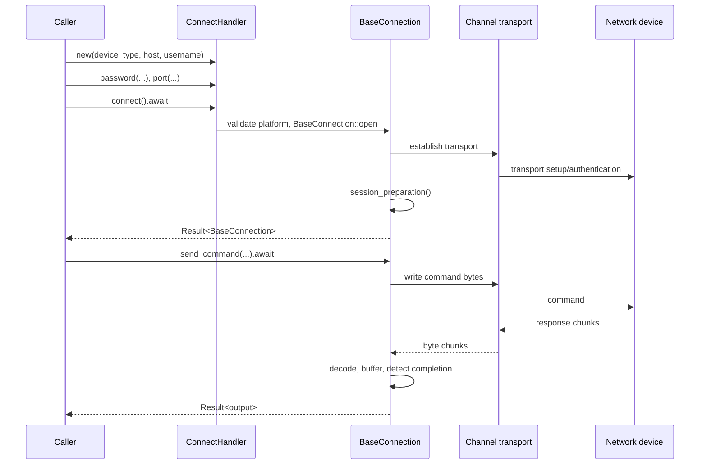

# LEARNME.md — Learn Rust by Understanding the Netmiko Port

**Audience:** a network engineer who knows Python and has just completed Rust Hello World. **Goal:** learn enough Rust to read, debug, test, and safely contribute to this repository. This is a learning textbook and project guide, not a claim that one document teaches every part of Rust.

> **Evidence rule:** the Rust tree is the source of truth for Rust behavior. The companion `netmiko-develop` tree provides a Python reference. Similar names do not prove identical behavior. Examples labelled *illustrative* teach a concept and are not production code. Never test against production devices without authorization.

## Table of contents

1. [Repository findings](#1-repository-findings)
2. [Hello World and the Rust toolchain](#2-hello-world-and-the-rust-toolchain)
3. [Variables, types, strings, and collections](#3-variables-types-strings-and-collections)
4. [Control flow, loops, and iterators](#4-control-flow-loops-and-iterators)
5. [Functions, methods, and builder APIs](#5-functions-methods-and-builder-apis)
6. [Ownership, borrowing, and lifetimes](#6-ownership-borrowing-and-lifetimes)
7. [Structs, enums, traits, and type design](#7-structs-enums-traits-and-type-design)
8. [Modules, imports, and visibility](#8-modules-imports-and-visibility)
9. [Errors and recovery](#9-errors-and-recovery)
10. [Networking fundamentals](#10-networking-fundamentals)
11. [Trace a command through the port](#11-trace-a-command-through-the-port)
12. [Transport and byte-level I/O](#12-transport-and-byte-level-io)
13. [Platform dispatch and extensibility](#13-platform-dispatch-and-extensibility)
14. [Dependencies, features, async, and concurrency](#14-dependencies-features-async-and-concurrency)
15. [Macros, memory, and performance](#15-macros-memory-and-performance)
16. [Parsers, CLI, SCP, serial, and Telnet](#16-parsers-cli-scp-serial-and-telnet)
17. [Python-to-Rust mapping and parity](#17-python-to-rust-mapping-and-parity)
18. [Testing and debugging](#18-testing-and-debugging)
19. [Contributing safely](#19-contributing-safely)
20. [Progressive exercises and solutions](#20-progressive-exercises-and-solutions)
21. [Porting methodology](#21-porting-methodology)
22. [Syntax reference](#22-syntax-reference)
23. [Glossary](#23-glossary)
24. [Learning roadmap](#24-learning-roadmap)
25. [Source map](#25-source-map)

---

# 1. Repository findings

## 1.1 Files inspected

The Rust tree includes `Cargo.toml`, `Cargo.lock`, `README.md`, `src/`, `tests/`, `examples/`, `tools/`, and generated platform data. Key files:

| File | Responsibility |
|---|---|
| `src/lib.rs` | Library root, feature-gated modules, public re-exports. |
| `src/main.rs` | CLI binary entry point; requires `cli`. |
| `src/core/types.rs` | `Protocol`, `SerialSettings`, `HostKeyPolicy`, `ConnectionParams`, `CommandOutput`, `ExtraArgs`. |
| `src/core/error.rs` | `NetmikoError`, `Result<T>`, error conversions/helpers. |
| `src/core/traits.rs` | `Channel` transport contract and `Platform` behavior contract. |
| `src/core/util.rs` | Byte conversion, timeout helpers, line-feed normalization, ANSI/backspace cleanup, regex helpers. |
| `src/connection/base.rs` | `BaseConnection`, session state, command I/O, prompt handling, preparation, disconnect. |
| `src/connection/platforms/mod.rs`, `generated.rs` | Platform schema, lookup, generated catalogue/session steps. |
| `src/dispatch.rs` | `ConnectHandler`, `connect`, Telnet fallback, redispatch, platform listing. |
| `src/ssh/mod.rs` | SSH client/transport using `russh`. |
| `src/telnet/mod.rs` | Telnet TCP transport. |
| `src/serial/mod.rs` | Serial console transport, behind `serial` feature. |
| `src/scp/mod.rs` | SCP transfer support, behind `scp`. |
| `src/parsers/{textfsm,ttp,clitable}.rs` | Structured output parsing, behind `parsers`. |
| `src/cli/{args,inventory,output}.rs` | CLI arguments, YAML inventory, output formatting. |
| `tests/platforms.rs` | Platform catalogue and prompt-pattern checks. |
| `tests/textfsm.rs` | TextFSM fixture and Python-reference compatibility checks. |
| `tests/fixtures/` | Expected parser output. |
| `examples/ssh_show_version.rs`, `examples/send_config.rs` | Usage examples. |
| `tools/extract_platforms.py`, `tools/gen_platforms_rs.py` | Platform extraction/generation utilities. |

The supplied Python tree includes `netmiko/base_connection.py` and `netmiko/ssh_dispatcher.py`. In it, `BaseConnection` is the central connection class and `ConnectHandler` is defined in the dispatcher. These are useful behavioral comparison points, but matching method names do not prove parity.

## 1.2 Configuration facts verified in `Cargo.toml`

- Package `netmiko`, version `0.1.0`; Rust edition **2021**; minimum Rust version **1.85**.
- Default feature: `ssh`. Optional groups: `telnet`, `serial`, `scp`, `parsers`, `cli`, and `all`.
- The CLI binary requires `cli`; examples declare feature requirements.
- Tokio supplies async runtime/I/O; `russh` supplies SSH functionality. This is not a synchronous `std::net::TcpStream`-only implementation.

The README describes the goal as Netmiko 5.x API/behavior parity. Treat that as intent, not proof that every feature is complete. Source inspection cannot establish compatibility with every real device, authentication mode, or timeout edge case.

---

# 2. Hello World and the Rust toolchain

```rust
fn main() {
    println!("Hello, world!");
}
```

- `fn` declares a function; `main` is the conventional binary entry point.
- `()` is an empty parameter list.
- `{}` delimit the function body.
- `println!` prints formatted text and a newline. The `!` means this is a **macro invocation**, expanded during compilation, not an ordinary function call.
- The quoted text is a string literal; `;` terminates the statement.

Python generally executes source through an interpreter and resolves many types at runtime. Rust compiles source into native artifacts and checks types, visibility, and many ownership rules before execution. Rust still has runtime failures: connections can fail, credentials can be rejected, device output can be malformed, and logic can be wrong.

| Term | Meaning |
|---|---|
| `rustc` | Rust compiler, invoked by Cargo. |
| `rustup` | Toolchain installer/manager. |
| Cargo | Build, dependency, test, and packaging tool. |
| Package | Unit described by `Cargo.toml`. |
| Crate | Rust compilation unit; this package has a library and feature-gated binary. |
| Module | Namespace and privacy boundary, e.g. `core`, `connection`, `ssh`. |
| Dependency | External crate, e.g. Tokio or `serde`. |
| Edition | Language compatibility mode; this project uses 2021. |

From the repository root, use this workflow:

```bash
rustc --version
cargo --version
cargo check
cargo build
cargo test
cargo fmt -- --check
cargo clippy --all-targets --all-features -- -D warnings
cargo run --features cli -- --help
```

`cargo check` is a fast type-check; `cargo build` compiles; `cargo test` runs tests; `cargo fmt -- --check` checks formatting without rewriting; Clippy runs additional lints. The CLI command requires the optional feature. These are recommended commands, not a claim they have already passed.

`Cargo.toml` describes package metadata, dependency requirements, and features. `Cargo.lock` records the resolved dependency graph for this checkout. `--release` enables optimization; debug builds are generally quicker to compile and easier to debug. Feature attributes such as `#[cfg(feature = "ssh")]` compile items only when that feature is enabled. `ssh` is default; `cargo test --all-features` is useful when optional dependencies are available.

**Compiler-error habit:** read the expected/found types; find the first move/borrow location; check module path, visibility, and feature gates for unresolved imports. Fix the root cause instead of adding `.clone()` everywhere. Practice by temporarily passing a string where a `u16` port is expected, running `cargo check`, reading the error, and undoing the edit.

---

# 3. Variables, types, strings, and collections

## 3.1 Bindings and mutability

```rust
let host = "switch-01";        // immutable binding
let mut retries = 0;            // mutable binding
retries += 1;
const SSH_PORT: u16 = 22;
let host = host.to_uppercase(); // shadowing: a new binding
```

`let` creates a binding. It is immutable unless `mut` is used; unlike Python, reassignment must be explicit. `const` needs a type and compile-time constant value. Shadowing declares a new binding with the same name; it is not mutation. In `src/dispatch.rs`, builder setters take `mut self`, update owned parameters, then return `self` so calls can be chained.

## 3.2 Types and conversions

Common types include `bool`, `char`, signed integers (`i32`, `i64`), unsigned integers (`u16`, `u32`, `u64`), and floats (`f32`, `f64`). `ConnectionParams.port` is `u16`; timeout and delay fields use numeric types. Rust does not silently convert arbitrary numbers or strings. Parsing can fail, so it returns a `Result`:

```rust
// Illustrative: the enclosing function must return a compatible Result.
let port_text = "22";
let port: u16 = port_text.parse()?;
```

Python's `int("22")` can also fail, but the failure is an exception at runtime; Rust's signature can make failure explicit.

## 3.3 `String` and `&str`

- `String` owns growable UTF-8 text.
- `&str` borrows a view of UTF-8 text; it does not own it.
- A literal such as `"show version"` is a `&'static str`.
- `to_string()` and `String::from(...)` create owned strings, often allocating.

`ConnectHandler::new` accepts `impl Into<String>` for device type, host, and username, allowing either literals or `String`. Methods that only inspect text often take `&str`. Python's `str` does not expose this ownership distinction.

Rust `char` is a Unicode scalar value, not necessarily one byte. Network I/O is bytes; decode only at the boundary where text is expected. `String::from_utf8_lossy` replaces invalid UTF-8 sequences instead of returning an error, as used by the `Channel` convenience method.

## 3.4 Collections, tuples, and slices

```rust
let pair: (&str, u16) = ("router-a", 22);
let octets: [u8; 4] = [192, 0, 2, 1];
let commands: Vec<String> = vec!["show version".into()];
```

A tuple groups values; `[u8; 4]` has a fixed length; `Vec<T>` is a growable collection of values of one type; `&[u8]` borrows a slice. `HashMap<K,V>` is a hash map; `ExtraArgs` aliases `HashMap<String, serde_json::Value>`. The CLI uses `BTreeMap` where ordered keys are useful. Python lists/maps can hold mixed types more freely; Rust normally models variation with an enum or a wrapper type.

A type alias like `pub type ExtraArgs = HashMap<String, serde_json::Value>;` is a readable name for an existing type, not a distinct type. A newtype wrapper would create a distinct type boundary.

## 3.5 Expressions, statements, stack, and heap

An expression evaluates to a value; a statement performs an action. A block's last expression can be its value:

```rust
let port = if use_telnet { 23 } else { 22 };
```

Both branches must have compatible types. Adding a semicolon changes an expression into a statement. Small fixed-size values often live on the stack; dynamic contents of `String` and `Vec` live on the heap. Memory location alone does not explain ownership—the move/borrow rules do.

---

# 4. Control flow, loops, and iterators

Rust `if` conditions must be `bool`; unlike Python, arbitrary objects do not have general truthiness. `match` uses patterns and must cover all possibilities (or include `_`). `src/core/types.rs` uses a `match` over `Protocol::{Ssh, Telnet, Serial}`; adding an enum variant can require updating exhaustive matches.

- `loop` repeats until `break`, return, or error propagation exits.
- `while condition` repeats while true.
- `for item in collection` iterates through an iterator.
- `0..n` excludes `n`; `0..=n` includes it.
- `continue` skips to the next iteration; `break` exits.

Ownership depends on the iterator:

```rust
for item in &items { /* shared borrow */ }
for item in &mut items { /* mutable borrow */ }
for item in items { /* consume/move items */ }
```

`iter()` yields shared references; `iter_mut()` mutable references; `into_iter()` consumes its receiver. Use borrowing when the collection must remain usable. A closure is an anonymous function, often `|x| ...`; `map` transforms items, `filter` retains matches, `find` returns the first match, and `collect` builds a collection. Many adapters are lazy until consumed.

```rust
// Illustrative iterator chain
let ssh_ports: Vec<u16> = [22_u16, 23, 2222]
    .into_iter()
    .filter(|port| *port != 23)
    .collect();
```

The `*` dereferences the reference passed to the filter predicate. When inspecting a real loop, ask: what is iterated, what stops it, does it move or borrow items, can it return early, and can an operation fail? Parser modules iterate over lines/rules; platform helpers search and map device-type strings.

---

# 5. Functions, methods, and builder APIs

## 5.1 Functions

```rust
fn add_one(value: u32) -> u32 {
    value + 1
}
```

`value: u32` is a typed parameter and `-> u32` is the return type. The final expression has no semicolon, so it is returned. `return` is useful for early exits. Rust signatures enforce types; Python commonly checks them dynamically.

## 5.2 Receivers and associated functions

A method is a function inside an `impl` block:

- `self` takes ownership of the instance.
- `&self` borrows immutably.
- `&mut self` borrows mutably.

`ConnectionParams::new` is an associated function used as a constructor; `new` is a convention, not a keyword. `BaseConnection::new` builds session state but does not connect. `BaseConnection::open` constructs and connects asynchronously.

## 5.3 Builder pattern in `src/dispatch.rs`

```rust,no_run
use netmiko::ConnectHandler;
# async fn example() -> netmiko::Result<()> {
let conn = ConnectHandler::new("cisco_ios", "192.0.2.10", "operator")
    .password("replace-with-secret")
    .port(22)
    .connect()
    .await?;
# let _ = conn;
# Ok(())
# }
```

This is a **no-run** documentation example, not a test that contacts a device. `ConnectHandler::new` creates `ConnectionParams`; setters such as `password`, `port`, and `key_file` update the owned builder and return `Self`. `connect(self)` consumes the builder, validates the device type, and returns `Result<BaseConnection>`.

`impl Into<String>` is a generic constraint: accepted inputs must implement conversion into `String`. It makes literal calls ergonomic without accepting every arbitrary type.

## 5.4 How to walk each function

For every important function, record: caller, arguments, return type, state mutation, side effects, error path, Python equivalent, and test. Start with:

1. `ConnectHandler::new`, setters, and `connect` in `src/dispatch.rs`.
2. `connect`, `telnet_fallback`, `telnet_variant`, `redispatch` in the same file.
3. `ConnectionParams::new`, `Default`, and `protocol` in `src/core/types.rs`.
4. `BaseConnection::new`, `connect`, `open`, `write_channel`, `read_channel`, `send_command`, `send_config_set`, `session_preparation`, `disconnect` in `src/connection/base.rs`.
5. `Channel` implementations in each transport module.

For long functions, divide execution into logical phases rather than memorizing the body at once.

---

# 6. Ownership, borrowing, and lifetimes

Ownership is the most important conceptual difference for a Python developer. Rust gives each owned value one owner; when that owner goes out of scope, the value is dropped. This prevents many use-after-free and double-free bugs without a tracing garbage collector. Python references are managed by its runtime; Rust makes transfers and borrowing visible in types.

```rust
let original = String::from("router");
let moved = original;
// println!("{original}"); // compile error: ownership moved
println!("{moved}");
```

The `String` moves to `moved`; `original` can no longer be used. Small `Copy` types such as `u16` and `bool` copy on assignment. `Clone` explicitly requests a copy and may allocate.

```rust
fn print_host(host: &str) { println!("{host}"); }
fn rename(host: &mut String) { host.push_str("-lab"); }
```

`&T` is a shared/immutable borrow; `&mut T` is exclusive and mutable. Rust prevents conflicting aliases in safe code. If a function only reads text, `&str` is often suitable. If it stores text beyond the call, it may need an owned `String`. If it mutates caller-owned state, `&mut T` may be appropriate.

### Ownership decisions in this project

- `ConnectHandler` owns `ConnectionParams`; builder setters modify it and return the builder.
- `params(&self) -> &ConnectionParams` lends read-only access; `params_mut(&mut self) -> &mut ConnectionParams` lends exclusive mutable access without cloning.
- `BaseConnection` owns `Box<dyn Channel>`, hiding the concrete SSH/Telnet/serial transport behind a trait object.
- `BaseConnection` retains `ConnectionParams` and a read `String` across multiple async method calls.
- `telnet_fallback` clones parameters so the original can be reused if an alternate Telnet attempt is needed. This simplifies control flow at the cost of cloning owned strings/options.
- `ScpClient<'a>` and `FileTransfer<'a>` borrow a connection for lifetime `'a`; the borrowed connection must outlive those objects.

A lifetime describes reference validity; it does not keep an object alive. Rust infers many lifetimes through elision. `'static` means a reference is valid for the whole program, or a bound excludes non-static borrows; it does not mean “mutable forever.” String literals commonly have type `&'static str`.

### Borrow-checker troubleshooting

1. Read the first diagnostic location.
2. Identify the owner and where it is moved/borrowed/mutated.
3. Shorten the borrow's scope if possible.
4. Return owned data if it must outlive a temporary source.
5. Clone only when two independent owners are required.
6. Avoid structs containing references until the lifetime relationship is clear.

**Exercise:** return a `&str` referencing a local `String`; observe the dangling-reference error, then return `String`. A reference cannot outlive its referent.

---

# 7. Structs, enums, traits, and type design

`ConnectionParams` in `src/core/types.rs` groups host, port, username, optional credentials/key paths, timeouts, host-key settings, encoding, logging, serial settings, terminal dimensions, and command-verification flags. Its `Default` implementation provides baseline values; `ConnectionParams::new` fills host, username, and device type while using defaults for other fields.

`Option<String>` represents a present string (`Some(value)`) or absence (`None`), not a nullable string that can be used without checking. `Result<T,E>` represents success (`Ok(T)`) or failure (`Err(E)`). `CommandOutput` models output alternatives in a type; inspect its variants and `Display` implementation before relying on it.

`Protocol` has `Ssh`, `Telnet`, and `Serial`; `from_device_type` derives a protocol from the device-type naming convention, and `as_str` returns a lowercase name. `HostKeyPolicy` distinguishes `AutoAdd` and `Reject`. These policies are security-relevant and should not be treated as interchangeable. Verify actual SSH host-key handling and defaults before deployment.

A **trait** defines behavior a type promises to provide. `Channel` in `src/core/traits.rs` defines the shared interface used by `BaseConnection`: write, read bytes, check liveness, close, identify transport, and optionally open a remote exec channel. SSH/Telnet/serial implement this contract where features are enabled. `Platform` exposes platform configuration and an async cleanup hook; most vendor differences are data in `PlatformConfig`, with custom trait behavior where needed.

`Box<dyn Channel>` is a heap-owned trait object with runtime dynamic dispatch. It lets `BaseConnection` use any transport implementation without becoming generic over each concrete transport. The trade-off is indirection and dynamic dispatch, reasonable at a transport boundary. `Send` means a value may be transferred between threads; `Sync` means shared references are safe across threads. The trait bounds constrain safe scheduling/sharing.

`#[derive(Debug, Clone, Serialize, Deserialize)]` asks macros to generate trait implementations. `Debug` supports diagnostic formatting, `Clone` permits explicit cloning, and Serde traits support serialization. A clone is not necessarily cheap. Public fields in `ConnectionParams` are convenient but become API commitments. `BaseConnection` keeps transport and buffers private so callers use its public methods rather than modifying protocol internals.

---

# 8. Modules, imports, and visibility

`src/lib.rs` declares `pub mod core`, `pub mod connection`, and `pub mod dispatch`; transport/parser/CLI modules are feature-gated. `pub use` re-exports types so callers can use `use netmiko::ConnectHandler` rather than deep paths.

- `mod name;` declares a module.
- `pub mod name;` makes the module accessible externally, if its containing path is also visible.
- `use path::Item;` imports a name into scope.
- `pub use path::Item;` re-exports it as part of the API.
- `crate::` starts at the crate root; `self::` means current module; `super::` means parent.
- `pub(crate)` limits visibility to the crate; `pub(super)` to the parent; `pub(in path)` to a chosen ancestor path.

In `src/lib.rs`, `pub use dispatch::{connect, redispatch, telnet_fallback, ConnectHandler};` exposes convenient root-level names. `ConnectHandler.params` is private, while `params()` and `params_mut()` are public accessors. `BaseConnection` exposes selected state but keeps its channel/read buffers private. Make an item public only when external callers need it: public fields and enum variants become compatibility commitments and can make future refactoring harder.

A public function returning an inaccessible private type is an API design problem. Fix the intended boundary rather than making every internal type public by default.

---

# 9. Errors and recovery

Python typically raises exceptions; Rust commonly returns `Result<T,E>` for expected failures. In `src/core/error.rs`:

```rust
pub type Result<T> = std::result::Result<T, NetmikoError>;
```

`NetmikoError` includes categories such as `Authentication`, `Timeout`, `Connection`, `Ssh`, `Telnet`, `Serial`, `Scp`, `Regex`, `Io`, `UnsupportedDeviceType`, `ConfigInvalid`, `InvalidParameter`, `NotConnected`, `Read`, `Parsing`, `NotImplemented`, and `Generic`. This lets callers match error categories instead of parsing strings. `is_timeout()` and `is_auth()` use `matches!` to test variants.

```rust
let platform = platforms::require(&params.device_type)?;
```

`?` extracts an `Ok` value or returns early with the error (converting it when a suitable conversion exists). This resembles allowing a Python exception to propagate, but the Rust failure is represented in the function's return type. `#[from]` on the `Io` variant enables `std::io::Error` conversion; `impl From<russh::Error> for NetmikoError` maps SSH errors to `Ssh`.

`unwrap()` panics on `Err`/`None`; `expect("message")` panics with context; `panic!` is for programming failures or deliberately unrecoverable states. Normal network failures—bad credentials, refused connections, timeouts—should ordinarily be recoverable `Result` errors, not panics.

Audit failure paths in `src/ssh/mod.rs`, `src/telnet/mod.rs`, `src/connection/base.rs`, `src/parsers/`, `src/cli/args.rs`, and `src/cli/inventory.rs`. `BaseConnection::connect` returns `NotImplemented` when a required transport feature is disabled. Distinguish connection, authentication, banner, read/blocking, and session timeouts; they refer to different phases. Do not assume every error variant is used in every path without checking the source.

---

# 10. Networking fundamentals

Netmiko simplifies interactive CLI automation across network vendors by managing transport setup, login, prompt/paging handling, command writes, response reads, and device-specific behavior.

- **TCP connection:** reliable byte stream; it does not understand commands or prompts.
- **SSH transport:** encrypted/authenticated protocol over TCP.
- **SSH channel:** logical channel inside SSH; an interactive shell differs from a remote exec channel.
- **Telnet:** protocol over TCP with negotiation/control bytes; not encrypted by default.
- **Serial console:** byte stream via a serial device rather than a TCP socket.
- **Platform/device driver:** vendor/OS-specific rules such as prompts, paging commands, and session preparation.
- **Prompt detection:** application logic that infers command completion from response patterns or timing; TCP does not label command boundaries.
- **Connection timeout:** initial connection deadline. **Authentication timeout:** login deadline. **Read timeout:** waiting for response data. **Session timeout:** bound on a session/operation workflow.

A typical workflow is: configure parameters → validate device type → open transport → authenticate/login → run session preparation → write command and Enter → read chunks → decode/normalize → detect completion → return output/error → disconnect. This is a conceptual workflow; the exact stages vary by transport and device.

---

# 11. Trace a command through the port

## 11.1 Sequence diagram



This depicts the main path from source structure, not every handshake or failure edge.

## 11.2 Parameter construction and validation

`ConnectHandler::new` in `src/dispatch.rs` accepts `impl Into<String>`, calls `ConnectionParams::new`, and stores the result in a private field. Builder setters update that record. `ConnectHandler::connect(self)` consumes the builder, calls `platforms::require(&params.device_type)?`, then `BaseConnection::open(params).await`. Unsupported device types can therefore fail before network activity.

The free `dispatch::connect(params)` follows the same high-level validate/open route. `telnet_fallback` first tries `connect(params.clone())`; on failure it looks for a Telnet variant, changes the device type and port to 23, and retries. If no variant exists it returns the original error. If fallback itself fails, it logs both failures and returns the fallback error. That means the final error may describe the second attempt.

## 11.3 `BaseConnection` lifecycle

`BaseConnection::new` in `src/connection/base.rs` resolves the platform, chooses `return_str` and `response_return`, optionally creates a session log, initializes prompt/read state, and installs a `NullChannel`. It does not connect yet. `BaseConnection::open(params)` constructs the object then calls `connect().await`.

`connect` switches on `params.protocol()`, opens the feature-enabled SSH/Telnet/serial transport, performs Telnet/serial login where applicable, and calls `session_preparation`. If preparation fails, it attempts `disconnect` before returning the error. This cleanup-on-failure is important: any new early return during session setup must consider resource cleanup.

`BaseConnection` owns `Box<dyn Channel>`, so common command logic can use `write`, `read_buffer_bytes`, `is_alive`, `close`, and `transport_name` without knowing the concrete transport. `Channel::read_buffer` decodes bytes with `String::from_utf8_lossy`; `read_channel` loops until a read returns an empty chunk.

## 11.4 Command execution and response handling

Study `send_command`, `read_until_pattern`, `read_until_prompt`, `read_channel_timing`, and `send_command_timing` in `src/connection/base.rs`. Pattern-based paths write the command, read chunks, accumulate a buffer, and look for a prompt/pattern. Timing-based paths use delays/quiet periods rather than relying exclusively on a known prompt. Exact behavior depends on options; read the method body before changing timeouts.

`write_channel` uses `data.as_bytes()` and delegates to the channel; it can optionally record writes in a session log. A single read is not a packet or command-response boundary: TCP/SSH can split or coalesce bytes arbitrarily. Completion detection is application logic.

`session_preparation` uses platform settings/session steps to prepare the CLI and discover prompt state. `disconnect` is the explicit cleanup path. Add success and failure-path tests when modifying lifecycle behavior.

## 11.5 Python comparison

The supplied Python `netmiko/ssh_dispatcher.py` defines `ConnectHandler`; `netmiko/base_connection.py` contains `BaseConnection`, `session_preparation`, `send_command`, and `send_config_set`. Rust `src/dispatch.rs` explicitly identifies itself as the dispatcher counterpart. Python commonly maps device types to subclasses; Rust uses shared `BaseConnection`, a platform configuration catalogue, and a `Platform` trait for special behavior. This is an architectural translation, not a line-by-line rewrite.

---

# 12. Transport and byte-level I/O

A network stream contains bytes, not Rust strings. It may carry text, terminal controls, or invalid UTF-8. The `Channel` interface is byte-oriented and offers text helpers on top:

- `Vec<u8>` owns a growable byte buffer; `&[u8]` borrows a slice.
- `data.as_bytes()` views UTF-8 bytes without creating a new owned string.
- `String::from_utf8_lossy` replaces invalid sequences when producing text.
- Standard `Read`/`Write` are synchronous I/O traits; Tokio provides async I/O traits/extensions.

A read can return only some available bytes. It need not fill the buffer or return a whole command response. Repeated reads plus a stopping condition are required.

`src/ssh/mod.rs` uses `russh::client`, SSH channel messages, `bytes::Bytes`, and timeout facilities. `SshTransport::connect` establishes an SSH client connection/authentication; its `Channel` implementation adapts SSH channels to the shared interface. The module has an `ExecChannel` for remote exec commands such as SCP. Read method bodies before assuming every shell/exec edge case is identical.

`src/telnet/mod.rs` uses `tokio::net::TcpStream` and async read/write extensions. Telnet negotiation and login mean it is not merely an unadorned TCP stream. `src/serial/mod.rs` maps settings into `serialport` types.

Timeouts are deadlines, not proof that the device finished. `tokio::time::timeout` bounds a future; `src/ssh/mod.rs` has a `with_timeout` helper. `ConnectionParams` distinguishes connection, authentication, banner, blocking, session, keepalive, and read override values. Debug timeouts by phase—connection, handshake, auth, initial prompt, command response, cleanup—instead of increasing every timeout.

`src/core/util.rs` provides `normalize_linefeeds`, `strip_ansi_escape_codes`, `strip_backspaces`, regex split helpers, and related utilities. Device output may include `\r`, `\n`, ANSI sequences, echoed commands, and backspace corrections. Over-normalization can corrupt meaningful output. Telnet's default Enter characters differ from SSH; `return_str` and `response_return` serve different purposes.

**Illustrative example:** a peer writes `hello`, but reads may yield `he` then `llo`. Append chunks and decide when the message is complete. A CLI device generally has no length prefix, so prompt/pattern/timing logic acts as the application boundary.

---

# 13. Platform dispatch and extensibility

`src/connection/platforms/` defines `PlatformConfig` and `SessionStep`, with generated platform data. Entries describe device-type properties such as prompt patterns, enable/config commands, paging-disable commands, login patterns, and session preparation. `lookup` searches; `require` returns an error for unknown types; `supported_device_types` lists accepted names.

Python Netmiko often implements platform differences using many subclasses. A data-driven catalogue avoids duplicating the shared command engine when differences are declarative. A behavior requiring custom logic may need a `Platform` implementation or shared-engine change.

To add a platform safely:

1. Confirm device type and expected behavior against the Python source/reference docs.
2. Check `src/connection/platforms/generated.rs` and `tools/platforms.json` for an existing entry.
3. Understand `tools/extract_platforms.py` and `tools/gen_platforms_rs.py`; do not hand-edit generated output unless the workflow calls for it.
4. Update source data and regenerate.
5. Add lookup, prompt-regex, and session behavior tests.
6. Run `cargo test --test platforms` and relevant tests.
7. Verify against a simulator/lab device if possible.

`tests/platforms.rs` checks catalogue coverage, absence of silently missing platforms, prompt-pattern compilation, and rejection of unknown device types. It does not prove every real device's command behavior. Treat architectural extensions as proposals until implemented and tested.

---

# 14. Dependencies, features, async, and concurrency

## 14.1 Dependency map

| Dependency | Role |
|---|---|
| `tokio` | Async runtime, TCP, timers, I/O, synchronization, filesystem/process features. |
| `russh` | SSH client and channels. |
| `async-trait` | Async methods in traits. |
| `regex`, `fancy-regex` | Prompt matching and parser patterns. |
| `thiserror` | Typed error formatting/conversions. |
| `serde`, `serde_json`, `toml`, optional `serde_yaml` | Data/config serialization. |
| `indexmap` | Ordered-map support. |
| `bytes`, `futures` | Byte buffers and future utilities. |
| `sha2`, `md-5`, `hex`, `base64` | Hashing/encoding helpers. |
| `walkdir` | Recursive directory traversal/template discovery. |
| Optional `clap` | CLI arguments. |
| Optional `serialport` | Serial console access. |
| Optional `rpassword` | Hidden CLI password entry. |
| Dev `tempfile`, `pretty_assertions` | Test helpers. |

Use `cargo tree` and `cargo tree -e features` to inspect dependency relationships/features. The manifest specifies version requirements; the lockfile records resolved versions for this checkout. Do not replace a dependency without locating all imports and understanding its role.

## 14.2 Async Rust

This project uses `async fn` and `.await`. An async function describes work that can suspend; calling it creates a future. `.await` polls the future through a runtime until it completes or yields. Tokio schedules tasks and provides async TCP/time utilities. `#[tokio::main]` initializes a runtime for an executable/example.

Async does not automatically mean parallel. A task can yield while waiting for I/O, letting other tasks progress. CPU-heavy parsing still consumes CPU unless moved to a suitable blocking worker. Avoid holding a synchronous lock across `.await` without understanding the consequences.

`Send` means a value can safely move between threads; `Sync` means shared references are safe across threads. `Channel: Send` and `Platform: Send + Sync` constrain scheduling/sharing; they do not by themselves guarantee concurrent sessions. The CLI's `max_workers`, `ssh_conn`, and `run_tasks` in `src/cli/mod.rs` are the places to inspect actual scheduling/result aggregation.

---

# 15. Macros, memory, and performance

`println!`, `format!`, and `matches!` are macros. `#[derive(Debug, Clone, Serialize, Deserialize)]` generates trait implementations. `#[async_trait]` supports async trait patterns; `#[cfg(feature = "...")]` conditionally compiles code; `#[test]` marks a test; `///` and `//!` are documentation comments. Attributes affect compilation or attach metadata; they are not ordinary runtime calls.

**RAII** ties resource release to value lifetime. Rust types often clean up when dropped, but async protocols may require explicit graceful `close`/`disconnect`. `BaseConnection::connect` attempts `disconnect` if session preparation fails. When changing cleanup, consider protocol shutdown as well as local resource release.

Performance-sensitive areas include command buffering, regex matching, parsing large outputs, and multi-device CLI tasks. Avoid needless clones/allocations, but do not sacrifice clarity to remove a small clone. Cloning parameters in fallback can be reasonable because two attempts need access to the settings. Benchmark representative workloads in release mode before claiming performance gains; this guide includes no unmeasured Rust-versus-Python speed claim.

---

# 16. Parsers, CLI, SCP, serial, and Telnet

## 16.1 Parsers

`src/parsers/textfsm.rs` implements a TextFSM-style state machine with values, rules, line/record operations, and row conversion. `src/parsers/ttp.rs` implements a documented subset of TTP; unsupported features should error rather than silently mis-parse. `src/parsers/clitable.rs` handles index-table lookup and parsed-table combination. `src/parsers/mod.rs` exposes structured-data APIs and template discovery.

Transport and parsing are separate stages: acquire raw output first, then select the correct template/platform/command and parse. Parsing errors are not transport errors. The README describes Genie-style behavior as an actionable error when Genie is unavailable; verify the exact function path before relying on it.

`tests/textfsm.rs` compares Rust output with Python TextFSM reference output using fixtures and checks row/dictionary agreement. This is useful compatibility evidence for those fixtures, not proof of every template.

## 16.2 CLI and inventory

The optional CLI splits responsibilities: `args.rs` defines Clap arguments and validation; `inventory.rs` loads YAML and selects devices/groups; `output.rs` formats raw/text/JSON output and highlighting; `mod.rs` orchestrates commands/tasks. `BTreeMap` helps make result ordering deterministic. Inspect `device_tasks`, `run_show`, `run_cfg`, and `run_grep` for actual command flow. Test inventory using temporary YAML files, not production credentials.

## 16.3 SCP

`src/scp/mod.rs` includes `ScpClient`, `FileTransfer`, transfer status/options, record/ack helpers, checksum and remote-space helpers, and the top-level transfer function. SCP uses an SSH remote exec channel; it is not simply copying bytes over an interactive shell. The default `Channel::open_exec` returns `NotImplemented`; SSH provides the exec path. Understand transfer direction, acknowledgements, file size, hashing, and cleanup before changing it. Never test writes to real devices without explicit approval.

## 16.4 Telnet and serial

Telnet uses Tokio TCP plus negotiation/login logic; serial uses the optional `serialport` dependency and maps `SerialSettings` to dependency types. With a transport feature disabled, `BaseConnection::connect` returns `NotImplemented` rather than pretending support exists. Test disabled-feature behavior separately from enabled transport behavior.

---

# 17. Python-to-Rust mapping and parity

| Python concept | Rust approach | Important difference | Project example |
|---|---|---|---|
| Class with fields | `struct` | Statically typed fields. | `ConnectionParams`, `BaseConnection`. |
| Instance method | `impl` method | Receiver encodes ownership/borrowing. | `ConnectHandler` setters. |
| Constructor | Associated function (`new`) | `new` is a convention. | `ConnectionParams::new`. |
| `None` | `Option<T>` | Presence must be handled explicitly. | Optional credentials/timeouts. |
| Exception | `Result<T,E>` | Ordinary failures are typed return values. | `NetmikoError`, `?`. |
| List | `Vec<T>` | Homogeneous element type, owned by default. | Command/task lists. |
| Dictionary | `HashMap` / `BTreeMap` | Explicit key/value types; BTreeMap orders keys. | `ExtraArgs`, inventory/results. |
| Public attribute | `pub` field/accessor | Privacy is explicit and API-sensitive. | `ConnectionParams`, `params()`. |
| Duck typing | Traits/generics | Required behavior is statically described. | `Channel`, `Platform`. |
| Inheritance | Composition, traits, enums/config | No class inheritance. | `PlatformConfig` + shared base. |
| `str` | `String` / `&str` | Owned value versus borrowed view. | Parameters and command inputs. |
| `bytes` | `Vec<u8>`, `&[u8]`, `Bytes` | Decoding is explicit. | Channel and transports. |
| `asyncio` | async functions + Tokio | Futures need runtime polling. | Connection and command APIs. |
| Imports | `mod`, `use`, `pub use` | Module privacy changes accessibility. | `src/lib.rs`. |
| Decorator/metadata | Attributes/macros | May generate or conditionally compile code. | `#[derive]`, `#[cfg]`, `#[test]`. |
| Cleanup | RAII + explicit async close | Drop may not replace protocol shutdown. | `disconnect`, `Channel::close`. |

## 17.1 Conservative feature-parity matrix

| Capability | Status | Evidence and caveat |
|---|---|---|
| Device-type catalogue | **Implemented; catalogue consistency tested** | `generated.rs`; `tests/platforms.rs` checks catalogue/regex properties, not every device. |
| Common connection/command API | **Implemented in source; broad parity not fully verified** | `BaseConnection` and exports; no exhaustive real-device matrix established here. |
| SSH | **Implemented in source** | `src/ssh/mod.rs`; real-world interoperability requires tests. |
| Telnet | **Implemented in source; feature-gated** | `src/telnet/mod.rs`; negotiation/login edge cases need tests. |
| Serial | **Implemented in source; feature-gated** | `src/serial/mod.rs`; hardware/driver environment matters. |
| SCP | **Implemented in source; feature-gated** | `src/scp/mod.rs`; test both directions and failures in a lab. |
| TextFSM | **Implemented and fixture-compared** | `tests/textfsm.rs`; only tested fixtures are verified. |
| TTP | **Partial/subset implementation** | Source/README describe supported and unsupported syntax. |
| Genie | **Unavailable or explicit error path** | README describes an actionable unavailable error; verify the function before relying on it. |
| CLI | **Implemented; optional feature** | `src/cli/`; use fixture inventory/mocks for testing. |
| Full upstream parity | **Unknown/not established** | No exhaustive vendor, timeout, authentication, and transport matrix is proven by supplied evidence. |

“Implemented” means code exists; “verified” requires tests or controlled experiments covering the claim. Do not infer complete parity from a README statement.

---

# 18. Testing and debugging

Existing tests include `tests/platforms.rs` (catalogue coverage, regex compilation, unknown-device rejection), `tests/textfsm.rs` (Python-reference fixtures and row/dictionary agreement), and unit-test modules in `src/core/util.rs`, `src/parsers/*`, `src/scp/mod.rs`, and `src/cli/output.rs`. A test proves only its assertions: a regex compiling does not prove it detects every device prompt.

Recommended safe workflow:

```bash
cargo fmt -- --check
cargo check
cargo test
cargo test --test platforms
cargo test --test textfsm
cargo test --all-features
```

`--all-features` may need optional system dependencies and may reveal platform-specific build problems. Do not claim a command passed unless it was actually executed. Never let a test issue configuration commands to a real device without authorization, lab credentials, and rollback planning. Prefer pure functions, fake `Channel`s, local TCP servers, fixtures, and temporary directories.

| Behavior | Safe test approach |
|---|---|
| Unknown device type | Validate without opening a socket. |
| Invalid parameters | Exercise validation with invalid input. |
| Connection refused | Local unused port or controlled local server. |
| Timeout | Local server deliberately delays response. |
| Split response | Local server sends chunks with controlled delay. |
| Prompt detection | Deterministic response text and expected pattern. |
| Line-ending/ANSI cleanup | Pure unit tests with known strings. |
| Parsing | Fixture input and expected structured output. |
| Cleanup on preparation failure | Fake channel fails during prep; assert close attempted. |
| Inventory | Temporary YAML, including malformed/missing cases. |

Debugging: reproduce minimally; determine compile-time versus runtime; run `cargo check`; use `RUST_BACKTRACE=1` for panics; enable tracing filters if initialized; add a regression test; keep secrets out of logs; run formatter, targeted tests, and broader tests. For timeouts, identify the phase before adjusting settings. For ownership errors, locate the move and decide between borrowing, shorter scope, returning owned data, or a justified clone.

---

# 19. Contributing safely

1. Start with `git status` and a clean working tree.
2. Read `README.md`, `Cargo.toml`, and the relevant module docs.
3. Reproduce the bug or add a failing test.
4. Trace from public API to implementation and back.
5. Decide whether the change belongs in shared connection logic, transport, platform data, parser, or CLI.
6. Make the smallest complete change.
7. Add success and failure-path tests.
8. Run formatter, `cargo check`, targeted tests, then broader tests/features.
9. Review public API and feature-gate implications; regenerate generated data through its scripts.
10. Update docs/examples and disclose limitations.
11. Prepare a pull request with problem, approach, commands/results, compatibility impact, and lab limitations.

**Worked first contribution:** add a focused assertion to `tests/platforms.rs` for an existing platform's known configuration. Read the test helpers, use the public lookup API, run `cargo test --test platforms`, and explain what the assertion proves and does not prove. This is safer than immediately editing transport code. For a new platform, follow `tools/extract_platforms.py`, `tools/gen_platforms_rs.py`, and `tools/platforms.json`; do not edit generated output without understanding the generation workflow.

Before making something `pub`, ask whether an external consumer needs it and whether it is stable enough to become a contract. Public fields and enum variants affect downstream users; renaming a public API may be breaking. Document the feature required to compile feature-gated APIs.

---

# 20. Progressive exercises and solutions

All snippets here are exercises, not new production code.

## Level 1 — basics

**Exercise 1: count characters.**

```rust
fn char_count(name: &str) -> usize {
    name.chars().count()
}
fn main() {
    let device = "router-a";
    println!("{device}: {} characters", char_count(device));
}
```

`&str` borrows text; `usize` is a platform-sized count. `chars()` counts Unicode scalar values, not UTF-8 bytes or visual grapheme clusters.

**Exercise 2: count non-Telnet ports.**

```rust
fn non_telnet_ports(ports: &[u16]) -> usize {
    let mut count = 0;
    for port in ports {
        if *port != 23 { count += 1; }
    }
    count
}
```

`&[u16]` borrows a slice, `port` is a reference, `*port` dereferences it, and `mut` permits updating `count`.

## Level 2 — types and errors

**Exercise 3: optional password.**

```rust
fn password_is_present(password: &Option<String>) -> bool {
    password.is_some()
}
```

The option is borrowed, not consumed. If only text is needed, `Option<&str>` may be more convenient; if a struct must own it, `Option<String>` is appropriate.

**Exercise 4: parse a port.**

```rust
fn parse_port(text: &str) -> Result<u16, std::num::ParseIntError> {
    text.parse::<u16>()
}
```

The result exposes parse failure. `::<u16>` supplies the generic type. A public crate API may convert this low-level error into its own validation error.

## Level 3 — borrowing and testing

**Exercise 5: first non-empty output line.**

```rust
fn first_nonempty_line(output: &str) -> Option<&str> {
    output.lines().find(|line| !line.trim().is_empty())
}
```

The returned slice borrows from `output`; `Option` represents the possibility that no line matches.

**Exercise 6: test it.**

```rust
#[test]
fn finds_first_nonempty_line() {
    assert_eq!(first_nonempty_line("\n  \nrouter#\n"), Some("router#"));
    assert_eq!(first_nonempty_line("\n \n"), None);
}
```

`#[test]` marks the function for the test harness; `assert_eq!` is a macro that fails if values differ.

## Level 4 — network abstraction

**Exercise 7: model a command request.**

```rust
#[derive(Debug, Clone, PartialEq, Eq)]
struct CommandRequest {
    command: String,
    expect: Option<String>,
}
```

The request owns its command string; expected pattern is optional. This type is illustrative, not present in the production tree.

**Exercise 8: fake a channel.** Read `src/core/traits.rs` and implement a test-only `Channel` that returns predetermined chunks and records writes. Use it to test response buffering/prompt detection without a router. Match the exact current trait signatures.

## Level 5 — repository contributions

**Exercise 9:** read `src/core/util.rs::normalize_linefeeds`, list edge cases, add a test not already covered, run its test module and `cargo fmt -- --check`, and explain each changed character.

**Exercise 10:** add an assertion to `tests/platforms.rs` for an existing platform, run `cargo test --test platforms`, then explain why catalogue membership is not the same as end-to-end device support. For actual new platform support, follow the generator workflow and test in a lab.

For each exercise, write down the objective, expected behavior, test, common mistakes, and why the solution works. Build from pure functions toward transport abstractions; do not begin by testing against a real router.

---

# 21. Porting methodology

Porting a mature Python library is not a mechanical syntax translation:

1. Define observable behavior: public methods, defaults, return shapes, errors, side effects, timeouts, cleanup.
2. Map the public API and decide which Rust types make invalid states harder to represent.
3. Make hidden Python assumptions explicit: dynamic attributes, optional values, implicit conversions, exception types, subclass hooks.
4. Use enums for finite alternatives, traits for shared behavior, and configuration data for declarative vendor differences.
5. Model errors and preserve diagnostic context.
6. Translate tests/fixtures before optimizing.
7. Track implemented, verified, partial, unsupported, and unknown features separately.
8. Handle bytes versus strings, partial reads, line endings, prompt detection, cancellation, and timeouts deliberately.
9. Document incompatibilities rather than silently approximating behavior.
10. Review public API stability and benchmark before claiming speedups.

Concrete example: Python `ConnectHandler` in `netmiko/ssh_dispatcher.py` maps device types to connection implementations. Rust `ConnectHandler::connect` in `src/dispatch.rs` calls `platforms::require`, then `BaseConnection::open`. Rust uses typed parameters and data-driven platform configuration. Ownership and async requirements shape the design, but do not prove parity by themselves.

A parity record should state: original Python behavior; Rust implementation; why the Rust design differs; tests; untested edge cases; known limitations. Never mark a feature “verified” without tests or controlled experiments that establish the behavior claimed.

---

# 22. Syntax reference

| Syntax | Meaning |
|---|---|
| `fn f(x: u16) -> bool` | Typed function signature. |
| `let mut x = 0;` | Mutable binding. |
| `&T` / `&mut T` | Shared / exclusive borrow. |
| `struct X { field: String }` | Named-field struct. |
| `enum P { Ssh, Telnet }` | Finite set of variants. |
| `impl X { ... }` | Methods/associated functions. |
| `trait T { fn call(&self); }` | Behavior contract. |
| `Option<T>` | `Some(T)` or `None`. |
| `Result<T, E>` | `Ok(T)` or `Err(E)`. |
| `value?` | Propagate failure from a fallible operation. |
| `match x { ... }` | Pattern matching. |
| `|x| x + 1` | Closure. |
| `0..n` / `0..=n` | Exclusive / inclusive range. |
| `pub fn f()` | Public function within a visible module path. |
| `pub(crate) fn f()` | Visible within the crate. |
| `use crate::core::types::Protocol;` | Import a path. |
| `pub use path::Item;` | Re-export an item. |
| `#[derive(Debug, Clone)]` | Generate trait implementations. |
| `#[cfg(feature = "ssh")]` | Compile only with feature. |
| `#[test]` | Mark a test. |
| `async fn f()` / `.await` | Async function/future and suspension point. |
| `Box<dyn Channel>` | Owned trait object with dynamic dispatch. |
| `impl Into<String>` | Generic argument constrained by conversion. |

---

# 23. Glossary

- **Borrow:** temporary access without ownership transfer.
- **Borrow checker:** compiler analysis of reference validity and aliasing.
- **Channel:** this project's shared byte-I/O interface; in SSH, also a protocol construct.
- **Crate:** Rust compilation unit.
- **Dispatch:** selecting configuration/implementation based on `device_type`.
- **Enum:** type with a finite set of variants.
- **Future:** value representing asynchronous work that may complete later.
- **Generic:** code parameterized by types or compile-time values.
- **Lifetime:** compiler-checked validity interval for references.
- **Macro:** compile-time code-generation/token transformation mechanism.
- **Module:** namespace and privacy boundary.
- **Ownership:** each owned value has one owner at a time.
- **Prompt detection:** deciding from response text/patterns when an interactive command appears complete.
- **RAII:** tying resource cleanup to object lifetime/drop.
- **Trait:** contract of behavior a type implements.
- **Transport:** mechanism carrying bytes: SSH, Telnet/TCP, or serial here.
- **Typed error:** error represented as a type/value rather than only free-form text.
- **Feature flag:** compile-time switch enabling optional code/dependencies.
- **Partial read:** read returning only a portion of expected application data.
- **Session preparation:** device-specific setup after connection, such as prompt/paging handling.
- **Trait object:** dynamically dispatched value such as `dyn Channel`.

---

# 24. Learning roadmap

1. **Day 1:** run Hello World, `cargo check`, and `cargo test`; read `Cargo.toml` and `src/lib.rs`.
2. **Days 2–3:** variables, types, strings, functions, loops, structs, enums.
3. **Days 4–5:** ownership and errors; read `src/core/types.rs`, `src/core/error.rs`, and `src/core/traits.rs`.
4. **Days 6–7:** read `src/dispatch.rs`; trace `ConnectHandler::connect` into `BaseConnection::open`.
5. **Week 2:** study `connect`, `send_command`, read/prompt helpers, `session_preparation`, and `disconnect` in `src/connection/base.rs`.
6. **Week 3:** read `src/ssh/mod.rs`; compare Telnet and serial `Channel` implementations.
7. **Week 4:** study platform generation and parser tests; complete a fixture-based test change.
8. **Afterwards:** add a regression test, then a small implementation change, then a reviewed platform/parser/transport extension.

Recommended file order: `Cargo.toml` → `src/lib.rs` → `src/core/types.rs` → `src/core/error.rs` → `src/core/traits.rs` → `src/dispatch.rs` → `src/connection/base.rs` → `src/connection/platforms/mod.rs` → `src/ssh/mod.rs` → `src/telnet/mod.rs` → `tests/platforms.rs` → `tests/textfsm.rs` → optional modules relevant to your task.

## Readiness checklist

- [ ] Explain package, crate, and module.
- [ ] Explain `String` vs `&str`, move vs borrow, and `Option` vs `Result`.
- [ ] Explain why platform validation precedes connection setup.
- [ ] Trace a command from `send_command` through `Channel` to buffering/completion detection.
- [ ] Explain `ConnectionParams`, `BaseConnection`, `Channel`, and `PlatformConfig`.
- [ ] Identify the returned error type and explain `?`.
- [ ] Add a deterministic test without a real device.
- [ ] Run formatter, targeted tests, and relevant feature builds.
- [ ] Distinguish existing code from behavior proven by tests.
- [ ] Describe limitations and compatibility impact of a change.

---

# 25. Source map

Use this as the checklist for a deeper file-by-file walkthrough. Generated platform entries are data-heavy; study their schema and generator instead of memorizing every entry.

| File | Symbols to start with | Questions |
|---|---|---|
| `src/lib.rs` | module declarations, re-exports | What is public? Which features gate modules? |
| `src/core/types.rs` | `Protocol`, `ConnectionParams`, `CommandOutput` | Which fields are optional? What defaults apply? |
| `src/core/error.rs` | `NetmikoError`, `Result`, `From<russh::Error>` | Which failures can callers distinguish? |
| `src/core/traits.rs` | `Channel`, `Platform` | Which methods are shared/defaulted? |
| `src/core/util.rs` | `write_bytes`, `normalize_linefeeds`, regex helpers | Which transformations alter output? Which edge cases are tested? |
| `src/dispatch.rs` | `ConnectHandler`, `connect`, `telnet_fallback`, `redispatch` | When is validation performed? Which error survives fallback? |
| `src/connection/base.rs` | `new`, `connect`, `open`, `send_command`, `send_config_set`, `session_preparation`, `disconnect` | Where is state held? How does cleanup work? |
| `src/connection/platforms/mod.rs` | `PlatformConfig`, `SessionStep`, lookup/require | How are platform differences represented? |
| `src/connection/platforms/generated.rs` | generated entries | Which properties are data rather than code? |
| `src/ssh/mod.rs` | `ClientHandler`, `SshTransport`, `authenticate`, `with_timeout` | How are host keys, auth, shell and exec channels handled? |
| `src/telnet/mod.rs` | `TelnetTransport::connect`, `Channel` impl | How are negotiation, login, and reads handled? |
| `src/serial/mod.rs` | settings conversion and connect/read/write | How are settings mapped to `serialport`? |
| `src/scp/mod.rs` | `ScpClient`, `FileTransfer`, `file_transfer` | How do acknowledgements, sizes, hashes, and cleanup work? |
| `src/parsers/textfsm.rs` | `TextFSM`, `TextFSMRule`, `TextFSMValue` | How do states and record actions work? |
| `src/parsers/ttp.rs` | `TtpTemplate`, variable/line parsing | Which syntax is supported/rejected? |
| `src/parsers/clitable.rs` | `IndexTable`, `CliTable`, `ParsedTable` | How are templates selected and records merged? |
| `src/cli/args.rs` | `Cli`, `Command`, `validate` | Which inputs are accepted/rejected? |
| `src/cli/inventory.rs` | inventory loading/device selection | How are groups and defaults merged? |
| `src/cli/output.rs` | output functions | How are raw/text/JSON and highlighting produced? |
| `src/cli/mod.rs` | `run`, `max_workers`, `run_show`, `run_cfg`, `run_grep` | How are tasks scheduled and failures reported? |
| `tests/platforms.rs` | catalogue tests | What does each assertion prove? |
| `tests/textfsm.rs` | reference comparison | Which fixtures establish parity? |
| Python `netmiko/base_connection.py` | `BaseConnection` methods | Which observable behavior is being ported? |
| Python `netmiko/ssh_dispatcher.py` | `ConnectHandler` | How does Python map device types to classes? |

**Final principle:** understand the function contract, trace the data, identify ownership, follow the error path, and prove behavior with a test. That process—not memorizing syntax—is how you become an independent contributor.
